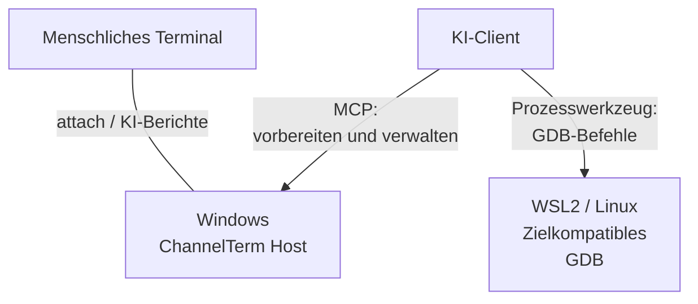
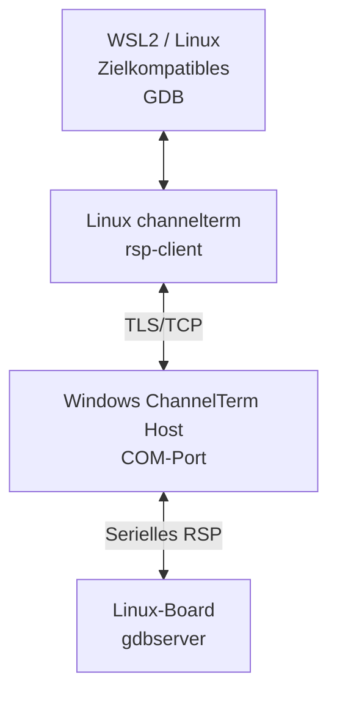
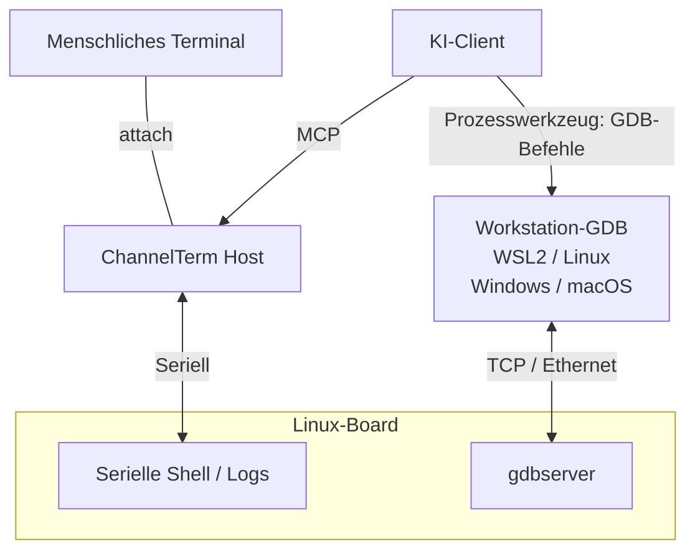

[English](README.md) | [Deutsch](README.de.md) | [Español](README.es.md) | [Français](README.fr.md) | [日本語](README.ja.md) | [한국어](README.ko.md) | [Русский](README.ru.md) | [简体中文](README.zh-CN.md) | [繁體中文](README.zh-TW.md)

# ChannelTerm

**Debuggen Sie Ihr Board mit KI – bleiben Sie im selben Terminal.**

ChannelTerm lässt Sie und Ihren KI-Client ein echtes serielles oder SSH-Terminal teilen. Lesen Sie dieselbe Geräteausgabe, verfolgen Sie KI-Terminalbefehle und bedienen Sie das Board abwechselnd. Es läuft unter Windows, Linux und macOS und bindet externe KI-Clients über MCP an.

Mit GDB kann die KI Haltepunkte setzen, Linux-Programme schrittweise ausführen und Variablen prüfen. Verbinden Sie den seriellen Port unter Windows und starten Sie GDB in WSL2, oder behalten Sie die gemeinsame Konsole, während GDB das Board über Ethernet erreicht. [Debugging-Aufbau wählen](#gdb-debugging).

> Dieses Dokument ist der deutschsprachige Einstieg. Für Verhalten, Optionen und Kompatibilität
> sind das englische [README](README.md), der aktuelle Quellcode und `channelterm --help`
> maßgeblich.

Bei kurzen Boot-Zeitfenstern kann der Host U-Boot unterbrechen und die Eingabeaufforderung prüfen. Exportieren Sie zur Fehleranalyse ein Diagnose-ZIP, optional mit Rohbytes. [U-Boot und Diagnose](docs/getting-started/serial-terminal.md#enter-u-boot-and-export-evidence).

## Warum ChannelTerm?

Lassen Sie Ihr Terminal offen, während die KI dieselbe Geräteverbindung nutzt:

```text
                         +---- Human terminal
                         |
Serial device ---- Session
                         |
                         +---- AI / MCP client
```

Jeder Client liest unabhängig; die KI verbraucht keine Ausgabe, die Sie beobachten. ChannelTerm zeigt KI-Terminaleingaben in Ihrem Terminal an; für externe Debugger gelten eigene [Sichtbarkeitsregeln](#gdb-debugging).

## Möglichkeiten

- **Konsole teilen:** Mensch und KI/MCP verwenden eine serielle oder SSH-Session.
- **Arbeit verfolgen:** KI-Terminalbefehle erscheinen neben der Geräteausgabe.
- **Linux-Programme debuggen:** mit verwaltetem GDB, serieller Brücke oder Netzwerk-GDB.
- **Dateien übertragen:** über die gemeinsame serielle Session mit SHA-256-Prüfung oder über eigene SFTP/SCP-Verbindungen.
- **Mit einem Attach starten:** `channelterm attach` kann den lokalen gemeinsamen Host automatisch erstellen.

## Installation

Laden Sie unter [Releases](https://github.com/akira-init1/ChannelTerm/releases) das Archiv für Ihr
Betriebssystem und Ihre Architektur herunter und prüfen Sie es anhand der `SHA256SUMS` derselben
Version. Entpacken Sie es und führen Sie im entpackten Verzeichnis `.\channelterm.exe install`
unter Windows oder `./channelterm install` unter Linux/macOS aus. Fertige Binärdateien benötigen kein Go.

Zum Bauen aus dem Quellcode ist Go 1.26 oder neuer erforderlich. Verwenden Sie eine aktuell
unterstützte Patch-Version und erstellen Sie das Programm im Stammverzeichnis des Repositorys:

```bash
git clone https://github.com/akira-init1/ChannelTerm.git
cd ChannelTerm
go build ./cmd/channelterm
./channelterm install
```

`install` kopiert die laufende Binärdatei in den Standard-Programmpfad des aktuellen Benutzers,
erstellt die Befehle `channelterm` und `cterm`, ergänzt den Benutzer-PATH nur bei Bedarf und erzeugt
eine fehlende minimale Konfiguration. Öffnen Sie nach einer PATH-Änderung ein neues Terminal.
`channelterm uninstall` entfernt die vom Installer verwalteten Befehle und die PATH-Änderung, behält
aber Benutzerdaten. `channelterm uninstall --purge` verlangt eine ausdrückliche Bestätigung, bevor
Konfiguration, Gerätestatus und lokale HTTP-Anmeldedaten gelöscht werden.

Unterstützte Desktop-Ziele sind Windows, Linux und macOS auf amd64/arm64. Weitere Informationen:
[Aus dem Quellcode bauen und installieren](docs/getting-started/build.md), vollständiger Vertrag für
[`install` / `uninstall`](docs/reference/cli.md#install-and-uninstall),
[Konfigurationspfade](docs/reference/configuration.md) sowie
[Build und Tests](docs/development/building-and-testing.md).

## Schnellstart: ein Befehl, ein Terminal

Listen Sie erkannte serielle Geräte, gespeicherte Profile und bei verfügbarem Standard-HTTP-Host
dessen Sessions auf:

```bash
channelterm list
```

Der Host muss nicht laufen. Ist er nicht erreichbar, meldet `list` MCP als offline und zeigt lokale
Geräte und Profile weiterhin an.

Den vollständigen Optionsvertrag finden Sie in der [CLI-Referenz](docs/reference/cli.md#list).

Soll ein KI-Client der Session beitreten, konfigurieren Sie vor dem Verbinden einmalig einen
unterstützten Client:

```bash
channelterm init --mcp
```

Wählen Sie HTTP oder drücken Sie Enter für die HTTP-Vorgabe. Die Konfiguration enthält den lokalen
Bearer-Zugang. Laden oder starten Sie den KI-Client neu, falls er die Änderung nicht sofort erkennt.

Führen Sie anschließend nur den Befehl für Ihre Plattform aus:

```bash
# Windows
channelterm attach COM8 --baud 115200 --label board

# Linux
channelterm attach /dev/ttyUSB0 --baud 115200 --label board

# macOS
channelterm attach /dev/cu.usbserial-110 --baud 115200 --label board
```

Dieser einzelne `attach`-Befehl öffnet das serielle Gerät und verbindet das aktuelle Terminal. Wenn
am Standard-Endpunkt kein kompatibler Host läuft, startet er automatisch einen temporären lokalen
HTTP-MCP-Session-Host. Eine typische Ausgabe lautet:

```text
Shared Session created: SER-1 (0123456789abcdef0123456789abcdef)
[ChannelTerm] Temporary Session Host started; it and all shared Sessions stop when this attachment exits. Run 'channelterm mcp --transport http' separately for a persistent Host.
```

Für diesen schnellen Ablauf ist kein separates MCP-Server-Terminal nötig. Solange die Verbindung
offen bleibt, kann ein konfigurierter HTTP-MCP-Client `http://127.0.0.1:37099/mcp` verwenden und
dieselbe Session `SER-1` bedienen. Der temporäre Host und alle von ihm verwalteten Sessions enden,
wenn die erzeugende Verbindung beendet wird. Verwenden Sie einen dauerhaften Host nur dann, wenn
Sessions unabhängig von diesem Terminal weiterlaufen müssen.

`--label board` ist ein optionaler Anzeigename, keine Kennung. Andere Clients müssen `SER-1` oder die
vollständige undurchsichtige Session-ID verwenden.

### Häufige Abläufe

| Ziel | Befehl |
| --- | --- |
| Eine gemeinsam genutzte serielle Session öffnen und automatisch einen temporären Host starten | `channelterm attach COM8 --baud 115200` |
| Einen unterstützten KI-Client für den gemeinsamen HTTP-Host konfigurieren | `channelterm init --mcp` |
| Host und Sessions unabhängig vom Terminal aktiv halten | `channelterm mcp --transport http` |
| Vorhandene Sessions auflisten oder ihnen beitreten | `channelterm list --kind session`, danach `channelterm attach SER-1` |
| Eine private serielle Verbindung ohne MCP-Freigabe öffnen | `channelterm attach COM8 --private --baud 115200` |
| Strukturierte Session-Ereignisse beobachten | `channelterm events SER-1` |
| Das geführte Dateiübertragungsmenü in der aktuellen gemeinsamen Verbindung öffnen | `Ctrl+]` und danach `f` drücken |
| Über eine gemeinsame Session senden oder empfangen | `channelterm file send firmware.bin --session SER-1` oder `channelterm file receive /tmp/log.txt ./log.txt --session SER-1` |

Ein dauerhafter Host ist ein separater, lang laufender Prozess. Nachdem
`MCP Streamable HTTP listening on http://127.0.0.1:37099/mcp` erscheint, können andere Shells und
konfigurierte KI-Clients Sessions erstellen oder ihnen beitreten. Keine weitere Ausgabe nach dieser
Bereitschaftsmeldung ist normal. Beenden Sie den Host und alle seine Sessions mit `Ctrl+C`.

Bei normaler Terminalnutzung außerhalb von Dateiübertragung oder Debugger-Übernahme:

```text
Ctrl+C      0x03 an das entfernte Terminal senden
Ctrl+] q    Dieses CLI verlassen; ein von ihm gestarteter temporärer Host endet ebenfalls
Ctrl+] ?    Lokale Hilfe zu Escape-Befehlen anzeigen
```

Alle lokalen Steuerbefehle stehen in der [CLI-Referenz](docs/reference/cli.md#attach); Client-Einrichtung und durch KI erstellte Sessions beschreibt der [MCP-Workflow](docs/getting-started/mcp-server.md).

Installieren Sie für wiederverwendbare Workflow-Anleitungen den mitgelieferten
[`cterm-serial-debug` Agent Skill](docs/getting-started/mcp-server.md#install-the-bundled-agent-skill)
in einem Agent-Skills-kompatiblen Client. `channelterm init --mcp` konfiguriert MCP-Clients,
installiert den Skill jedoch nicht.

Der HTTP-Host benötigt ein Bearer-Token und lauscht standardmäßig nur auf der Loopback-Adresse. Die
integrierten CLI-Clients lesen das lokale Benutzertoken automatisch. Der Host kann auch
[in einem vertrauenswürdigen LAN lauschen](docs/getting-started/mcp-server.md#listen-on-a-lan).
Entfernte Clients müssen seine erreichbare Adresse verwenden und dasselbe Token im
`Authorization`-Header senden. Stellen Sie den Endpunkt nicht ohne TLS und zusätzliche
Netzwerkzugriffskontrollen in einem nicht vertrauenswürdigen Netzwerk bereit.

<a id="beispielabläufe"></a>
<a id="embedded-linux-debugging"></a>
<a id="die-ki-bedient-der-mensch-beobachtet"></a>
<a id="der-mensch-greift-ein"></a>

## Ein gemeinsames Terminal in der Praxis

Eine verbundene CLI zeigt einen Agent-Befehl als lokalen `AI`-Aktivitätsblock an. `terminal_exec` hält diesen Befehl aus der History eines inaktiven Bash-Prompts heraus. Die folgenden Zeilen bleiben die rohe Terminalausgabe des Geräts. Sobald die kurze Befehls-Lease freigegeben wird, kann der Mensch wieder tippen:

```bash
root@board:~#

──────── AI ────────
[18:52:31] >> echo agent-check
────────────────────
agent-check
root@board:~# echo human-still-here
human-still-here
root@board:~#
```

Die genaue Befehlsausgabe hängt vom angeschlossenen Gerät ab. Der `AI`-Block ist eine lokale Darstellung aus strukturierten Session-Ereignissen; er wird weder in den Byte-Stream des Geräts noch in die gespeicherte Terminalausgabe eingefügt. Rohe Tasteneingaben und interaktive Programme verwenden weiterhin `terminal_write` und behalten das normale History-Verhalten des Geräts bei.

## Gemeinsame SSH-Shell

Verbinden Sie sich mit einem autorisierten privaten Schlüssel (verschlüsselte Schlüssel fragen nach einer Passphrase) oder geben Sie auf
Nachfrage Ihr Passwort ein (beides wird nicht gespeichert). Prüfen Sie bei einem unbekannten Server den
angezeigten Fingerabdruck und geben Sie `yes` ein, um seinen öffentlichen Schlüssel in
`~/.ssh/known_hosts` zu speichern; geänderte Schlüssel werden abgelehnt. Die Abfragen benötigen ein interaktives Terminal:

```bash
# Terminal 1: Shell öffnen, dann dort uname -a ausführen.
channelterm ssh user@192.168.1.50

# Terminal 2: dieselbe Shell beobachten und bedienen.
channelterm attach SSH-1
```

Lassen Sie den ersten Befehl laufen: Beim Beenden werden dieser Host und seine Sessions geschlossen. Der lokale Standardport muss frei sein; mit `--listen` und dem ausgegebenen Attach-Endpunkt verwenden Sie einen separaten Host. Der [SSH-Ablauf](docs/getting-started/ssh-terminal.md) beschreibt Schlüsselpfade, Hostprüfung, Ports und aktuelle Grenzen.

## Dateien über SSH übertragen

Nutzen Sie SFTP für Dateiübertragung und entfernte Dateiverwaltung oder das klassische SCP für kompatible POSIX-Server:

```bash
channelterm sftp user@192.168.1.50 ls /tmp
channelterm sftp user@192.168.1.50 put ./firmware.bin /tmp/firmware.bin
channelterm sftp user@192.168.1.50 get /tmp/log.txt ./log.txt
channelterm scp user@192.168.1.50 put ./release /tmp/release --recursive
```

Diese Befehle verwenden dieselbe Schlüssel-/Passwortauthentifizierung und Hostprüfung wie SSH,
jedoch eine von Terminal-Sessions unabhängige Verbindung. Das Ersetzen vorhandener Dateien erfordert
`--overwrite`. Verzeichnisregeln, Abbruch und Grenzen beschreibt die
[Dateiübertragung](docs/getting-started/file-transfer.md#sftp-and-scp-over-ssh).

Dateiübertragungen über gemeinsame Terminal-Sessions verwenden ein kleines Linux-Shell-Protokoll.
Separate SSH-Dateiverbindungen verwenden SFTP oder das klassische SCP.

<a id="ki-dateien-und-lokale-steuerung"></a>

## Dateien über eine gemeinsame Session übertragen

Dieselbe gemeinsame serielle Session kann auch reguläre Dateien und Verzeichnisse übertragen, ohne KI-Client oder separat installierten Übertragungsagenten auf dem Board. Drücken Sie in einem aktiven gemeinsamen `attach` zuerst `Ctrl+]` und dann `f`, um das geführte Sende-/Empfangsmenü zu öffnen. Verzeichnisse verwenden Standard-tar sowie bestätigte, gut abbrechbare Datenblöcke. Dieselben Vorgänge sind als Befehle verfügbar:

```bash
channelterm file send firmware.bin --session SER-1
channelterm file receive /tmp/log.txt ./log.txt --session SER-1
channelterm file send ./build/release /tmp/release --session SER-1
channelterm file receive /var/log/myapp ./myapp --session SER-1
```

Übertragungen benötigen eine wartende Linux-Shell und die im [Dateitransfer-Workflow](docs/getting-started/file-transfer.md) genannten Programme. Sie prüfen SHA-256 und wählen einen neuen Namen, statt ein vorhandenes Ziel zu überschreiben. Während einer Übertragung fragt `Ctrl+C` in einem gemeinsamen Attachment nach einer Abbruchbestätigung; andere Schreibzugriffe bleiben bis zur Bereinigung und Lease-Freigabe gesperrt.

Dateiübertragungen in GUI und CLI verwenden standardmäßig Base64 und benötigen `base64` und `tr` auf dem Gerät.
Verwenden Sie `--wire raw` nur bei kompatiblen 8-Bit-Verbindungen ohne XON/XOFF; der Dateiinhalt bleibt unverändert.

Optionale fortsetzbare Übertragungen unterstützen Dateien und Verzeichnisse in beide Richtungen, auch nach einem GUI-/Host-Neustart. Aktivieren Sie den GUI-Prüfpunkt oder verwenden Sie `--resumable` und danach `file resume JOB_ID --session SESSION`. Details zu Momentaufnahmen, Prüfung und ungewisser Veröffentlichung stehen im [Resume-Ablauf](docs/getting-started/file-transfer.md#manual-resume-for-serial-files-and-directories).

<a id="gdb-debugging"></a>

## Remote-Debugging mit GDB

Wählen Sie, wie der Debugger Ihr Linux-Programm erreicht. Jeder Weg benötigt zielkompatible Werkzeuge und passende Symbole.

| Weg | GDB-Verbindung | Konsole / Session während des Debuggings |
| --- | --- | --- |
| [Serielle Brücke](#gdb-serial-bridge) | Workstation-GDB → ChannelTerm → Board-Seriell; Windows/WSL2-Beispiel unten | Bis zur Wiederherstellung für GDB reserviert |
| [Serielle Konsole + TCP](#gdb-serial-tcp) | Workstation-GDB → Board-Netzwerk; WSL2, Linux, Windows oder macOS mit kompatiblem GDB | Für unabhängige Shell-/Log-Arbeit verfügbar |
| [Verwaltetes GDB/MI](docs/getting-started/gdb-debugging.md#managed-native-linux-prerequisites) | MCP steuert GDB; Host, Shell, Werkzeuge und ELF in einer nativen Linux-Umgebung | Ausgewählte Session während des Debuggings reserviert |

<a id="gdb-serial-bridge"></a>

### Serielle GDB-Brücke: Windows + WSL2

**Windows verbindet den seriellen Port, WSL2 führt GDB aus, die KI koordiniert das Remote-Debugging.** Der Windows-Host von ChannelTerm hält COM-Port und gemeinsame Session offen. Ein zielkompatibles GDB in WSL2 verbindet sich über den Linux-Helfer `channelterm rsp-client` und die authentifizierte TLS/TCP-Brücke mit dem Linux-gdbserver des Boards.

**Steuerung und Beobachtung**



**RSP-Datenpfad**



Behalten Sie Windows-Treiber und Linux-Toolchain: Das serielle Gerät bleibt unter Windows, und das Board benötigt keinen Netzwerk-GDB-Port.

1. Konfigurieren Sie den KI-Client unter Windows mit `channelterm init --mcp` (HTTP) und verbinden Sie das Board, etwa mit `channelterm attach COM8 --baud 115200`. Verwenden Sie bestätigte serielle Einstellungen und lassen Sie den zugehörigen Host laufen.
2. Sichern Sie gemäß den [Vorbereitungsschritten](docs/getting-started/gdb-debugging.md#prepare-and-open) den TTY-Zustand, bereiten Sie einen kompatiblen `gdbserver --once stdio` auf dem Board vor und rufen Sie `debug_bridge_start` über MCP auf. Für GDB in WSL2 benötigt die KI zusätzlich ein Werkzeug zur Prozessausführung.
3. Nutzen Sie in WSL2 Linux-ChannelTerm, zielkompatibles GDB und das passende ELF. Speichern Sie den geheimen Verbindungsdeskriptor als `bridge.json` im WSL-Dateisystem (`chmod 600`). Netzwerk und Pfade erklärt die [WSL2-Anleitung](docs/getting-started/gdb-debugging.md#connect-independent-gdb-from-wsl2). Ersetzen Sie unten den Dateipfad:

```text
(gdb) target remote | channelterm rsp-client --connection /home/EXAMPLE/private/bridge.json
(gdb) break main
(gdb) continue
(gdb) next
(gdb) backtrace
(gdb) detach
```

4. Unter Windows zeigen `channelterm gdb-list` und `channelterm gdb-list --json` Brückenports und Zustände. Prüfen Sie nach GDB detach, dass das Board wieder in der Shell ist, und rufen Sie `debug_bridge_restore` mit dem gesicherten TTY-Zustand auf, um das gemeinsame Terminal weiterzuverwenden.

Bei dieser seriellen Brücke kann die KI tatsächliche Befehle und Beobachtungen mit `debug_bridge_report` im angehängten Terminal melden. Die Einträge sind als KI-Berichte gekennzeichnet, nicht als vollständiges automatisches GDB-Protokoll.

<a id="gdb-serial-tcp"></a>

### Gemeinsame serielle Konsole + GDB über Ethernet

Die serielle Konsole bleibt für gemeinsame Logs und Shell-Arbeit verfügbar, während GDB das Netzwerk nutzt. Serieller Host und GDB können auf demselben oder auf verschiedenen Rechnern laufen; Treiber und Ziel-Toolchain lassen sich unabhängig wählen.



Soll die serielle Shell weiter Befehle annehmen, führen Sie gdbserver unabhängig von dieser interaktiven Shell aus. Laden Sie das passende ELF in das Workstation-GDB und verbinden Sie sich wie unten über ein beschränktes Netzwerk (`TARGET_IP` und Port ersetzen). Der [Workflow für serielle Konsole + TCP](docs/getting-started/gdb-debugging.md#shared-serial-console-with-tcp-gdb) beschreibt Zielstart, Programmein-/ausgabe und SSH-Tunnel.

```text
(gdb) target remote TARGET_IP:2345
```

Dieser TCP-Weg verbindet sich direkt mit gdbserver, ohne `rsp-client` oder `debug_bridge_*`. Mensch und KI sehen die gemeinsame serielle Aktivität; externe GDB-Befehle und Ergebnisse bleiben in der Debugger-Ausgabe und werden nicht automatisch ins serielle Terminal gespiegelt.

CI prüft verwaltetes GDB/MI und die externe Brücke mit echtem GDB/gdbserver auf Linux-PTYs. Einrichtung, Kompatibilität, SSH-Alternativen und Wiederherstellung beschreibt der [vollständige Workflow](docs/getting-started/gdb-debugging.md).

## Funktionsweise

```text
Human CLI -----+
               +--> Session Host --> Session <--> Channel <--> Serial / SSH endpoint
AI via MCP ----+                         |
                                        +-- retained output, activity, events
                                        `-- serialized writes
```

Der Session Host besitzt die Verbindungen und verwaltet die Session-Lebensdauer. Ein Serial oder SSH Transport stellt einen protokollneutralen Channel her; die Session liest diesen Channel, hält Ausgabe, Aktivität und Ereignisse begrenzt im Speicher und serialisiert Schreibzugriffe. CLI- und MCP-Adapter nutzen dasselbe Core-Verhalten. Darstellung wie Hervorhebung und der `AI`-Aktivitätsblock bleibt außerhalb der gespeicherten Terminaldaten.

Leser haben unabhängige Cursor. Rohe Schreibzugriffe werden serialisiert, koordinieren aber nicht die Bedeutung von Shell-Befehlen. Application-Leases sperren andere Schreiber vorübergehend während Befehlsausführung, Übertragungen und Debugging. Siehe [gemeinsame Sessions](docs/getting-started/shared-session.md) für Besitz und Nebenläufigkeit.

Gemeinsame Referenzen wie `SER-1` gelten nur innerhalb des besitzenden Host-Prozesses. Das Stoppen dieses Hosts schließt seine Sessions. Ein zusätzliches Attachment kann unabhängig beendet werden; beim Beenden des Attachments mit eigenem temporären Host oder des besitzenden SSH-Befehls werden auch deren Sessions geschlossen. Die Schichtgrenzen beschreibt die [Architekturübersicht](docs/architecture/overview.md).

## Konfiguration

`config.toml` enthält benutzerverwaltete serielle Profile und die Verbindungsrichtlinie.
`state.json` ist der von ChannelTerm verwaltete Gerätestatus. `http-auth-token` ist das Geheimnis zur
Authentifizierung von MCP-HTTP-Clients; geben Sie es nicht weiter und committen Sie es nicht.

```powershell
# Ein serielles Profil speichern und wiederverwenden.
channelterm serial --port COM8 --baud 115200 --save board
channelterm serial --profile board

# Für diesen Vorgang eine andere config.toml verwenden.
channelterm serial --config ./channelterm.toml --profile board
```

Häufige Optionen sind `--profile`, `--save`, `--config`, `--port` und `--baud`. Der MCP-Host
unterstützt außerdem `--connection-policy ask|auto|deny`. `--config` ändert nur die ausgewählte
`config.toml`, nicht die standardmäßigen Dateien `state.json` oder `http-auth-token`. Siehe
[Serielle Profile](docs/getting-started/serial-profiles.md) und
[Konfigurationsreferenz](docs/reference/configuration.md).

## Dokumentation

- [Dokumentationsindex](docs/README.md)
- [Electron-GUI-Prototyp und Entwicklung](docs/development/electron-gui.md) — Der lokale Standard-Host wird automatisch verbunden oder gestartet; serielle und SSH-Sitzungen lassen sich direkt in der GUI erstellen. Geräteverzeichnisse durchsuchen und Dateien/Ordner seriell in beide Richtungen mit GUI-Fortschritt übertragen.
- [Seriellen Terminalablauf verwenden](docs/getting-started/serial-terminal.md)
- [SSH-Shell verwenden](docs/getting-started/ssh-terminal.md)
- [Eine Session teilen](docs/getting-started/shared-session.md)
- [Dateiübertragungsablauf](docs/getting-started/file-transfer.md)
- [MCP-Server](docs/getting-started/mcp-server.md)
- [GDB-Debugging](docs/getting-started/gdb-debugging.md)
- [CLI-Referenz](docs/reference/cli.md)
- [MCP-Werkzeugreferenz](docs/reference/mcp-tools.md)
- [Kennungen und Referenzen](docs/reference/identifiers.md)
- [Architekturübersicht](docs/architecture/overview.md)

Für genaue Befehlsoptionen und Standardwerte ist die `--help`-Ausgabe des laufenden Programms maßgeblich.

## Ausblick

Serielle Verbindungen und SSH-PTY-Shells sind implementierte Transports; dedizierte SFTP- und ältere SCP-Dateiclients stehen ebenfalls bereit. Beliebiges SSH exec, Telnet und stärkere Koordination mehrerer Schreiber bleiben zukünftige Richtungen, keine implementierten Funktionen oder Release-Zusagen.

ChannelTerm implementiert derzeit weder JTAG/OpenOCD noch virtuelle serielle Geräte, eine integrierte KI oder Multi-Agent-Orchestrierung.

## Lizenz

ChannelTerm steht unter der [Apache License 2.0](LICENSE).
