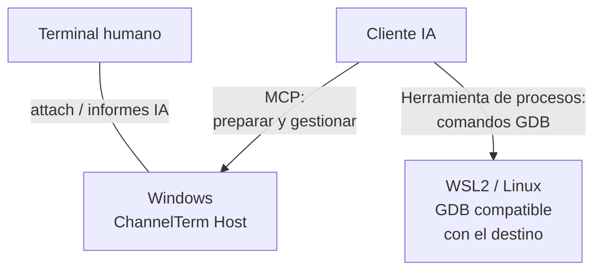
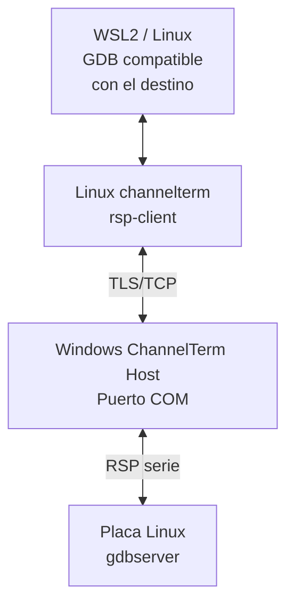
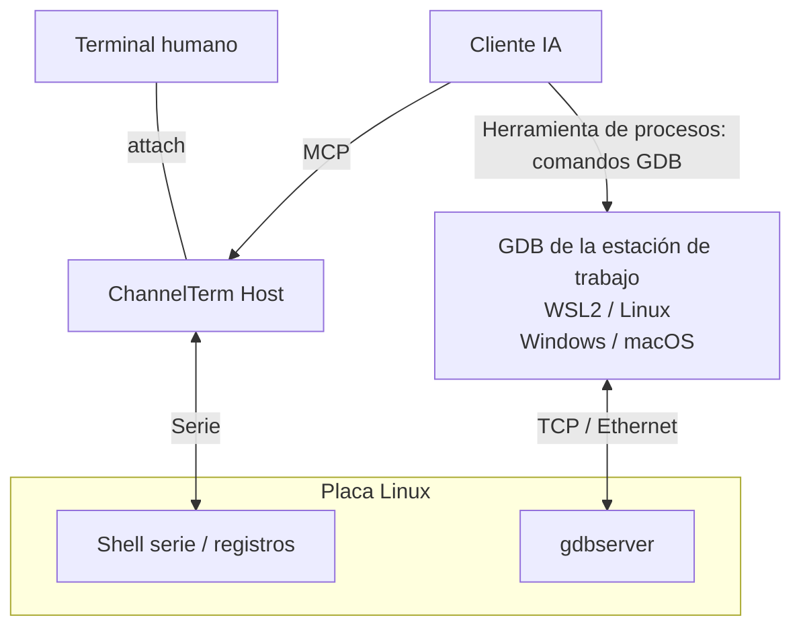

[English](README.md) | [Deutsch](README.de.md) | [Español](README.es.md) | [Français](README.fr.md) | [日本語](README.ja.md) | [한국어](README.ko.md) | [Русский](README.ru.md) | [简体中文](README.zh-CN.md) | [繁體中文](README.zh-TW.md)

# ChannelTerm

**Depure su placa con IA. Siga en el mismo terminal.**

ChannelTerm permite compartir un terminal serie o SSH real con su cliente de IA. Lea la misma salida del dispositivo, siga los comandos de terminal de la IA y túrnese para operar la placa. Funciona en Windows, Linux y macOS y conecta clientes de IA externos mediante MCP.

Con GDB, la IA puede establecer puntos de interrupción, recorrer programas Linux y consultar variables. Conecte el puerto serie en Windows y ejecute GDB en WSL2, o mantenga la consola compartida mientras GDB usa Ethernet. [Elija una configuración](#gdb-debugging).

> Este documento es el punto de entrada en español. El [README en inglés](README.md), el código
> fuente actual y `channelterm --help` son la referencia para el comportamiento, las opciones y la
> compatibilidad.

Para ventanas de arranque cortas, el Host puede interrumpir U-Boot y verificar el prompt. Exporte un ZIP de diagnóstico con bytes sin procesar opcionales para investigar fallos. [Flujo de U-Boot y diagnóstico](docs/getting-started/serial-terminal.md#enter-u-boot-and-export-evidence).

## ¿Por qué ChannelTerm?

Mantenga su terminal abierto mientras la IA usa la misma conexión al dispositivo:

```text
                         +---- Human terminal
                         |
Serial device ---- Session
                         |
                         +---- AI / MCP client
```

Cada cliente lee de forma independiente, por lo que la IA no consume la salida que está observando. ChannelTerm muestra las escrituras de terminal de la IA; los depuradores externos tienen sus propias [reglas de visibilidad](#gdb-debugging).

## Qué permite hacer

- **Comparta la consola:** personas e IA/MCP usan una Session serie o SSH.
- **Siga el trabajo:** vea los comandos de terminal de la IA junto a la salida del dispositivo.
- **Depure programas Linux:** con GDB administrado, puente serie o GDB por red.
- **Transfiera archivos:** por la Session serie compartida con SHA-256 o mediante conexiones SFTP/SCP dedicadas.
- **Empiece con un attach:** `channelterm attach` puede crear automáticamente el Host local compartido.

## Instalación

Descarga de [Releases](https://github.com/akira-init1/ChannelTerm/releases) el archivo para tu sistema
operativo y arquitectura y verifícalo con `SHA256SUMS` de la misma versión. Descomprímelo y ejecuta
`.\channelterm.exe install` en Windows o `./channelterm install` en Linux/macOS desde el directorio
extraído. Los binarios precompilados no requieren Go.

Compilar desde el código fuente requiere Go 1.26 o posterior. Usa una versión con parches que siga
siendo compatible y compila desde la raíz del repositorio:

```bash
git clone https://github.com/akira-init1/ChannelTerm.git
cd ChannelTerm
go build ./cmd/channelterm
./channelterm install
```

`install` copia el binario en ejecución a la ubicación estándar de programas del usuario actual,
crea los comandos `channelterm` y `cterm`, añade su directorio al PATH del usuario solo cuando es
necesario e inicializa una configuración mínima si no existe. Abre un terminal nuevo si cambia el
PATH. `channelterm uninstall` elimina los comandos y el cambio de PATH propiedad del instalador,
pero conserva los datos del usuario. `channelterm uninstall --purge` exige una confirmación explícita
antes de eliminar la configuración, el estado de dispositivos y la credencial HTTP local.

Los destinos de escritorio compatibles son Windows, Linux y macOS en amd64/arm64. Consulta
[Compilar e instalar desde el código fuente](docs/getting-started/build.md), el contrato completo de
[`install` / `uninstall`](docs/reference/cli.md#install-and-uninstall), las
[ubicaciones de configuración](docs/reference/configuration.md) y
[Compilación y pruebas](docs/development/building-and-testing.md).

## Inicio rápido: un comando, un terminal

Enumera los dispositivos serie detectados, los Profile guardados y, cuando esté disponible el Host
HTTP predeterminado, sus Sessions:

```bash
channelterm list
```

No es necesario que el Host esté en ejecución. Si no está disponible, `list` informa que MCP está
offline y sigue mostrando los dispositivos y Profile locales.

Consulta la [referencia de CLI](docs/reference/cli.md#list) para ver el contrato completo de opciones.

Si un cliente de IA debe unirse a la Session, configura una vez un cliente compatible antes de
conectarte:

```bash
channelterm init --mcp
```

Elige HTTP o pulsa Enter para aceptar HTTP como opción predeterminada. La configuración incluye la
credencial Bearer local. Recarga o reinicia el cliente de IA si no detecta el cambio inmediatamente.

Después ejecuta únicamente el comando correspondiente a tu plataforma:

```bash
# Windows
channelterm attach COM8 --baud 115200 --label board

# Linux
channelterm attach /dev/ttyUSB0 --baud 115200 --label board

# macOS
channelterm attach /dev/cu.usbserial-110 --baud 115200 --label board
```

Ese único comando `attach` abre el dispositivo serie y conecta el terminal actual. Si no hay un Host
compatible en el endpoint predeterminado, también inicia automáticamente un Host de Session MCP HTTP
local y temporal. Una salida típica es:

```text
Shared Session created: SER-1 (0123456789abcdef0123456789abcdef)
[ChannelTerm] Temporary Session Host started; it and all shared Sessions stop when this attachment exits. Run 'channelterm mcp --transport http' separately for a persistent Host.
```

Esta ruta rápida no requiere otro terminal para el servidor MCP. Mientras el attachment permanezca
abierto, un cliente MCP HTTP configurado puede usar `http://127.0.0.1:37099/mcp` y operar la misma
Session `SER-1`. El Host temporal y todas sus Sessions se detienen cuando finaliza el attachment que
lo creó. Usa un Host persistente solo cuando las Sessions deban sobrevivir a ese terminal.

`--label board` es un nombre visual opcional, no un identificador. Los demás clientes deben usar
`SER-1` o el ID opaco completo de la Session.

### Flujos habituales

| Objetivo | Comando |
| --- | --- |
| Abrir una Session serie compartida e iniciar automáticamente un Host temporal | `channelterm attach COM8 --baud 115200` |
| Configurar un cliente de IA compatible para el Host HTTP compartido | `channelterm init --mcp` |
| Mantener el Host y las Sessions activos de forma independiente | `channelterm mcp --transport http` |
| Enumerar o unirse a una Session existente | `channelterm list --kind session` y después `channelterm attach SER-1` |
| Abrir una conexión serie privada sin compartir por MCP | `channelterm attach COM8 --private --baud 115200` |
| Observar eventos estructurados de la Session | `channelterm events SER-1` |
| Abrir el menú guiado de transferencia en el attachment compartido actual | Pulsa `Ctrl+]` y después `f` |
| Enviar o recibir mediante una Session compartida | `channelterm file send firmware.bin --session SER-1` o `channelterm file receive /tmp/log.txt ./log.txt --session SER-1` |

Un Host persistente es un proceso separado de larga duración. Después de mostrar
`MCP Streamable HTTP listening on http://127.0.0.1:37099/mcp`, otros shells y los clientes de IA
configurados pueden crear Sessions o unirse a ellas. Es normal que no haya más salida tras el mensaje
de disponibilidad. Pulsa `Ctrl+C` para detener el Host y todas sus Sessions.

Durante el uso normal del terminal, fuera de una transferencia o del control del depurador:

```text
Ctrl+C      Enviar 0x03 al terminal remoto
Ctrl+] q    Salir de este CLI; también se detiene cualquier Host temporal que le pertenezca
Ctrl+] ?    Mostrar la ayuda local de secuencias de escape
```

Consulte la [referencia CLI](docs/reference/cli.md#attach) para todos los controles locales y el [flujo MCP](docs/getting-started/mcp-server.md) para configurar clientes y crear Sessions desde la IA.

Para obtener una guía de flujo reutilizable, instala el
[Agent Skill `cterm-serial-debug`](docs/getting-started/mcp-server.md#install-the-bundled-agent-skill)
incluido en un cliente compatible con Agent Skills. `channelterm init --mcp` configura clientes
MCP, pero no instala el Skill.

El Host HTTP exige un token Bearer y solo escucha en loopback de forma predeterminada. Los clientes
CLI integrados leen automáticamente el token del usuario local. También puede
[escuchar en una LAN de confianza](docs/getting-started/mcp-server.md#listen-on-a-lan); los clientes
remotos deben usar la dirección alcanzable del Host y enviar el mismo token mediante el encabezado
`Authorization`. No expongas el endpoint a una red no fiable sin TLS y controles de acceso de red
adicionales.

<a id="ejemplos-de-flujos"></a>
<a id="depuración-de-linux-embebido"></a>
<a id="la-ia-opera-y-la-persona-observa"></a>
<a id="la-persona-interviene"></a>

## Un terminal compartido en la práctica

Una CLI conectada muestra un comando del agente como un bloque local de actividad `AI`. `terminal_exec` evita que el comando entre en el historial de un prompt Bash inactivo. Las líneas siguientes siguen siendo la salida sin procesar del dispositivo, y la persona puede volver a escribir cuando se libera la breve concesión del comando:

```bash
root@board:~#

──────── AI ────────
[18:52:31] >> echo agent-check
────────────────────
agent-check
root@board:~# echo human-still-here
human-still-here
root@board:~#
```

La salida exacta depende del dispositivo conectado. El bloque `AI` es una presentación local derivada de eventos estructurados de Session; no se inserta en el flujo de bytes del dispositivo ni en la salida de terminal almacenada. Las teclas sin procesar y los programas interactivos siguen usando `terminal_write` y conservan el comportamiento normal del historial del dispositivo.

## Shell SSH compartida

Conéctate con una clave privada autorizada (las claves cifradas solicitan una frase de contraseña) o introduce tu contraseña cuando se solicite
(ninguna se guarda). Para un servidor desconocido, verifica la huella mostrada y escribe `yes` para
guardar su clave pública en `~/.ssh/known_hosts`; las claves cambiadas se rechazan.
Las solicitudes requieren un terminal interactivo:

```bash
# Terminal 1: abrir la shell y ejecutar uname -a en ella.
channelterm ssh user@192.168.1.50

# Terminal 2: observar y usar la misma shell.
channelterm attach SSH-1
```

Mantén activo el primer comando: al salir se cierran este Host y sus Sessions. El puerto local predeterminado debe estar libre; usa `--listen` y el endpoint de attach mostrado para otro Host. El [flujo SSH](docs/getting-started/ssh-terminal.md) explica las rutas de claves, la verificación del servidor, los puertos y las limitaciones actuales.

## Archivos mediante SSH

Usa SFTP para transferir y gestionar archivos remotos, o SCP clásico con servidores POSIX compatibles:

```bash
channelterm sftp user@192.168.1.50 ls /tmp
channelterm sftp user@192.168.1.50 put ./firmware.bin /tmp/firmware.bin
channelterm sftp user@192.168.1.50 get /tmp/log.txt ./log.txt
channelterm scp user@192.168.1.50 put ./release /tmp/release --recursive
```

Estos comandos usan la misma autenticación por clave/contraseña y verificación del servidor que SSH,
con una conexión independiente de las Sessions de terminal. Reemplazar archivos requiere
`--overwrite`. Consulta [transferencia de archivos](docs/getting-started/file-transfer.md#sftp-and-scp-over-ssh)
para las reglas de directorios, cancelación y límites.

Las transferencias mediante Sessions de terminal compartidas usan un pequeño protocolo de shell Linux.
Las conexiones SSH dedicadas a archivos usan SFTP o SCP clásico.

<a id="ia-archivos-y-controles-locales"></a>

## Archivos mediante una Session compartida

La misma Session serie compartida también puede transferir archivos normales y directorios sin un cliente de IA ni un agente de transferencia instalado por separado en la placa. En un `attach` compartido activo, pulsa `Ctrl+]` y luego `f` para abrir el menú guiado de envío/recepción. Los directorios usan tar estándar y bloques con confirmación que facilitan la cancelación. Las mismas operaciones están disponibles como comandos:

```bash
channelterm file send firmware.bin --session SER-1
channelterm file receive /tmp/log.txt ./log.txt --session SER-1
channelterm file send ./build/release /tmp/release --session SER-1
channelterm file receive /var/log/myapp ./myapp --session SER-1
```

Las transferencias requieren una shell Linux inactiva y las herramientas del [flujo de transferencia](docs/getting-started/file-transfer.md). Verifican SHA-256 y eligen un nombre nuevo en lugar de sobrescribir un destino existente. Durante una transferencia, `Ctrl+C` en una conexión compartida pide confirmar la cancelación; las demás escrituras siguen bloqueadas hasta que la limpieza libera la concesión.

Las transferencias de archivos de GUI y CLI usan Base64 de forma predeterminada y requieren `base64` y `tr` en el dispositivo.
Use `--wire raw` solo en enlaces compatibles de 8 bits sin XON/XOFF; el contenido del archivo no cambia.

<a id="gdb-debugging"></a>

## Depuración remota con GDB

Elija cómo llega el depurador al programa Linux. Cada opción requiere herramientas compatibles con el destino y símbolos correspondientes.

| Opción | Conexión GDB | Consola / Session durante la depuración |
| --- | --- | --- |
| [Puente serie](#gdb-serial-bridge) | GDB de la estación → ChannelTerm → puerto serie de la placa; ejemplo Windows + WSL2 abajo | Reservada para GDB hasta restaurarla |
| [Consola serie + TCP](#gdb-serial-tcp) | GDB de la estación → red de la placa; WSL2, Linux, Windows o macOS con GDB compatible | Disponible para shell/registros independientes |
| [GDB/MI administrado](docs/getting-started/gdb-debugging.md#managed-native-linux-prerequisites) | MCP controla GDB; Host, shell, herramientas y ELF en un mismo Linux nativo | Session seleccionada reservada durante la depuración |

<a id="gdb-serial-bridge"></a>

### Puente GDB serie: Windows + WSL2

**Windows conecta el puerto serie; WSL2 ejecuta GDB; la IA coordina la depuración remota.** El Host de ChannelTerm en Windows mantiene abiertos el puerto COM y la Session compartida. Un GDB compatible con el destino en WSL2 se conecta al gdbserver Linux de la placa mediante el auxiliar Linux `channelterm rsp-client` y el puente TLS/TCP autenticado.

**Control y observación**



**Ruta de datos RSP**



Conserve el controlador serie Windows y el toolchain Linux: el dispositivo serie permanece en Windows y la placa no necesita un puerto GDB de red.

1. En Windows, configure el cliente de IA con `channelterm init --mcp` (HTTP) y conecte la placa, por ejemplo con `channelterm attach COM8 --baud 115200`. Use sus parámetros serie confirmados y mantenga en ejecución el Host propietario.
2. Siga los [pasos de preparación](docs/getting-started/gdb-debugging.md#prepare-and-open): guarde el estado TTY, prepare un `gdbserver --once stdio` compatible en la placa y llame a `debug_bridge_start` mediante MCP. La IA también necesita una herramienta de ejecución de procesos para ejecutar GDB en WSL2.
3. En WSL2, use ChannelTerm Linux, GDB compatible con el destino y el ELF correspondiente. Guarde el descriptor privado como `bridge.json` en el sistema de archivos WSL (`chmod 600`). La [guía WSL2](docs/getting-started/gdb-debugging.md#connect-independent-gdb-from-wsl2) explica red y rutas. Sustituya la ruta del archivo:

```text
(gdb) target remote | channelterm rsp-client --connection /home/EXAMPLE/private/bridge.json
(gdb) break main
(gdb) continue
(gdb) next
(gdb) backtrace
(gdb) detach
```

4. En Windows, use `channelterm gdb-list` o `channelterm gdb-list --json` para consultar puertos y estados. Tras GDB detach, confirme que la placa haya vuelto a la shell y llame a `debug_bridge_restore` con el estado TTY guardado para volver a usar el terminal compartido.

En este puente serie, la IA puede publicar comandos reales y observaciones mediante `debug_bridge_report` para seguirlos en el terminal conectado. Las entradas se identifican como informes de IA, no como un registro automático completo de GDB.

<a id="gdb-serial-tcp"></a>

### Consola serie compartida + GDB por Ethernet

La consola serie sigue disponible para registros y trabajo de shell compartidos mientras GDB utiliza la red. El Host serie y GDB pueden estar en el mismo equipo o en equipos distintos; los controladores y el toolchain de destino se eligen por separado.



Mantenga gdbserver ejecutándose independientemente de la shell serie interactiva si desea seguir enviando comandos a esta. Cargue el ELF correspondiente en GDB y conecte por una red restringida como se muestra abajo (sustituya `TARGET_IP` y el puerto). Consulte el [flujo consola serie + TCP](docs/getting-started/gdb-debugging.md#shared-serial-console-with-tcp-gdb) para inicio del destino, entrada/salida y túneles SSH.

```text
(gdb) target remote TARGET_IP:2345
```

Esta ruta TCP conecta directamente con gdbserver, sin `rsp-client` ni `debug_bridge_*`. Personas e IA ven la actividad serie compartida; los comandos y resultados de GDB externo permanecen en la salida del depurador y no se reflejan automáticamente en el terminal serie.

CI comprueba GDB/MI administrado y el puente externo con GDB/gdbserver reales en PTY Linux. Consulte el [flujo completo](docs/getting-started/gdb-debugging.md) para configuración, compatibilidad, alternativas SSH y recuperación.

## Cómo funciona

```text
Human CLI -----+
               +--> Session Host --> Session <--> Channel <--> Serial / SSH endpoint
AI via MCP ----+                         |
                                        +-- retained output, activity, events
                                        `-- serialized writes
```

El Session Host posee las conexiones y administra la vida de las Sessions. Un Serial o SSH Transport establece un Channel independiente del protocolo; la Session lee ese Channel, conserva una cantidad limitada de salida, actividad y eventos en memoria y serializa las escrituras. Los adaptadores CLI y MCP reutilizan el mismo comportamiento del Core. La presentación, como el resaltado y el bloque de actividad `AI`, queda fuera de los datos de terminal almacenados.

Cada lector tiene cursores independientes. Las escrituras en bruto se serializan, pero no coordinan el significado de los comandos de shell. Las concesiones de la aplicación bloquean temporalmente a otros escritores durante comandos, transferencias y depuración. Consulte [Sessions compartidas](docs/getting-started/shared-session.md) para propiedad y concurrencia.

Las referencias compartidas como `SER-1` solo son válidas dentro del proceso Host propietario. Detener ese Host cierra sus Sessions. Una conexión CLI adicional puede salir de forma independiente, pero salir de la conexión que posee un Host temporal o del comando SSH propietario también cierra sus Sessions. Consulte la [descripción de la arquitectura](docs/architecture/overview.md) para los límites entre capas.

## Configuración

`config.toml` contiene los perfiles serie y la política de conexión administrados por el usuario.
`state.json` es el estado de identidad de dispositivos administrado por ChannelTerm.
`http-auth-token` es el secreto usado para autenticar clientes MCP HTTP; no lo compartas ni lo
incluyas en commits.

```powershell
# Guardar y reutilizar un perfil serie.
channelterm serial --port COM8 --baud 115200 --save board
channelterm serial --profile board

# Usar otro config.toml para esta operación.
channelterm serial --config ./channelterm.toml --profile board
```

Las opciones habituales son `--profile`, `--save`, `--config`, `--port` y `--baud`; el Host MCP
también acepta `--connection-policy ask|auto|deny`. `--config` solo cambia el `config.toml`
seleccionado, no los archivos predeterminados `state.json` ni `http-auth-token`. Consulta
[Perfiles serie](docs/getting-started/serial-profiles.md) y la
[referencia de configuración](docs/reference/configuration.md).

## Documentación

- [Índice de documentación](docs/README.md)
- [Prototipo GUI Electron y desarrollo](docs/development/electron-gui.md) — El Host local predeterminado se conecta o inicia automáticamente; cree sesiones serie y SSH directamente en la GUI. Explore directorios del dispositivo y transfiera archivos/carpetas por serie en ambas direcciones con progreso en la GUI.
- [Uso del terminal serie](docs/getting-started/serial-terminal.md)
- [Flujo de shell SSH](docs/getting-started/ssh-terminal.md)
- [Compartir una Session](docs/getting-started/shared-session.md)
- [Flujo de transferencia de archivos](docs/getting-started/file-transfer.md)
- [Servidor MCP](docs/getting-started/mcp-server.md)
- [Flujo de depuración GDB](docs/getting-started/gdb-debugging.md)
- [Referencia de CLI](docs/reference/cli.md)
- [Referencia de herramientas MCP](docs/reference/mcp-tools.md)
- [Identificadores y referencias](docs/reference/identifiers.md)
- [Descripción de la arquitectura](docs/architecture/overview.md)

La salida `--help` del programa en ejecución es la referencia para los indicadores exactos y sus valores predeterminados.

## Hoja de ruta

Las conexiones serie y las shells SSH PTY son Transports implementados; también están disponibles clientes dedicados de archivos SFTP y SCP tradicional. SSH exec arbitrario, Telnet y una coordinación más fuerte entre múltiples escritores siguen siendo direcciones futuras, no funciones implementadas ni compromisos de lanzamiento.

ChannelTerm no implementa actualmente JTAG/OpenOCD, dispositivos serie virtuales, una IA integrada ni orquestación de múltiples agentes.

## Licencia

ChannelTerm se distribuye bajo la [licencia Apache 2.0](LICENSE).
