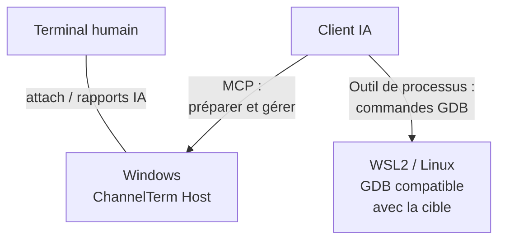
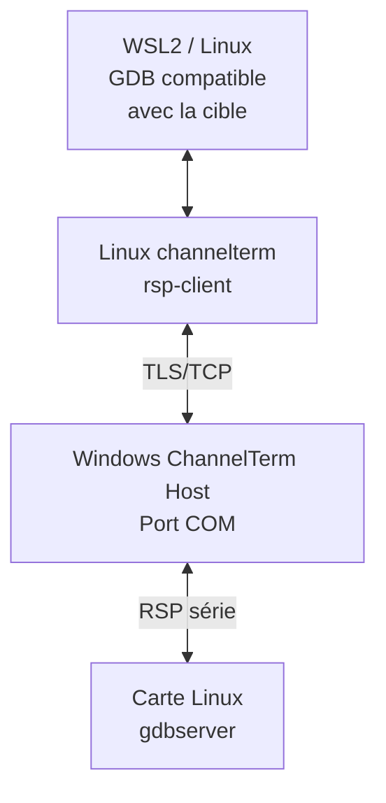
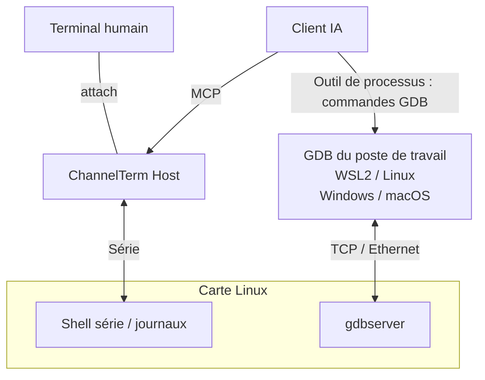

[English](README.md) | [Deutsch](README.de.md) | [Español](README.es.md) | [Français](README.fr.md) | [日本語](README.ja.md) | [한국어](README.ko.md) | [Русский](README.ru.md) | [简体中文](README.zh-CN.md) | [繁體中文](README.zh-TW.md)

# ChannelTerm

**Déboguez votre carte avec l’IA. Restez dans le même terminal.**

ChannelTerm vous permet de partager un vrai terminal série ou SSH avec votre client IA. Lisez la même sortie, suivez les commandes de terminal de l’IA et utilisez la carte à tour de rôle. Il fonctionne sous Windows, Linux et macOS et connecte les clients IA externes via MCP.

Avec GDB, l’IA peut poser des points d’arrêt, parcourir un programme Linux et examiner ses variables. Connectez le port série sous Windows et lancez GDB dans WSL2, ou gardez la console partagée pendant que GDB utilise Ethernet. [Choisir une configuration](#gdb-debugging).

> Ce document est la page d’entrée en français. Le [README anglais](README.md), le code source
> actuel et `channelterm --help` font autorité pour le comportement, les options et la compatibilité.

Pour les courtes fenêtres de démarrage, le Host peut interrompre U-Boot et vérifier l’invite. Exportez un ZIP de diagnostic, avec les octets bruts en option, pour analyser les échecs. [Procédure U-Boot et diagnostic](docs/getting-started/serial-terminal.md#enter-u-boot-and-export-evidence).

## Pourquoi ChannelTerm ?

Gardez votre terminal ouvert pendant que l’IA utilise la même connexion à l’appareil :

```text
                         +---- Human terminal
                         |
Serial device ---- Session
                         |
                         +---- AI / MCP client
```

Chaque client lit indépendamment : l’IA ne consomme pas la sortie que vous observez. ChannelTerm affiche les écritures de terminal de l’IA ; les débogueurs externes ont leurs propres [règles de visibilité](#gdb-debugging).

## Ce que permet ChannelTerm

- **Partager la console :** humains et IA/MCP utilisent une Session série ou SSH.
- **Suivre le travail :** voyez les commandes de terminal de l’IA à côté de la sortie de l’appareil.
- **Déboguer Linux :** avec GDB géré, un pont série ou GDB par le réseau.
- **Transférer des fichiers :** sur la Session série partagée avec SHA-256, ou par des connexions SFTP/SCP dédiées.
- **Démarrer avec un attach :** `channelterm attach` peut créer automatiquement le Host local partagé.

## Installation

Téléchargez depuis [Releases](https://github.com/akira-init1/ChannelTerm/releases) l’archive adaptée
à votre système et à votre architecture, puis vérifiez-la avec le fichier `SHA256SUMS` de la même
version. Décompressez-la et exécutez `.\channelterm.exe install` sous Windows ou
`./channelterm install` sous Linux/macOS depuis le répertoire extrait. Les binaires précompilés
ne nécessitent pas Go.

La compilation depuis les sources nécessite Go 1.26 ou une version ultérieure. Utilisez une version
corrigée encore prise en charge, puis compilez depuis la racine du dépôt :

```bash
git clone https://github.com/akira-init1/ChannelTerm.git
cd ChannelTerm
go build ./cmd/channelterm
./channelterm install
```

`install` copie le binaire en cours d’exécution dans l’emplacement standard du programme pour
l’utilisateur courant, crée les commandes `channelterm` et `cterm`, ajoute leur répertoire au PATH
utilisateur seulement si nécessaire et initialise une configuration minimale absente. Ouvrez un
nouveau terminal si le PATH a changé. `channelterm uninstall` retire les commandes et la modification
du PATH appartenant à l’installateur, tout en conservant les données utilisateur.
`channelterm uninstall --purge` exige une confirmation explicite avant de supprimer la configuration,
l’état des périphériques et l’identifiant HTTP local.

Les cibles de bureau prises en charge sont Windows, Linux et macOS sur amd64/arm64. Consultez
[Compiler et installer depuis les sources](docs/getting-started/build.md), le contrat complet
[`install` / `uninstall`](docs/reference/cli.md#install-and-uninstall), les
[emplacements de configuration](docs/reference/configuration.md) et le guide
[Compilation et tests](docs/development/building-and-testing.md).

## Démarrage rapide : une commande, un terminal

Listez les périphériques série détectés, les Profile enregistrés et, lorsque le Host HTTP par défaut
est disponible, ses Sessions :

```bash
channelterm list
```

Le Host n’a pas besoin d’être actif. S’il est inaccessible, `list` signale MCP comme offline tout en
continuant d’afficher les périphériques et Profile locaux.

Consultez la [référence CLI](docs/reference/cli.md#list) pour le contrat complet des options.

Si un client IA doit rejoindre la Session, configurez une fois un client pris en charge avant la
connexion :

```bash
channelterm init --mcp
```

Choisissez HTTP, ou appuyez sur Entrée pour accepter HTTP par défaut. La configuration contient
l’identifiant Bearer local. Rechargez ou redémarrez le client IA s’il ne détecte pas immédiatement
la nouvelle configuration.

Exécutez ensuite uniquement la commande correspondant à votre plateforme :

```bash
# Windows
channelterm attach COM8 --baud 115200 --label board

# Linux
channelterm attach /dev/ttyUSB0 --baud 115200 --label board

# macOS
channelterm attach /dev/cu.usbserial-110 --baud 115200 --label board
```

Cette seule commande `attach` ouvre le périphérique série et connecte le terminal courant. Si aucun
Host compatible n’écoute sur le point de terminaison par défaut, elle démarre automatiquement un
Host de Session MCP HTTP local temporaire. Une sortie typique est :

```text
Shared Session created: SER-1 (0123456789abcdef0123456789abcdef)
[ChannelTerm] Temporary Session Host started; it and all shared Sessions stop when this attachment exits. Run 'channelterm mcp --transport http' separately for a persistent Host.
```

Aucun terminal distinct n’est nécessaire pour le serveur MCP dans ce parcours rapide. Tant que
l’attachement reste ouvert, un client MCP HTTP configuré peut utiliser
`http://127.0.0.1:37099/mcp` et piloter la même Session `SER-1`. Le Host temporaire et toutes ses
Sessions s’arrêtent lorsque l’attachement qui l’a créé se termine. Utilisez un Host persistant
seulement si les Sessions doivent survivre à ce terminal.

`--label board` est un nom d’affichage facultatif, pas un identifiant. Les autres clients doivent
utiliser `SER-1` ou l’ID opaque complet de la Session.

### Utilisations courantes

| Objectif | Commande |
| --- | --- |
| Ouvrir une Session série partagée et démarrer automatiquement un Host temporaire | `channelterm attach COM8 --baud 115200` |
| Configurer un client IA pris en charge pour le Host HTTP partagé | `channelterm init --mcp` |
| Maintenir le Host et les Sessions indépendamment du terminal | `channelterm mcp --transport http` |
| Lister ou rejoindre une Session existante | `channelterm list --kind session`, puis `channelterm attach SER-1` |
| Ouvrir une connexion série privée sans partage MCP | `channelterm attach COM8 --private --baud 115200` |
| Observer les événements structurés d’une Session | `channelterm events SER-1` |
| Ouvrir le menu guidé de transfert dans l’attachement partagé courant | Appuyez sur `Ctrl+]`, puis sur `f` |
| Envoyer ou recevoir via une Session partagée | `channelterm file send firmware.bin --session SER-1` ou `channelterm file receive /tmp/log.txt ./log.txt --session SER-1` |

Un Host persistant est un processus distinct de longue durée. Après l’affichage de
`MCP Streamable HTTP listening on http://127.0.0.1:37099/mcp`, d’autres shells et les clients IA
configurés peuvent créer ou rejoindre des Sessions. L’absence de sortie après ce message est
normale. Appuyez sur `Ctrl+C` pour arrêter le Host et toutes ses Sessions.

En usage normal du terminal, hors transfert de fichiers ou prise de contrôle par le débogueur :

```text
Ctrl+C      Envoyer 0x03 au terminal distant
Ctrl+] q    Quitter ce CLI ; un Host temporaire détenu par cet attachement s’arrête aussi
Ctrl+] ?    Afficher l’aide locale des séquences d’échappement
```

Consultez la [référence CLI](docs/reference/cli.md#attach) pour toutes les commandes locales et le [guide MCP](docs/getting-started/mcp-server.md) pour la configuration des clients et la création de Sessions par l’IA.

Pour bénéficier d’un workflow guidé réutilisable, installez l’
[Agent Skill `cterm-serial-debug`](docs/getting-started/mcp-server.md#install-the-bundled-agent-skill)
inclus dans un client compatible avec Agent Skills. `channelterm init --mcp` configure les clients
MCP, mais n’installe pas le Skill.

Le Host HTTP exige un token Bearer et n’écoute par défaut que sur l’interface de bouclage. Les CLI
intégrés lisent automatiquement le token de l’utilisateur local. Le Host peut aussi
[écouter sur un réseau local de confiance](docs/getting-started/mcp-server.md#listen-on-a-lan) ; les
clients distants doivent employer son adresse joignable et envoyer le même token dans l’en-tête
`Authorization`. N’exposez pas ce point de terminaison à un réseau non fiable sans TLS et contrôles
d’accès réseau supplémentaires.

<a id="exemples-de-workflows"></a>
<a id="débogage-linux-embarqué"></a>
<a id="lia-agit-lutilisateur-observe"></a>
<a id="lutilisateur-intervient"></a>

## Un terminal partagé en pratique

Un CLI connecté affiche une commande de l’agent dans un bloc local d’activité `AI`. `terminal_exec` évite d’inscrire cette commande dans l’historique d’une invite Bash inactive. Les lignes suivantes restent la sortie brute du terminal de l’appareil, et l’utilisateur peut de nouveau saisir du texte une fois le court bail de commande libéré :

```bash
root@board:~#

──────── AI ────────
[18:52:31] >> echo agent-check
────────────────────
agent-check
root@board:~# echo human-still-here
human-still-here
root@board:~#
```

La sortie exacte dépend de l’appareil connecté. Le bloc `AI` est une présentation locale issue des événements structurés de Session ; il n’est inséré ni dans le flux d’octets de l’appareil ni dans la sortie de terminal stockée. Les touches brutes et les programmes interactifs utilisent toujours `terminal_write` et conservent le comportement habituel de l’historique de l’appareil.

## Shell SSH partagé

Connectez-vous avec une clé privée autorisée (une phrase secrète est demandée pour les clés chiffrées) ou saisissez votre mot de passe à la demande
(aucun des deux n'est enregistré). Pour un serveur inconnu, vérifiez l'empreinte affichée et saisissez `yes`
pour enregistrer sa clé publique dans `~/.ssh/known_hosts` ; les clés modifiées sont refusées.
Ces invites nécessitent un terminal interactif :

```bash
# Terminal 1 : ouvrir le shell, puis y exécuter uname -a.
channelterm ssh user@192.168.1.50

# Terminal 2 : observer et utiliser le même shell.
channelterm attach SSH-1
```

Gardez la première commande ouverte : sa fermeture arrête ce Host et ses Sessions. Le port local par défaut doit être libre ; utilisez `--listen` et le point de connexion attach affiché pour un autre Host. Le [guide SSH](docs/getting-started/ssh-terminal.md) décrit les chemins des clés, la vérification du serveur, les ports et les limites actuelles.

## Fichiers via SSH

Utilisez SFTP pour transférer et gérer les fichiers distants, ou SCP classique avec les serveurs POSIX compatibles :

```bash
channelterm sftp user@192.168.1.50 ls /tmp
channelterm sftp user@192.168.1.50 put ./firmware.bin /tmp/firmware.bin
channelterm sftp user@192.168.1.50 get /tmp/log.txt ./log.txt
channelterm scp user@192.168.1.50 put ./release /tmp/release --recursive
```

Ces commandes réutilisent l'authentification par clé/mot de passe et la vérification des hôtes SSH,
sur une connexion indépendante des Sessions de terminal. Le remplacement de fichiers nécessite
`--overwrite`. Voir [transfert de fichiers](docs/getting-started/file-transfer.md#sftp-and-scp-over-ssh)
pour les règles des répertoires, l'annulation et les limites.

Les transferts via les Sessions de terminal partagées utilisent un petit protocole de shell Linux.
Les connexions SSH dédiées aux fichiers utilisent SFTP ou SCP classique.

<a id="ia-fichiers-et-commandes-locales"></a>

## Fichiers via une Session partagée

La même Session série partagée peut aussi transférer des fichiers ordinaires et des répertoires, sans client IA ni agent de transfert installé séparément sur la carte. Dans un `attach` partagé actif, appuyez sur `Ctrl+]`, puis sur `f`, pour ouvrir le menu guidé d’envoi/réception. Les répertoires utilisent tar standard et des blocs acquittés qui facilitent l’annulation. Les mêmes opérations sont disponibles en ligne de commande :

```bash
channelterm file send firmware.bin --session SER-1
channelterm file receive /tmp/log.txt ./log.txt --session SER-1
channelterm file send ./build/release /tmp/release --session SER-1
channelterm file receive /var/log/myapp ./myapp --session SER-1
```

Les transferts nécessitent un shell Linux inactif et les outils indiqués dans le [guide de transfert](docs/getting-started/file-transfer.md). Ils vérifient SHA-256 et choisissent un nouveau nom au lieu d’écraser une destination existante. Pendant un transfert, `Ctrl+C` dans un attachement partagé demande confirmation de l’annulation ; les autres écritures restent bloquées jusqu’à la fin du nettoyage et à la libération du bail.

<a id="gdb-debugging"></a>

## Débogage distant avec GDB

Choisissez comment le débogueur atteint votre programme Linux. Chaque voie nécessite des outils compatibles avec la cible et les symboles correspondants.

| Voie | Connexion GDB | Console / Session pendant le débogage |
| --- | --- | --- |
| [Pont série](#gdb-serial-bridge) | GDB du poste → ChannelTerm → port série de la carte ; exemple Windows + WSL2 ci-dessous | Réservée à GDB jusqu’à restauration |
| [Console série + TCP](#gdb-serial-tcp) | GDB du poste → réseau de la carte ; WSL2, Linux, Windows ou macOS avec GDB compatible | Disponible pour le shell et les journaux indépendants |
| [GDB/MI géré](docs/getting-started/gdb-debugging.md#managed-native-linux-prerequisites) | MCP contrôle GDB ; Host, shell, outils et ELF dans un même Linux natif | Session choisie réservée pendant le débogage |

<a id="gdb-serial-bridge"></a>

### Pont GDB série : Windows + WSL2

**Windows connecte le port série ; WSL2 exécute GDB ; l’IA coordonne le débogage distant.** Le Host ChannelTerm Windows garde le port COM et la Session partagée ouverts. Un GDB compatible avec la cible dans WSL2 se connecte au gdbserver Linux de la carte via l’auxiliaire Linux `channelterm rsp-client` et le pont TLS/TCP authentifié.

**Contrôle et observation**



**Chemin des données RSP**



Conservez le pilote série Windows et la chaîne Linux : le périphérique série reste sous Windows et la carte n’a pas besoin de port GDB réseau.

1. Sous Windows, configurez le client IA avec `channelterm init --mcp` (HTTP), puis connectez la carte, par exemple avec `channelterm attach COM8 --baud 115200`. Utilisez ses paramètres série confirmés et laissez tourner le Host propriétaire.
2. Suivez les [étapes de préparation](docs/getting-started/gdb-debugging.md#prepare-and-open) : sauvegardez l’état TTY, préparez un `gdbserver --once stdio` compatible sur la carte et appelez `debug_bridge_start` via MCP. L’IA a aussi besoin d’un outil d’exécution de processus pour lancer GDB dans WSL2.
3. Dans WSL2, utilisez ChannelTerm Linux, un GDB compatible et l’ELF correspondant. Enregistrez le descripteur privé dans `bridge.json` sur le système de fichiers WSL (`chmod 600`). Le [guide WSL2](docs/getting-started/gdb-debugging.md#connect-independent-gdb-from-wsl2) décrit réseau et chemins. Remplacez le chemin ci-dessous :

```text
(gdb) target remote | channelterm rsp-client --connection /home/EXAMPLE/private/bridge.json
(gdb) break main
(gdb) continue
(gdb) next
(gdb) backtrace
(gdb) detach
```

4. Sous Windows, `channelterm gdb-list` ou `channelterm gdb-list --json` affichent les ports et états des ponts. Après GDB detach, confirmez le retour de la carte au shell, puis appelez `debug_bridge_restore` avec l’état TTY sauvegardé pour reprendre l’usage du terminal partagé.

Pour ce pont série, l’IA peut publier ses commandes réelles et observations via `debug_bridge_report` dans le terminal attaché. Ces entrées sont étiquetées comme rapports IA, pas comme un enregistrement automatique complet de GDB.

<a id="gdb-serial-tcp"></a>

### Console série partagée + GDB par Ethernet

La console série reste disponible pour les journaux et le shell partagés pendant que GDB utilise le réseau. Host série et GDB peuvent être sur le même ordinateur ou sur des machines différentes ; pilotes et chaîne d’outils cible se choisissent indépendamment.



Faites tourner gdbserver indépendamment du shell série interactif si vous souhaitez continuer à y saisir des commandes. Chargez l’ELF correspondant dans GDB et connectez-vous sur un réseau restreint comme ci-dessous (remplacez `TARGET_IP` et le port). Le [guide console série + TCP](docs/getting-started/gdb-debugging.md#shared-serial-console-with-tcp-gdb) décrit le démarrage cible, les entrées/sorties et les tunnels SSH.

```text
(gdb) target remote TARGET_IP:2345
```

Cette voie TCP rejoint directement gdbserver, sans `rsp-client` ni `debug_bridge_*`. Humains et IA voient l’activité série partagée ; les commandes et résultats de GDB externe restent dans la sortie du débogueur et ne sont pas automatiquement recopiés dans le terminal série.

CI vérifie GDB/MI géré et le pont externe avec de vrais GDB/gdbserver sur des PTY Linux. La [procédure complète](docs/getting-started/gdb-debugging.md) décrit configuration, compatibilité, alternatives SSH et récupération.

## Fonctionnement

```text
Human CLI -----+
               +--> Session Host --> Session <--> Channel <--> Serial / SSH endpoint
AI via MCP ----+                         |
                                        +-- retained output, activity, events
                                        `-- serialized writes
```

Le Session Host possède les connexions et gère la durée de vie des Sessions. Un Serial ou SSH Transport établit un Channel indépendant du protocole ; la Session lit ce Channel, conserve en mémoire une quantité limitée de sortie, d’activité et d’événements, et sérialise les écritures. Les adaptateurs CLI et MCP réutilisent le même comportement du Core. La présentation, comme la coloration et le bloc d’activité `AI`, reste en dehors des données de terminal stockées.

Les lecteurs disposent de curseurs indépendants. Les écritures brutes sont sérialisées, sans coordination du sens des commandes shell. Les baux applicatifs bloquent temporairement les autres écritures pendant les commandes, transferts et débogages. Voir les [Sessions partagées](docs/getting-started/shared-session.md) pour la propriété et la concurrence.

Les références partagées comme `SER-1` ne sont valides que dans le processus Host qui les possède. Arrêter ce Host ferme ses Sessions. Une connexion CLI supplémentaire peut se terminer indépendamment, mais quitter la connexion propriétaire d’un Host temporaire ou la commande SSH propriétaire ferme aussi leurs Sessions. Voir la [vue d’ensemble de l’architecture](docs/architecture/overview.md) pour les limites entre couches.

## Configuration

`config.toml` contient les profils série et la stratégie de connexion gérés par l’utilisateur.
`state.json` contient l’état d’identité des périphériques géré par ChannelTerm. `http-auth-token`
est le secret d’authentification des clients MCP HTTP ; ne le partagez pas et ne le validez pas dans
le dépôt.

```powershell
# Enregistrer et réutiliser un profil série.
channelterm serial --port COM8 --baud 115200 --save board
channelterm serial --profile board

# Utiliser un autre config.toml pour cette opération.
channelterm serial --config ./channelterm.toml --profile board
```

Les options courantes sont `--profile`, `--save`, `--config`, `--port` et `--baud`. Le Host MCP
accepte aussi `--connection-policy ask|auto|deny`. `--config` ne change que le `config.toml`
sélectionné, pas les fichiers `state.json` ou `http-auth-token` par défaut. Consultez les
[profils série](docs/getting-started/serial-profiles.md) et la
[référence de configuration](docs/reference/configuration.md).

## Documentation

- [Index de la documentation](docs/README.md)
- [Prototype GUI Electron et développement](docs/development/electron-gui.md) — Créez des sessions série et SSH via un Host en cours d’exécution avec authentification.
- [Utiliser le terminal série](docs/getting-started/serial-terminal.md)
- [Utiliser un shell SSH](docs/getting-started/ssh-terminal.md)
- [Partager une Session](docs/getting-started/shared-session.md)
- [Workflow de transfert de fichiers](docs/getting-started/file-transfer.md)
- [Serveur MCP](docs/getting-started/mcp-server.md)
- [Procédure de débogage GDB](docs/getting-started/gdb-debugging.md)
- [Référence CLI](docs/reference/cli.md)
- [Référence des outils MCP](docs/reference/mcp-tools.md)
- [Identifiants et références](docs/reference/identifiers.md)
- [Vue d’ensemble de l’architecture](docs/architecture/overview.md)

Pour les options exactes et leurs valeurs par défaut, la sortie `--help` du programme en cours d’exécution fait autorité.

## Feuille de route

Les connexions série et les shells SSH PTY sont des Transports implémentés ; des clients de fichiers dédiés SFTP et SCP traditionnel sont également disponibles. SSH exec arbitraire, Telnet et une coordination plus forte entre plusieurs clients en écriture restent des orientations futures, et non des fonctionnalités implémentées ou des engagements de livraison.

ChannelTerm n’implémente actuellement ni JTAG/OpenOCD, ni périphériques série virtuels, ni IA intégrée, ni orchestration multi-agents.

## Licence

ChannelTerm est distribué sous [licence Apache 2.0](LICENSE).
