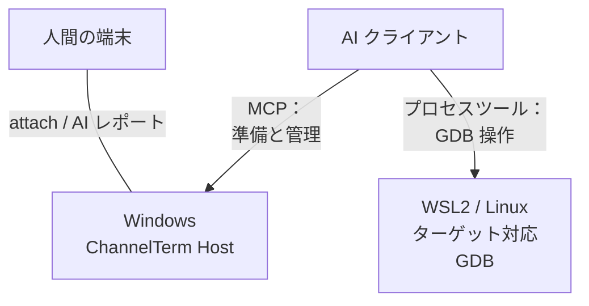
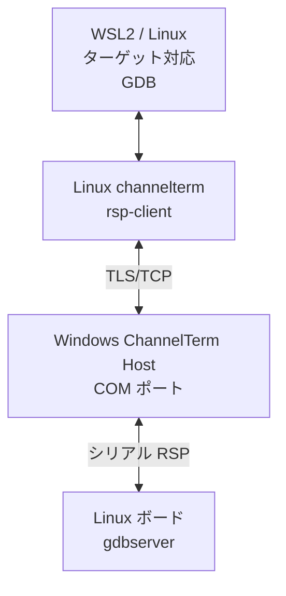
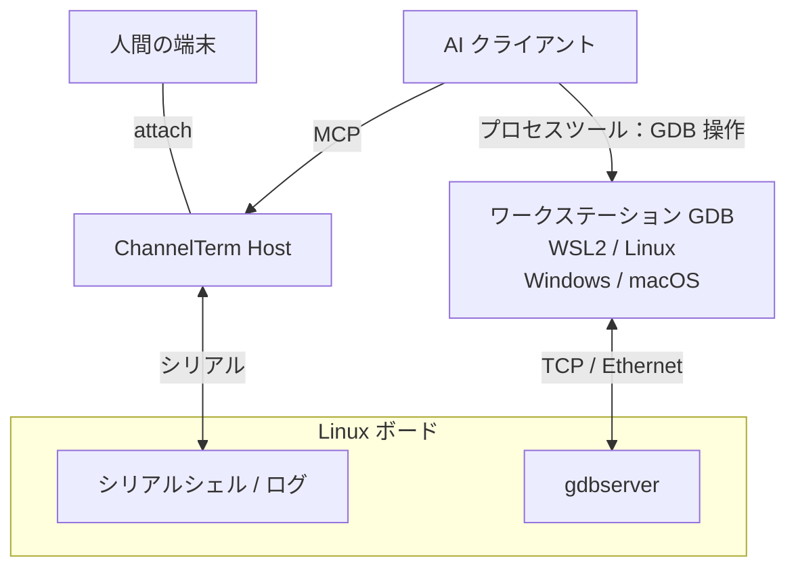

[English](README.md) | [Deutsch](README.de.md) | [Español](README.es.md) | [Français](README.fr.md) | [日本語](README.ja.md) | [한국어](README.ko.md) | [Русский](README.ru.md) | [简体中文](README.zh-CN.md) | [繁體中文](README.zh-TW.md)

# ChannelTerm

**AI と一緒にボードをデバッグ。同じ端末で作業を続ける。**

ChannelTerm は、あなたと AI クライアントで実際のシリアル端末や SSH 端末を共有します。同じデバイス出力を読み、AI の端末コマンドを確認し、交代でボードを操作できます。Windows、Linux、macOS に対応し、MCP で外部 AI クライアントと接続します。

GDB を使えば、AI にブレークポイント設定、Linux プログラムのステップ実行、変数確認を任せられます。Windows でシリアル接続して WSL2 で GDB を動かす構成や、共有コンソールを保ちつつ GDB が Ethernet を使う構成を選べます。[デバッグ構成を選ぶ](#gdb-debugging)。

> この文書は日本語版の入口です。動作、オプション、互換性については、英語版
> [README](README.md)、現在のソースコード、および `channelterm --help` が基準です。

短い起動待ち時間でも、Host が U-Boot を中断し、プロンプトを確認できます。障害調査用の診断 ZIP を出力でき、生バイトの収録は任意です。[U-Boot と診断の手順](docs/getting-started/serial-terminal.md#enter-u-boot-and-export-evidence)。

## ChannelTerm を使う理由

端末を開いたまま、AI と同じデバイス接続を使えます。

```text
                         +---- Human terminal
                         |
Serial device ---- Session
                         |
                         +---- AI / MCP client
```

各クライアントは独立して読むため、AI が読んでも人間が見ている出力は消費されません。ChannelTerm は AI の端末書き込みを表示します。外部デバッガーには別の[表示範囲](#gdb-debugging)があります。

## できること

- **コンソールを共有：**人間の CLI と AI/MCP が同じシリアル／SSH Session を利用。
- **作業を追う：**デバイス出力とともに AI の端末コマンドを確認。
- **Linux をデバッグ：**管理型 GDB、シリアルブリッジ、ネットワーク GDB を利用。
- **ファイルを転送：**共有シリアル Session と SHA-256 検証、または独立した SFTP/SCP 接続。
- **attach で開始：**`channelterm attach` がローカル共有 Host を自動作成可能。

## インストール

[Releases](https://github.com/akira-init1/ChannelTerm/releases) から OS とアーキテクチャに対応する
アーカイブをダウンロードし、同じリリースの `SHA256SUMS` と照合してください。展開先のディレクトリで
Windows は `.\channelterm.exe install`、Linux/macOS は `./channelterm install` を実行します。
ビルド済みバイナリの使用には Go は不要です。

ソースからのビルドには Go 1.26 以降が必要です。現在サポートされているパッチリリースを使い、
リポジトリのルートからビルドしてください。

```bash
git clone https://github.com/akira-init1/ChannelTerm.git
cd ChannelTerm
go build ./cmd/channelterm
./channelterm install
```

`install` は実行中のバイナリを現在のユーザーの標準プログラム領域へコピーし、`channelterm` と
`cterm` コマンドを作成します。必要な場合だけその場所をユーザーの PATH に追加し、設定がない場合は
最小構成を初期化します。PATH の変更が表示された場合は新しいターミナルを開いてください。
`channelterm uninstall` はインストーラーが所有するコマンドと PATH の変更を削除し、ユーザーデータを
保持します。`channelterm uninstall --purge` は明示的な確認後にのみ設定、デバイス状態、ローカルの
HTTP 認証情報を削除します。

対応デスクトップターゲットは Windows、Linux、macOS の amd64/arm64 です。詳細は
[ソースからのビルドとインストール](docs/getting-started/build.md)、
[`install` / `uninstall` の完全な契約](docs/reference/cli.md#install-and-uninstall)、
[設定パス](docs/reference/configuration.md)、および
[ビルドとテスト](docs/development/building-and-testing.md)を参照してください。

## クイックスタート：1 コマンド、1 端末

検出されたシリアルデバイス、保存済み Profile、および既定の HTTP Host が利用可能な場合はその
Session を一覧します。

```bash
channelterm list
```

Host は実行中でなくてもかまいません。接続できない場合、`list` は MCP を offline と報告し、
ローカルのデバイスと Profile は引き続き表示します。

完全なオプション仕様は [CLI リファレンス](docs/reference/cli.md#list)を参照してください。

AI クライアントを Session に参加させる場合は、接続前に対応クライアントを一度だけ設定します。

```bash
channelterm init --mcp
```

HTTP を選ぶか、Enter を押して既定の HTTP を使用します。設定にはローカル Bearer 認証情報が
含まれます。AI クライアントが変更をすぐに読み込まない場合は再読み込みまたは再起動してください。

次に、現在のプラットフォームに対応するコマンドを 1 つだけ実行します。

```bash
# Windows
channelterm attach COM8 --baud 115200 --label board

# Linux
channelterm attach /dev/ttyUSB0 --baud 115200 --label board

# macOS
channelterm attach /dev/cu.usbserial-110 --baud 115200 --label board
```

この 1 つの `attach` コマンドがシリアルデバイスを開き、現在の端末を接続します。既定の
エンドポイントで互換 Host が動作していない場合は、一時的なローカル HTTP MCP Session Host も
自動的に起動します。代表的な起動出力は次のとおりです。

```text
Shared Session created: SER-1 (0123456789abcdef0123456789abcdef)
[ChannelTerm] Temporary Session Host started; it and all shared Sessions stop when this attachment exits. Run 'channelterm mcp --transport http' separately for a persistent Host.
```

このクイックパスでは、MCP サーバー用の別端末は不要です。アタッチメントが動作している間、設定済み
HTTP MCP クライアントは `http://127.0.0.1:37099/mcp` を使用して同じ `SER-1` を操作できます。
作成元のアタッチメントが終了すると、一時 Host とそのすべての Session も停止します。Session を
現在の端末から独立して維持する必要がある場合だけ、永続 Host を別に実行します。

`--label board` は任意の表示名であり、識別子ではありません。他のクライアントは `SER-1` または
完全な Session ID を使用します。

### よく使うワークフロー

| 目的 | コマンド |
| --- | --- |
| 共有シリアル Session を開き、一時 Host を自動起動 | `channelterm attach COM8 --baud 115200` |
| 対応 AI クライアントに共有 HTTP Host を設定 | `channelterm init --mcp` |
| Host と Session を独立して維持 | `channelterm mcp --transport http` |
| 既存 Session を一覧または接続 | `channelterm list --kind session` の後に `channelterm attach SER-1` |
| MCP 共有なしのプライベート接続を開く | `channelterm attach COM8 --private --baud 115200` |
| 構造化 Session アクティビティを監視 | `channelterm events SER-1` |
| 現在の共有アタッチメントでガイド付きファイル転送を開く | `Ctrl+]` を押してから `f` を押す |
| 共有 Session でファイルを送受信 | `channelterm file send firmware.bin --session SER-1` または `channelterm file receive /tmp/log.txt ./log.txt --session SER-1` |

永続 Host は独立した長時間実行プロセスです。
`MCP Streamable HTTP listening on http://127.0.0.1:37099/mcp` が表示された後、他の Shell や設定済み
AI クライアントが Session を作成または接続できます。準備完了後に出力がないのは正常です。Host と
そのすべての Session を終了するときは `Ctrl+C` を押します。

ファイル転送やデバッガーの接管中を除く、通常の端末操作では：

```text
Ctrl+C      リモート端末へ 0x03 を送信
Ctrl+] q    現在の CLI を終了（一時 Host の所有者なら Host も停止）
Ctrl+] ?    ローカルのエスケープヘルプを表示
```

ローカル操作の一覧は [CLI リファレンス](docs/reference/cli.md#attach)、クライアント設定と AI による Session 作成は [MCP ガイド](docs/getting-started/mcp-server.md)を参照してください。

再利用可能なワークフローガイダンスを利用するには、Agent Skills 対応クライアントに同梱の
[`cterm-serial-debug` Agent Skill](docs/getting-started/mcp-server.md#install-the-bundled-agent-skill)を
インストールしてください。`channelterm init --mcp` は MCP クライアントを設定しますが、
Skill はインストールしません。

HTTP Host は Bearer token を必要とし、既定ではループバックだけを待ち受けます。組み込み CLI
はローカルユーザーの token を自動的に読み取ります。[信頼できる LAN で待ち受ける](docs/getting-started/mcp-server.md#listen-on-a-lan)
こともできますが、リモートクライアントは Host の到達可能な LAN アドレスを使用し、
`Authorization` ヘッダーで同じ token を送信する必要があります。TLS と追加のネットワークアクセス
制御なしで信頼できないネットワークへ公開しないでください。

<a id="ワークフローの例"></a>
<a id="組み込み-linux-のデバッグ"></a>
<a id="ai-が操作し人間が観察する"></a>
<a id="人間が介入する"></a>

## 共有端末の実例

接続中の CLI は Agent のコマンドをローカルの `AI` アクティビティブロックとして表示します。`terminal_exec` はそのコマンドをアイドル状態の Bash の履歴に残しません。ブロックに続く行はデバイスの生の端末出力であり、短いコマンドリースが解放されると人間が再び入力できます。

```bash
root@board:~#

──────── AI ────────
[18:52:31] >> echo agent-check
────────────────────
agent-check
root@board:~# echo human-still-here
human-still-here
root@board:~#
```

実際のコマンド出力は接続先のデバイスによって異なります。`AI` ブロックは構造化 Session イベントから生成されるローカル表示で、デバイスのバイトストリームや保存された端末出力には挿入されません。生のキー入力や対話型プログラムには引き続き `terminal_write` を使用し、デバイス本来の履歴動作を保ちます。

## SSH シェルの共有

認証を許可された秘密鍵を使用するか、要求されたらパスワードを入力します。暗号化された秘密鍵にはパスフレーズが必要です（どちらも保存されません）。
未知のサーバーでは表示されたフィンガープリントを確認し、`yes` を入力すると公開鍵が `~/.ssh/known_hosts` に保存されます。
変更されたサーバー鍵は拒否されます。これらの入力には対話型ターミナルが必要です。

```bash
# 端末 1：シェルを開き、そのプロンプトで uname -a を実行します。
channelterm ssh user@192.168.1.50

# 端末 2：同じシェルの出力を確認し、操作します。
channelterm attach SSH-1
```

最初のコマンドを実行したままにしてください。終了すると、この Host と Session も閉じます。既定のローカル共有ポートが使用中の場合は、`--listen` と表示された attach エンドポイントで別の Host を使います。鍵のパス、ホスト検証、ポート、現在の制限は [SSH ワークフロー](docs/getting-started/ssh-terminal.md)を参照してください。

## SSH 経由のファイル転送

SFTP でファイル転送とリモートファイル管理を行えます。対応する POSIX サーバーでは従来の SCP も使用できます。

```bash
channelterm sftp user@192.168.1.50 ls /tmp
channelterm sftp user@192.168.1.50 put ./firmware.bin /tmp/firmware.bin
channelterm sftp user@192.168.1.50 get /tmp/log.txt ./log.txt
channelterm scp user@192.168.1.50 put ./release /tmp/release --recursive
```

SSH と同じ鍵・パスワード認証とホスト検証を使い、端末 Session とは独立した接続で動作します。
既存ファイルの上書きには `--overwrite` が必要です。ディレクトリの扱い、キャンセル、制限は
[ファイル転送](docs/getting-started/file-transfer.md#sftp-and-scp-over-ssh)を参照してください。

共有端末 Session 経由のファイル転送は小規模な Linux-shell プロトコルを使用します。
独立した SSH ファイル接続は SFTP または従来の SCP を使用します。

<a id="aiファイルローカル操作"></a>

## 共有 Session でのファイル転送

同じ共有シリアル Session で通常のファイルやディレクトリも転送でき、AI クライアントや別途インストールするボード側の転送エージェントは不要です。実行中の共有 `attach` で `Ctrl+]`、続けて `f` を押すと、ガイド付き送受信メニューが開きます。ディレクトリには標準 tar と、確認応答を伴いキャンセルしやすいチャンク転送を使用します。同じ操作はコマンドでも実行できます。

```bash
channelterm file send firmware.bin --session SER-1
channelterm file receive /tmp/log.txt ./log.txt --session SER-1
channelterm file send ./build/release /tmp/release --session SER-1
channelterm file receive /var/log/myapp ./myapp --session SER-1
```

転送には、待機中の Linux シェルと[ファイル転送ガイド](docs/getting-started/file-transfer.md)に記載されたツールが必要です。SHA-256 を検証し、既存の宛先を上書きせず新しい名前を選びます。転送中に共有アタッチメントで `Ctrl+C` を押すとキャンセルの確認が表示されます。後処理がリースを解放するまで、他の書き込みはブロックされます。

<a id="gdb-debugging"></a>

## GDB によるリモートデバッグ

デバッガーから Linux プログラムへの接続方式を選びます。いずれもターゲット対応ツールと一致するシンボルが必要です。

| 方式 | GDB の接続経路 | デバッグ中のコンソール／Session |
| --- | --- | --- |
| [シリアルブリッジ](#gdb-serial-bridge) | ワークステーション GDB → ChannelTerm → ボードのシリアル；下記は Windows + WSL2 の例 | 復元まで GDB が占有 |
| [シリアルコンソール + TCP](#gdb-serial-tcp) | ワークステーション GDB → ボードのネットワーク；対応 GDB があれば WSL2、Linux、Windows、macOS | 独立したシェル／ログ操作に利用可能 |
| [管理型 GDB/MI](docs/getting-started/gdb-debugging.md#managed-native-linux-prerequisites) | MCP が GDB を操作；Host、シェル、ツール、ELF は同一ネイティブ Linux 環境 | 選択した Session をデバッグ中は占有 |

<a id="gdb-serial-bridge"></a>

### シリアル GDB ブリッジ：Windows + WSL2

**Windows でシリアル接続、WSL2 で GDB 実行、AI がリモートデバッグを進めます。** Windows の ChannelTerm Host が COM ポートと共有 Session を保持します。WSL2 のターゲット対応 GDB は、Linux 版 `channelterm rsp-client` と認証付き TLS/TCP ブリッジを経由して、ボード上の Linux gdbserver に接続します。

**制御と監視**



**RSP データ経路**



Windows のシリアルドライバーと Linux ツールチェーンをそのまま利用できます。シリアル機器は Windows 側に置き、ボード側のネットワーク GDB ポートは不要です。

1. Windows で `channelterm init --mcp`（HTTP）を使って AI クライアントを設定し、例えば `channelterm attach COM8 --baud 115200` でボードに接続します。確認済みのシリアル設定を使い、所有元の Host を稼働させておきます。
2. [準備手順](docs/getting-started/gdb-debugging.md#prepare-and-open)に従い、TTY 状態を保存し、ボード上で互換性のある `gdbserver --once stdio` を準備して、MCP から `debug_bridge_start` を呼び出します。AI が WSL2 で GDB を実行するにはプロセス実行ツールも必要です。
3. WSL2 では Linux 版 ChannelTerm、ターゲット対応 GDB、一致する ELF を使います。秘密の接続記述子を WSL ファイルシステムの `bridge.json` に保存してください（`chmod 600`）。ネットワークとパスは [WSL2 ガイド](docs/getting-started/gdb-debugging.md#connect-independent-gdb-from-wsl2)を参照し、下のファイルパスを置き換えます。

```text
(gdb) target remote | channelterm rsp-client --connection /home/EXAMPLE/private/bridge.json
(gdb) break main
(gdb) continue
(gdb) next
(gdb) backtrace
(gdb) detach
```

4. Windows で `channelterm gdb-list` または `channelterm gdb-list --json` を使い、ブリッジのポートと状態を確認します。GDB detach 後、ボードがシェルに戻ったことを確認して保存した TTY 状態で `debug_bridge_restore` を呼び出し、共有端末の利用を再開します。

このシリアルブリッジでは、AI が実際のコマンドや観測結果を `debug_bridge_report` で接続中の端末に報告できます。AI レポートと明示され、GDB の完全な自動記録ではありません。

<a id="gdb-serial-tcp"></a>

### 共有シリアルコンソール + Ethernet 経由の GDB

シリアルコンソールでログやシェル操作を共有しながら、GDB の通信にはネットワークを利用できます。シリアル Host と GDB は同じコンピューターでも別々でも構いません。ドライバーとターゲット用ツールチェーンを各環境に合わせて選べます。



シリアルシェルで引き続きコマンドを実行するには、gdbserver をその対話シェルとは独立して稼働させます。ワークステーションの GDB で一致する ELF を読み込み、制限されたネットワーク経由で下記のように接続します（`TARGET_IP` とポートを置き換えてください）。起動、プログラムの入出力、SSH トンネルは[シリアルコンソール + TCP の手順](docs/getting-started/gdb-debugging.md#shared-serial-console-with-tcp-gdb)を参照してください。

```text
(gdb) target remote TARGET_IP:2345
```

この TCP 構成は `rsp-client` や `debug_bridge_*` を使わず、gdbserver に直接接続します。人間と AI は共有シリアルの活動を確認できますが、外部 GDB のコマンドと結果はデバッガー側の出力に残り、シリアル端末へ自動転送されません。

CI は Linux PTY 上で実際の GDB/gdbserver により管理型 GDB/MI と外部ブリッジを検証します。設定、互換性、SSH の代替手順、復旧は[完全なガイド](docs/getting-started/gdb-debugging.md)を参照してください。

## 仕組み

```text
Human CLI -----+
               +--> Session Host --> Session <--> Channel <--> Serial / SSH endpoint
AI via MCP ----+                         |
                                        +-- retained output, activity, events
                                        `-- serialized writes
```

Session Host は接続と Session のライフサイクルを所有します。Serial または SSH Transport がプロトコルに依存しない Channel を確立し、Session はその Channel を読み取り、出力・アクティビティ・イベントを上限付きでメモリに保持し、書き込みを直列化します。CLI と MCP のアダプターは同じ Core の動作を再利用します。ハイライトや `AI` アクティビティブロックなどの表示処理は、保存された端末データの外で行います。

読み手ごとに独立したカーソルを使います。生の書き込みは直列化されますが、シェルコマンドの意味までは調整しません。コマンド実行、転送、デバッグ中は、アプリケーションのリースが他の書き込みを一時的にブロックします。所有権と並行性については[共有 Session](docs/getting-started/shared-session.md)を参照してください。

`SER-1` などの共有参照は、所有元の Host プロセス内でのみ有効です。Host を停止すると、その Session は閉じます。追加のアタッチメントは単独で終了できますが、一時 Host を所有するアタッチメントや所有元の SSH コマンドを終了すると、それらの Session も閉じます。レイヤーの境界は[アーキテクチャ概要](docs/architecture/overview.md)を参照してください。

## 設定

`config.toml` にはユーザー管理のシリアル Profile と接続ポリシーが保存されます。`state.json` は
ChannelTerm が管理するデバイス識別状態です。`http-auth-token` は MCP HTTP クライアントの認証に
使用する秘密情報なので、共有したりコミットしたりしないでください。

```powershell
# シリアル Profile を保存して再利用します。
channelterm serial --port COM8 --baud 115200 --save board
channelterm serial --profile board

# この操作で別の config.toml を使用します。
channelterm serial --config ./channelterm.toml --profile board
```

主なオプションは `--profile`、`--save`、`--config`、`--port`、`--baud` です。MCP Host は
`--connection-policy ask|auto|deny` にも対応します。`--config` が切り替えるのは選択した
`config.toml` だけで、既定の `state.json` や `http-auth-token` は移動しません。全フィールド、
優先順位、検証、永続化の動作については[シリアル Profile](docs/getting-started/serial-profiles.md)と
[設定リファレンス](docs/reference/configuration.md)を参照してください。

## ドキュメント

- [ドキュメント索引](docs/README.md)
- [Electron GUI プロトタイプと開発](docs/development/electron-gui.md)
- [シリアル端末ワークフロー](docs/getting-started/serial-terminal.md)
- [SSH シェルワークフロー](docs/getting-started/ssh-terminal.md)
- [共有 Session](docs/getting-started/shared-session.md)
- [ファイル転送ワークフロー](docs/getting-started/file-transfer.md)
- [MCP Server](docs/getting-started/mcp-server.md)
- [GDB デバッグ手順](docs/getting-started/gdb-debugging.md)
- [CLI リファレンス](docs/reference/cli.md)
- [MCP ツールリファレンス](docs/reference/mcp-tools.md)
- [識別子と参照](docs/reference/identifiers.md)
- [アーキテクチャ概要](docs/architecture/overview.md)

正確なコマンドフラグと既定値は、実行中のプログラムの `--help` 出力を参照してください。

## ロードマップ

シリアルと SSH PTY シェルは実装済みの Transport です。専用の SFTP および従来の SCP ファイルクライアントも利用できます。任意の SSH exec、Telnet、より強い複数書き込み側の協調は今後の方向性であり、実装済み機能やリリースの約束ではありません。

ChannelTerm は現在、JTAG/OpenOCD、仮想シリアルデバイス、組み込み AI、マルチエージェントのオーケストレーションを実装していません。

## ライセンス

ChannelTerm は [Apache License 2.0](LICENSE) の下で提供されます。
