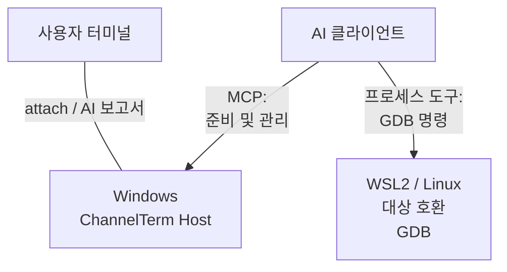
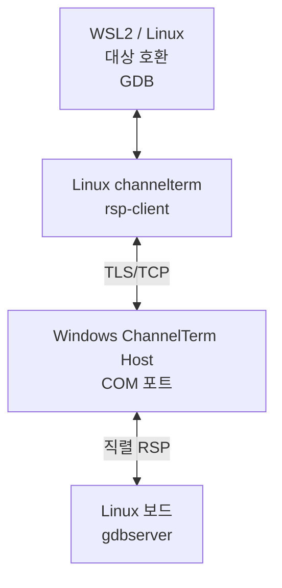
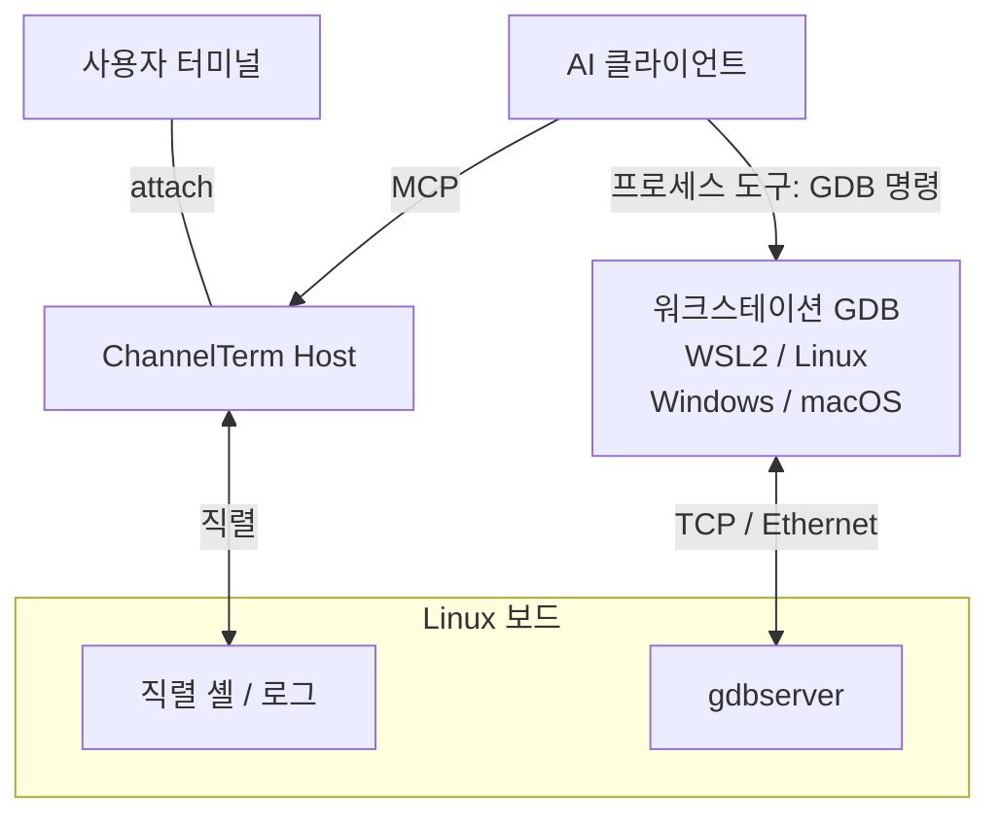

[English](README.md) | [Deutsch](README.de.md) | [Español](README.es.md) | [Français](README.fr.md) | [日本語](README.ja.md) | [한국어](README.ko.md) | [Русский](README.ru.md) | [简体中文](README.zh-CN.md) | [繁體中文](README.zh-TW.md)

# ChannelTerm

**AI와 함께 보드를 디버깅하세요. 같은 터미널에서 계속 작업하세요.**

ChannelTerm은 사용자와 AI 클라이언트가 실제 직렬 또는 SSH 터미널을 공유하게 합니다. 같은 장치 출력을 읽고, AI의 터미널 명령을 확인하며, 번갈아 보드를 조작할 수 있습니다. Windows, Linux, macOS에서 실행되며 MCP로 외부 AI 클라이언트에 연결합니다.

GDB를 통해 AI가 중단점을 설정하고 Linux 프로그램을 단계 실행하며 변수를 확인할 수 있습니다. Windows가 직렬 포트에 연결하고 WSL2가 GDB를 실행하거나, 공유 콘솔을 유지하면서 GDB가 보드의 Ethernet을 사용할 수 있습니다. [디버깅 구성 선택](#gdb-debugging).

> 이 문서는 한국어 안내 문서입니다. 동작, 옵션, 호환성에 관한 기준은 영문
> [README](README.md), 현재 소스 코드와 `channelterm --help`입니다.

짧은 부팅 대기 시간에도 Host가 U-Boot를 중단하고 프롬프트를 확인할 수 있습니다. 문제 조사용 진단 ZIP을 내보낼 수 있으며 원시 바이트 포함은 선택 사항입니다. [U-Boot 및 진단 절차](docs/getting-started/serial-terminal.md#enter-u-boot-and-export-evidence).

## ChannelTerm을 사용하는 이유

터미널을 열어 둔 채 AI와 같은 장치 연결을 사용하세요.

```text
                         +---- Human terminal
                         |
Serial device ---- Session
                         |
                         +---- AI / MCP client
```

각 클라이언트가 독립적으로 읽으므로 AI가 사용자가 보고 있는 출력을 소비하지 않습니다. ChannelTerm은 AI의 터미널 쓰기를 표시하며, 외부 디버거에는 별도의 [표시 범위](#gdb-debugging)가 적용됩니다.

## 제공하는 기능

- **콘솔 공유:** 사람의 CLI와 AI/MCP가 같은 직렬 또는 SSH Session을 사용합니다.
- **작업 확인:** 장치 출력과 함께 AI의 터미널 명령을 봅니다.
- **Linux 디버깅:** 관리형 GDB, 직렬 브리지 또는 네트워크 GDB를 사용합니다.
- **파일 전송:** 공유 직렬 Session과 SHA-256 검증 또는 독립 SFTP/SCP 연결을 사용합니다.
- **attach로 시작:** `channelterm attach`가 로컬 공유 Host를 자동 생성할 수 있습니다.

## 설치

[Releases](https://github.com/akira-init1/ChannelTerm/releases)에서 운영체제와 아키텍처에 맞는
압축 파일을 내려받아 같은 릴리스의 `SHA256SUMS`와 대조하십시오. 압축을 푼 디렉터리에서
Windows는 `.\channelterm.exe install`, Linux/macOS는 `./channelterm install`을 실행합니다.
미리 빌드된 바이너리를 사용하는 데는 Go가 필요하지 않습니다.

소스에서 빌드하려면 Go 1.26 이상이 필요합니다. 현재 지원되는 패치 릴리스를 사용하고
저장소 루트에서 빌드하십시오.

```bash
git clone https://github.com/akira-init1/ChannelTerm.git
cd ChannelTerm
go build ./cmd/channelterm
./channelterm install
```

`install`은 현재 실행 중인 바이너리를 현재 사용자의 표준 프로그램 위치로 복사하고 `channelterm`과
`cterm` 명령을 만듭니다. 필요한 경우에만 해당 위치를 사용자 PATH에 추가하며, 설정이 없으면 최소
설정을 초기화합니다. PATH 변경이 보고되면 새 터미널을 여십시오. `channelterm uninstall`은 설치
프로그램이 소유한 명령과 PATH 변경을 제거하지만 사용자 데이터는 보존합니다.
`channelterm uninstall --purge`는 명시적으로 확인한 뒤에만 설정, 장치 상태 및 로컬 HTTP 인증 정보를
삭제합니다.

지원되는 데스크톱 대상은 Windows, Linux, macOS의 amd64/arm64입니다. 자세한 내용은
[소스에서 빌드 및 설치](docs/getting-started/build.md),
[`install` / `uninstall` 전체 계약](docs/reference/cli.md#install-and-uninstall),
[설정 경로](docs/reference/configuration.md)와
[빌드 및 테스트](docs/development/building-and-testing.md)를 참고하십시오.

## 빠른 시작: 명령 하나, 터미널 하나

감지된 시리얼 장치, 저장된 Profile, 그리고 기본 HTTP Host를 사용할 수 있을 때 그 안의 Session을
나열합니다.

```bash
channelterm list
```

Host가 실행 중일 필요는 없습니다. 연결할 수 없으면 `list`는 MCP를 offline으로 표시하면서 로컬
장치와 Profile은 계속 보여 줍니다.

전체 옵션 계약은 [CLI 참조](docs/reference/cli.md#list)를 확인하십시오.

AI 클라이언트가 Session에 참여해야 한다면 연결하기 전에 지원되는 클라이언트를 한 번 설정합니다.

```bash
channelterm init --mcp
```

HTTP를 선택하거나 Enter를 눌러 기본 HTTP를 사용합니다. 설정에는 로컬 Bearer 인증 정보가 포함됩니다.
AI 클라이언트가 변경 사항을 즉시 읽지 않으면 다시 로드하거나 재시작하십시오.

그다음 현재 플랫폼에 맞는 명령 하나만 실행합니다.

```bash
# Windows
channelterm attach COM8 --baud 115200 --label board

# Linux
channelterm attach /dev/ttyUSB0 --baud 115200 --label board

# macOS
channelterm attach /dev/cu.usbserial-110 --baud 115200 --label board
```

이 `attach` 명령 하나가 시리얼 장치를 열고 현재 터미널을 연결합니다. 기본 엔드포인트에서 호환되는
Host가 실행 중이 아니면 임시 로컬 HTTP MCP Session Host도 자동으로 시작합니다. 일반적인 시작
출력은 다음과 같습니다.

```text
Shared Session created: SER-1 (0123456789abcdef0123456789abcdef)
[ChannelTerm] Temporary Session Host started; it and all shared Sessions stop when this attachment exits. Run 'channelterm mcp --transport http' separately for a persistent Host.
```

이 빠른 경로에는 MCP 서버용 별도 터미널이 필요하지 않습니다. 연결이 유지되는 동안 설정된 HTTP MCP
클라이언트는 `http://127.0.0.1:37099/mcp`를 사용하여 같은 `SER-1`을 조작할 수 있습니다. 생성한
연결이 종료되면 임시 Host와 그 Host가 소유한 모든 Session도 중지됩니다. Session이 현재 터미널과
독립적으로 유지되어야 할 때만 영구 Host를 별도로 실행합니다.

`--label board`는 선택적인 표시 이름이지 식별자가 아닙니다. 다른 클라이언트는 `SER-1` 또는 전체
Session ID를 사용해야 합니다.

### 자주 쓰는 워크플로

| 목적 | 명령 |
| --- | --- |
| 공유 시리얼 Session을 열고 임시 Host 자동 시작 | `channelterm attach COM8 --baud 115200` |
| 지원되는 AI 클라이언트에 공유 HTTP Host 설정 | `channelterm init --mcp` |
| Host와 Session을 독립적으로 계속 실행 | `channelterm mcp --transport http` |
| 기존 Session 목록 확인 또는 연결 | `channelterm list --kind session` 실행 후 `channelterm attach SER-1` |
| MCP 공유 없는 비공개 시리얼 연결 열기 | `channelterm attach COM8 --private --baud 115200` |
| 구조화된 Session 활동 관찰 | `channelterm events SER-1` |
| 현재 공유 연결에서 안내식 파일 전송 메뉴 열기 | `Ctrl+]`를 누른 다음 `f` 누르기 |
| 공유 Session으로 파일 송수신 | `channelterm file send firmware.bin --session SER-1` 또는 `channelterm file receive /tmp/log.txt ./log.txt --session SER-1` |

영구 Host는 독립적으로 장시간 실행되는 프로세스입니다.
`MCP Streamable HTTP listening on http://127.0.0.1:37099/mcp`가 표시된 뒤 다른 Shell과 설정된 AI
클라이언트가 Session을 만들거나 연결할 수 있습니다. 준비 메시지 이후 출력이 없는 것은 정상입니다.
Host와 모든 Session을 닫을 때 `Ctrl+C`를 누르십시오.

파일 전송이나 디버거가 제어하는 동안을 제외한 일반 터미널 사용에서는:

```text
Ctrl+C      원격 터미널에 0x03 전송
Ctrl+] q    현재 CLI 종료(소유한 임시 Host가 있으면 Host도 중지)
Ctrl+] ?    로컬 이스케이프 도움말 표시
```

전체 로컬 제어는 [CLI 참고 문서](docs/reference/cli.md#attach), 클라이언트 설정과 AI의 Session 생성은 [MCP 안내](docs/getting-started/mcp-server.md)를 참고하세요.

재사용 가능한 워크플로 지침을 사용하려면 Agent Skills 호환 클라이언트에 번들
[`cterm-serial-debug` Agent Skill](docs/getting-started/mcp-server.md#install-the-bundled-agent-skill)을
설치하십시오. `channelterm init --mcp`는 MCP 클라이언트를 구성하지만 Skill은 설치하지 않습니다.

HTTP Host에는 Bearer token이 필요하며 기본적으로 루프백 주소에서만 수신합니다. 내장 CLI는 로컬
사용자 token을 자동으로 읽습니다. [신뢰할 수 있는 LAN에서 수신](docs/getting-started/mcp-server.md#listen-on-a-lan)할
수도 있지만, 원격 클라이언트는 Host의 연결 가능한 LAN 주소를 사용하고 `Authorization` 헤더로 같은
token을 보내야 합니다. TLS와 별도의 네트워크 접근 제어 없이 신뢰할 수 없는 네트워크에 엔드포인트를
직접 노출하지 마십시오.

<a id="워크플로-예"></a>
<a id="임베디드-linux-디버깅"></a>
<a id="ai가-조작하고-사람이-관찰"></a>
<a id="사람이-개입"></a>

## 공유 터미널 사용 예

연결된 CLI는 Agent 명령을 로컬 `AI` 활동 블록으로 표시합니다. `terminal_exec`는 해당 명령을 유휴 Bash 프롬프트의 기록에 남기지 않습니다. 블록 다음에 나오는 줄은 여전히 장치의 원시 터미널 출력이며, 짧은 명령 임대가 해제되면 사람이 다시 입력할 수 있습니다.

```bash
root@board:~#

──────── AI ────────
[18:52:31] >> echo agent-check
────────────────────
agent-check
root@board:~# echo human-still-here
human-still-here
root@board:~#
```

실제 명령 출력은 연결된 장치에 따라 다릅니다. `AI` 블록은 구조화된 Session 이벤트에서 생성한 로컬 표시이며, 장치 바이트 스트림이나 저장된 터미널 출력에 삽입되지 않습니다. 원시 키 입력과 대화형 프로그램에는 계속 `terminal_write`를 사용하며, 장치의 기존 명령 기록 동작을 유지합니다.

## SSH 셸 공유

인증이 허용된 개인 키를 사용하거나 요청 시 비밀번호를 입력하세요. 암호화된 개인 키는 암호문구를 요청합니다(둘 다 저장되지 않습니다).
알 수 없는 서버는 표시된 지문을 확인한 뒤 `yes`를 입력하면 공개 키가 `~/.ssh/known_hosts`에 저장됩니다.
변경된 서버 키는 거부됩니다. 이러한 입력에는 대화형 터미널이 필요합니다.

```bash
# 터미널 1: 셸을 열고 해당 프롬프트에서 uname -a를 실행합니다.
channelterm ssh user@192.168.1.50

# 터미널 2: 같은 셸의 출력을 보고 사용합니다.
channelterm attach SSH-1
```

첫 번째 명령을 계속 실행해 두세요. 종료하면 이 Host와 Session도 닫힙니다. 기본 로컬 공유 포트가 사용 중이면 `--listen`과 출력된 attach 엔드포인트로 별도 Host를 사용하세요. 키 경로, 호스트 검증, 포트 및 현재 제한은 [SSH 워크플로](docs/getting-started/ssh-terminal.md)를 참조하세요.

## SSH 파일 전송

SFTP로 파일을 전송하고 원격 파일을 관리할 수 있으며, 호환되는 POSIX 서버에서는 기존 SCP도 사용할 수 있습니다.

```bash
channelterm sftp user@192.168.1.50 ls /tmp
channelterm sftp user@192.168.1.50 put ./firmware.bin /tmp/firmware.bin
channelterm sftp user@192.168.1.50 get /tmp/log.txt ./log.txt
channelterm scp user@192.168.1.50 put ./release /tmp/release --recursive
```

SSH와 동일한 키/비밀번호 인증 및 호스트 검증을 사용하며, 터미널 Session과 독립된 연결로 동작합니다.
기존 파일을 덮어쓰려면 `--overwrite`가 필요합니다. 디렉터리 처리, 취소 동작과 제한은
[파일 전송](docs/getting-started/file-transfer.md#sftp-and-scp-over-ssh)을 참조하세요.

공유 터미널 Session을 통한 파일 전송은 간단한 Linux-shell 프로토콜을 사용합니다.
독립된 SSH 파일 연결은 SFTP 또는 기존 SCP를 사용합니다.

<a id="ai-파일-및-로컬-제어"></a>

## 공유 Session을 통한 파일 전송

같은 공유 시리얼 Session으로 일반 파일과 디렉터리도 전송할 수 있습니다. AI 클라이언트나 보드에 별도로 설치하는 전송 에이전트는 필요하지 않습니다. 실행 중인 공유 `attach`에서 `Ctrl+]` 다음 `f`를 누르면 안내식 송수신 메뉴가 열립니다. 디렉터리는 표준 tar와 확인 응답이 있는 취소 가능한 청크 전송을 사용합니다. 같은 작업을 명령으로도 실행할 수 있습니다.

```bash
channelterm file send firmware.bin --session SER-1
channelterm file receive /tmp/log.txt ./log.txt --session SER-1
channelterm file send ./build/release /tmp/release --session SER-1
channelterm file receive /var/log/myapp ./myapp --session SER-1
```

전송에는 유휴 Linux 셸과 [파일 전송 안내](docs/getting-started/file-transfer.md)에 나열된 도구가 필요합니다. SHA-256을 검증하고 기존 대상을 덮어쓰지 않도록 새 이름을 선택합니다. 전송 중 공유 연결에서 `Ctrl+C`를 누르면 취소 여부를 묻습니다. 정리가 끝나 임대를 해제할 때까지 다른 쓰기는 차단됩니다.

GUI와 CLI 파일 전송은 기본적으로 Base64를 사용하며 장치에 `base64`와 `tr`이 필요합니다.
`--wire raw`는 XON/XOFF를 사용하지 않는 호환 8비트 연결에서만 사용하세요. 파일 내용은 변경되지 않습니다.

<a id="gdb-debugging"></a>

## GDB 원격 디버깅

디버거가 Linux 프로그램에 연결되는 방식을 선택하세요. 각 방식에는 대상 호환 도구와 일치하는 심볼이 필요합니다.

| 방식 | GDB 연결 경로 | 디버깅 중 콘솔 / Session |
| --- | --- | --- |
| [직렬 브리지](#gdb-serial-bridge) | 워크스테이션 GDB → ChannelTerm → 보드 직렬 포트; 아래는 Windows + WSL2 예제 | 복원할 때까지 GDB가 점유 |
| [직렬 콘솔 + TCP](#gdb-serial-tcp) | 워크스테이션 GDB → 보드 네트워크; 호환 GDB가 있는 WSL2, Linux, Windows, macOS | 독립된 셸/로그 작업에 사용 가능 |
| [관리형 GDB/MI](docs/getting-started/gdb-debugging.md#managed-native-linux-prerequisites) | MCP가 GDB 제어; Host, 셸, 도구, ELF가 같은 네이티브 Linux 환경 | 선택한 Session은 디버깅 중 점유됨 |

<a id="gdb-serial-bridge"></a>

### 직렬 GDB 브리지: Windows + WSL2

**Windows가 직렬 포트에 연결하고, WSL2가 GDB를 실행하며, AI가 원격 디버깅을 진행합니다.** Windows ChannelTerm Host는 COM 포트와 공유 Session을 유지합니다. WSL2의 대상 호환 GDB가 Linux용 `channelterm rsp-client`와 인증된 TLS/TCP 브리지를 거쳐 보드의 Linux gdbserver에 연결합니다.

**제어 및 관찰**



**RSP 데이터 경로**



Windows 직렬 드라이버와 Linux 도구 모음을 계속 사용할 수 있습니다. 직렬 장치는 Windows에 남고 보드에 네트워크 GDB 포트를 열 필요가 없습니다.

1. Windows에서 `channelterm init --mcp`(HTTP)로 AI 클라이언트를 설정하고, 예를 들어 `channelterm attach COM8 --baud 115200`으로 보드에 연결합니다. 보드에서 확인한 직렬 설정을 사용하고 소유 Host를 계속 실행하세요.
2. [준비 단계](docs/getting-started/gdb-debugging.md#prepare-and-open)에 따라 TTY 상태를 저장하고 보드에서 호환되는 `gdbserver --once stdio`를 준비한 다음 MCP로 `debug_bridge_start`를 호출합니다. AI가 WSL2에서 GDB를 실행하려면 프로세스 실행 도구도 필요합니다.
3. WSL2에서 Linux용 ChannelTerm, 대상 호환 GDB와 일치하는 ELF를 사용합니다. 비공개 연결 설명자를 WSL 파일시스템의 `bridge.json`으로 저장하세요(`chmod 600`). 네트워크와 경로는 [WSL2 안내](docs/getting-started/gdb-debugging.md#connect-independent-gdb-from-wsl2)를 참고하고 아래 파일 경로를 바꾸세요.

```text
(gdb) target remote | channelterm rsp-client --connection /home/EXAMPLE/private/bridge.json
(gdb) break main
(gdb) continue
(gdb) next
(gdb) backtrace
(gdb) detach
```

4. Windows에서 `channelterm gdb-list` 또는 `channelterm gdb-list --json`으로 브리지 포트와 상태를 확인합니다. GDB detach 후 보드가 셸로 돌아왔는지 확인하고 저장한 TTY 상태로 `debug_bridge_restore`를 호출하여 공유 터미널 사용을 재개합니다.

이 직렬 브리지에서는 AI가 실제 명령과 관찰 결과를 `debug_bridge_report`로 연결된 터미널에 보고할 수 있습니다. AI 보고서로 명시되며 GDB의 완전한 자동 기록은 아닙니다.

<a id="gdb-serial-tcp"></a>

### 공유 직렬 콘솔 + Ethernet GDB 디버깅

직렬 콘솔에서 로그와 셸 작업을 공유하면서 GDB는 네트워크로 통신합니다. 직렬 Host와 GDB는 같은 컴퓨터나 서로 다른 컴퓨터에 둘 수 있으며, 드라이버와 대상 도구 모음을 각 환경에 맞게 선택할 수 있습니다.



직렬 셸에서 계속 명령을 실행하려면 gdbserver를 해당 대화형 셸과 독립적으로 실행하세요. 워크스테이션 GDB에 일치하는 ELF를 로드하고 제한된 네트워크를 통해 아래처럼 연결합니다(`TARGET_IP`와 포트를 바꾸세요). 대상 시작, 프로그램 입출력, SSH 터널은 [직렬 콘솔 + TCP 절차](docs/getting-started/gdb-debugging.md#shared-serial-console-with-tcp-gdb)를 참고하세요.

```text
(gdb) target remote TARGET_IP:2345
```

이 TCP 경로는 `rsp-client`나 `debug_bridge_*` 없이 gdbserver에 직접 연결합니다. 사람과 AI는 공유 직렬 활동을 볼 수 있지만 외부 GDB 명령과 결과는 디버거 출력에 남으며 직렬 터미널에 자동으로 표시되지는 않습니다.

CI는 Linux PTY에서 실제 GDB/gdbserver로 관리형 GDB/MI와 외부 브리지를 검증합니다. 설정, 호환성, SSH 대안과 복구는 [전체 안내](docs/getting-started/gdb-debugging.md)를 참고하세요.

## 동작 원리

```text
Human CLI -----+
               +--> Session Host --> Session <--> Channel <--> Serial / SSH endpoint
AI via MCP ----+                         |
                                        +-- retained output, activity, events
                                        `-- serialized writes
```

Session Host는 연결과 Session 수명을 소유합니다. Serial 또는 SSH Transport가 프로토콜에 독립적인 Channel을 설정하며, Session은 이 Channel을 읽고 출력, 활동 및 이벤트를 제한된 메모리에 보관하며 쓰기를 직렬화합니다. CLI와 MCP 어댑터는 동일한 Core 동작을 재사용합니다. 강조 표시나 `AI` 활동 블록 같은 표현은 저장된 터미널 데이터와 분리됩니다.

각 읽기 클라이언트는 독립적인 커서를 사용합니다. 원시 쓰기는 직렬화되지만 셸 명령의 의미까지 조정하지는 않습니다. 명령 실행, 전송 및 디버깅 중에는 애플리케이션 임대가 다른 쓰기를 일시적으로 차단합니다. 소유권과 동시성은 [공유 Session](docs/getting-started/shared-session.md)을 참고하세요.

`SER-1` 같은 공유 참조는 소유 Host 프로세스 안에서만 유효합니다. Host를 중지하면 해당 Session이 닫힙니다. 추가 연결은 독립적으로 종료할 수 있지만, 임시 Host를 소유한 연결이나 소유 SSH 명령을 종료하면 해당 Session도 닫힙니다. 계층 경계는 [아키텍처 개요](docs/architecture/overview.md)를 참고하세요.

## 설정

`config.toml`에는 사용자가 관리하는 시리얼 Profile과 연결 정책이 저장됩니다. `state.json`은
ChannelTerm이 관리하는 장치 식별 상태입니다. `http-auth-token`은 MCP HTTP 클라이언트 인증에
사용되는 비밀 정보이므로 공유하거나 커밋하지 마십시오.

```powershell
# 시리얼 Profile을 저장하고 다시 사용합니다.
channelterm serial --port COM8 --baud 115200 --save board
channelterm serial --profile board

# 이 작업에서 다른 config.toml을 사용합니다.
channelterm serial --config ./channelterm.toml --profile board
```

주요 옵션은 `--profile`, `--save`, `--config`, `--port`, `--baud`입니다. MCP Host는
`--connection-policy ask|auto|deny`도 지원합니다. `--config`는 선택한 `config.toml`만 변경하며
기본 `state.json`이나 `http-auth-token`은 이동하지 않습니다. 전체 필드, 우선순위, 검증 및 영속화
동작은 [시리얼 Profile](docs/getting-started/serial-profiles.md)과
[설정 레퍼런스](docs/reference/configuration.md)를 참고하십시오.

## 문서

- [문서 색인](docs/README.md)
- [Electron GUI 프로토타입 및 개발](docs/development/electron-gui.md) — 기본 로컬 Host에 자동으로 연결하거나 시작하며, GUI에서 직렬 및 SSH 세션을 직접 생성할 수 있습니다. 장치 폴더를 탐색하고 직렬 연결로 파일과 폴더를 양방향 전송하며 GUI에서 진행 상황을 확인할 수 있습니다.
- [시리얼 터미널 워크플로](docs/getting-started/serial-terminal.md)
- [SSH 셸 워크플로](docs/getting-started/ssh-terminal.md)
- [공유 Session](docs/getting-started/shared-session.md)
- [파일 전송 워크플로](docs/getting-started/file-transfer.md)
- [MCP Server](docs/getting-started/mcp-server.md)
- [GDB 디버깅 워크플로](docs/getting-started/gdb-debugging.md)
- [CLI 레퍼런스](docs/reference/cli.md)
- [MCP 도구 레퍼런스](docs/reference/mcp-tools.md)
- [식별자와 참조](docs/reference/identifiers.md)
- [아키텍처 개요](docs/architecture/overview.md)

정확한 명령 플래그와 기본값은 실행 중인 프로그램의 `--help` 출력을 기준으로 합니다.

## 로드맵

시리얼과 SSH PTY 셸은 구현된 Transport이며, 전용 SFTP 및 기존 SCP 파일 클라이언트도 사용할 수 있습니다. 임의의 SSH exec, Telnet, 더 강력한 다중 쓰기 조정은 향후 방향이며 구현된 기능이나 릴리스 약속이 아닙니다.

ChannelTerm은 현재 JTAG/OpenOCD, 가상 시리얼 장치, 내장 AI 또는 다중 에이전트 오케스트레이션을 구현하지 않습니다.

## 라이선스

ChannelTerm은 [Apache License 2.0](LICENSE)에 따라 제공됩니다.
