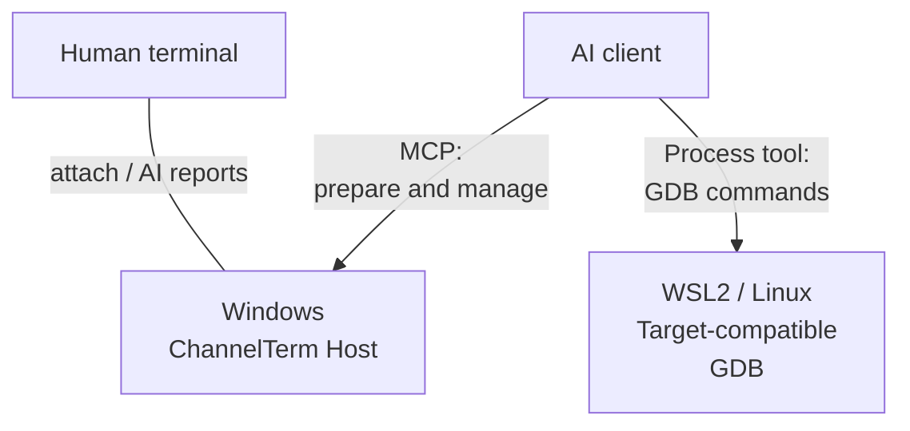
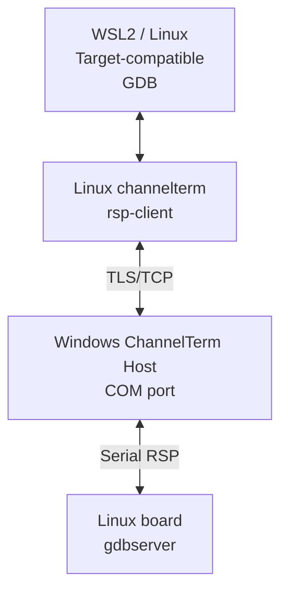
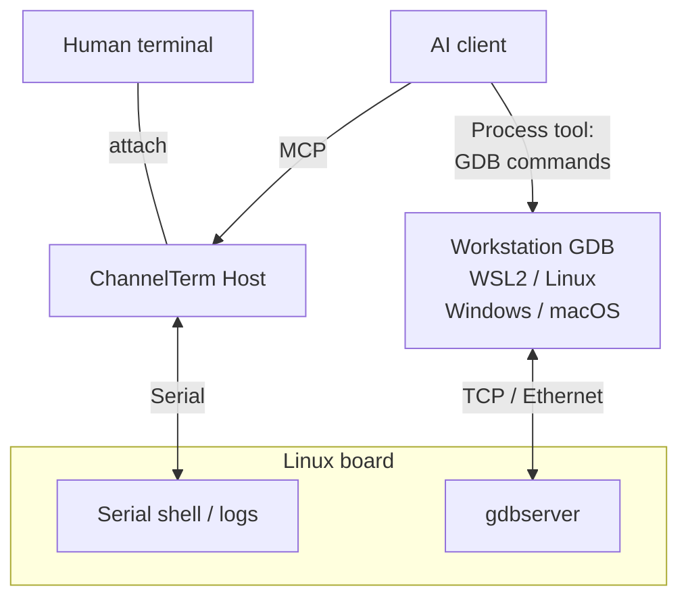

[English](README.md) | [Deutsch](README.de.md) | [Español](README.es.md) | [Français](README.fr.md) | [日本語](README.ja.md) | [한국어](README.ko.md) | [Русский](README.ru.md) | [简体中文](README.zh-CN.md) | [繁體中文](README.zh-TW.md)

# ChannelTerm

**Debug your board with AI. Stay in the same terminal.**

ChannelTerm lets you and your AI client share a live serial or SSH terminal. Read the same device output, follow AI terminal commands, and take turns operating the board. It runs on Windows, Linux, and macOS and connects external AI clients through MCP.

Use GDB to let AI set breakpoints, step through Linux programs, and inspect variables. Connect the serial port on Windows and run GDB in WSL2, or keep the shared console open while GDB uses the board's Ethernet connection. [Choose a debugging setup](#gdb-debugging).

For short boot windows, let the Host interrupt U-Boot and verify the prompt. Export a diagnostic ZIP with optional raw bytes when investigating failures. [U-Boot and diagnostic workflow](docs/getting-started/serial-terminal.md#enter-u-boot-and-export-evidence).

## Why ChannelTerm?

Keep your terminal open while the AI works with the same device connection:

```text
                         +---- Human terminal
                         |
Serial device ---- Session
                         |
                         +---- AI / MCP client
```

Each client reads independently, so an AI reader does not consume the output you are watching. ChannelTerm displays AI terminal writes in your attachment; external debugger output has its own [visibility rules](#gdb-debugging).

## What It Enables

- **Share the console:** human CLI and AI/MCP clients use one serial or SSH Session.
- **Follow the work:** see AI terminal commands alongside the device's output.
- **Debug Linux programs:** use managed GDB, a serial bridge, or GDB over the network.
- **Move files:** transfer over a shared serial Session with SHA-256 checks, or use dedicated SFTP/SCP connections.
- **Start with one attachment:** `channelterm attach` can create the local shared Host automatically.

## Installation

Download the archive for your operating system and architecture from
[Releases](https://github.com/akira-init1/ChannelTerm/releases) and verify it against that release's
`SHA256SUMS`. Extract it, then run `.\channelterm.exe install` on Windows or `./channelterm install`
on Linux/macOS from the extracted directory. Prebuilt binaries do not require Go.

Building from source requires Go 1.26 or newer. Use a currently supported patched Go toolchain,
then build the native executable from the repository root:

```bash
git clone https://github.com/akira-init1/ChannelTerm.git
cd ChannelTerm
go build ./cmd/channelterm
./channelterm install
```

`install` copies the running binary into the current user's standard program location, creates the
`channelterm` and `cterm` commands, adds that location to the user PATH only when necessary, and
initializes a missing minimal configuration. Open a new terminal when it reports a PATH change.
`channelterm uninstall` removes the installer-owned commands and PATH change while preserving user
data; `channelterm uninstall --purge` requires explicit confirmation before deleting configuration,
device state, and the local HTTP credential.

Supported desktop targets are Windows, Linux, and macOS on amd64/arm64. See [Build and install from source](docs/getting-started/build.md), the exact
[`install` / `uninstall` contract](docs/reference/cli.md#install-and-uninstall), and
[configuration locations](docs/reference/configuration.md). Repository checks and cross-build
scripts are covered by [Building and testing](docs/development/building-and-testing.md).

## Quick Start: One Command, One Terminal

List detected serial devices, saved profiles, and Sessions from the default HTTP Host when it is
available:

```bash
channelterm list
```

A running Host is optional. When it is unavailable, `list` reports MCP as offline and still shows
local devices and profiles.

See the [CLI reference](docs/reference/cli.md#list) for the complete option contract.

If an AI client should join the Session, configure a supported client once before attaching:

```bash
channelterm init --mcp
```

Choose HTTP, or press Enter for the HTTP default. The configuration includes the local Bearer
credential. Reload the AI client if it does not pick up configuration changes immediately.

Then run the command for the current platform:

```bash
# Windows
channelterm attach COM8 --baud 115200 --label board

# Linux
channelterm attach /dev/ttyUSB0 --baud 115200 --label board

# macOS
channelterm attach /dev/cu.usbserial-110 --baud 115200 --label board
```

That single `attach` command opens the serial device and attaches the current terminal. When no
compatible Host is already running at the default endpoint, it also starts a temporary local HTTP
MCP Session Host automatically. Typical startup output is:

```text
Shared Session created: SER-1 (0123456789abcdef0123456789abcdef)
[ChannelTerm] Temporary Session Host started; it and all shared Sessions stop when this attachment exits. Run 'channelterm mcp --transport http' separately for a persistent Host.
```

No separate MCP-server terminal is required for this quick path. While the attachment remains open,
a configured HTTP MCP client can use `http://127.0.0.1:37099/mcp` and operate the same `SER-1`.
The temporary Host and every Session it owns stop when the creating attachment exits; use a
persistent Host only when Sessions must outlive that terminal.

`--label board` is an optional display name, not an identifier. Use `SER-1` or the opaque Session ID
when another client needs to refer to the Session.

### Common workflows

| Goal | Command |
| --- | --- |
| Open a shared serial Session and auto-start a temporary Host | `channelterm attach COM8 --baud 115200` |
| Configure a supported AI client for the shared HTTP Host | `channelterm init --mcp` |
| Keep the Host and Sessions alive independently | `channelterm mcp --transport http` |
| List or join an existing Session | `channelterm list --kind session` then `channelterm attach SER-1` |
| Open a private serial connection with no MCP sharing | `channelterm attach COM8 --private --baud 115200` |
| Watch structured Session activity | `channelterm events SER-1` |
| Open the guided file-transfer menu in the current shared attachment | Press `Ctrl+]`, then press `f` |
| Send or receive through a shared Session | `channelterm file send firmware.bin --session SER-1` or `channelterm file receive /tmp/log.txt ./log.txt --session SER-1` |

A persistent Host is a separate long-running process. After it reports
`MCP Streamable HTTP listening on http://127.0.0.1:37099/mcp`, other shells and configured AI clients
can create or join Sessions. Silence after the readiness line is normal; stop the Host with
`Ctrl+C` when all of its Sessions should close.

During ordinary terminal use, outside a file transfer or debugger takeover:

```text
Ctrl+C      Send 0x03 to the remote terminal
Ctrl+] q    Leave this CLI; an attachment-owned temporary Host also stops
Ctrl+] ?    Show local escape help
```

See the [CLI reference](docs/reference/cli.md#attach) for all local controls and the [MCP workflow](docs/getting-started/mcp-server.md) for client setup and AI-created Sessions.

For reusable workflow guidance, install the bundled
[`cterm-serial-debug` Agent Skill](docs/getting-started/mcp-server.md#install-the-bundled-agent-skill)
in an Agent Skills-compatible client. `channelterm init --mcp` configures MCP clients but does not
install the Skill.

The HTTP server requires a per-user Bearer token and defaults to a loopback-only listener. Built-in
CLI clients use the local token automatically. It can also [listen on a trusted
LAN](docs/getting-started/mcp-server.md#listen-on-a-lan); remote clients must use the Host's reachable
address and send the same token through the `Authorization` header. Do not expose the endpoint
without TLS and separate network access controls.

<a id="example-workflows"></a>
<a id="embedded-linux-debugging"></a>
<a id="ai-operates-human-observes"></a>
<a id="human-intervenes"></a>

## A Shared Terminal in Practice

An attached CLI renders an Agent command as a local `AI` activity block. `terminal_exec` keeps that
command out of an idle Bash prompt's history; the lines after the block are still the device's raw
terminal output, and the human can type again when the short command lease is released:

```bash
root@board:~#

──────── AI ────────
[18:52:31] >> echo agent-check
────────────────────
agent-check
root@board:~# echo human-still-here
human-still-here
root@board:~#
```

The exact command output depends on the connected device. The `AI` block is local presentation
derived from structured Session events; it is not inserted into the device byte stream or stored
terminal output. Raw keys and interactive programs still use `terminal_write` and retain the
device's normal history behavior.

## Shared SSH shell

Connect using an authorized private key (encrypted keys prompt for a passphrase) or enter your
login password when prompted. Passwords and key passphrases are not saved. For an unknown server,
verify its displayed fingerprint and enter `yes` to save its public
key in `~/.ssh/known_hosts`; changed keys are rejected. Prompts require an interactive terminal:

```bash
# Terminal 1: open the shell; then run uname -a at its prompt.
channelterm ssh user@192.168.1.50

# Terminal 2: observe and use the same shell.
channelterm attach SSH-1
```

Keep the first command running: exiting it closes this Host and its Sessions. The default local sharing port must be free; use `--listen` and the printed attach endpoint for a separate Host. See the [SSH workflow](docs/getting-started/ssh-terminal.md) for key paths, host verification, ports, and current limits.

## Files over SSH

Use SFTP for file transfer and remote file management, or legacy SCP for compatible POSIX servers:

```bash
channelterm sftp user@192.168.1.50 ls /tmp
channelterm sftp user@192.168.1.50 put ./firmware.bin /tmp/firmware.bin
channelterm sftp user@192.168.1.50 get /tmp/log.txt ./log.txt
channelterm scp user@192.168.1.50 put ./release /tmp/release --recursive
```

These commands use the same key/password authentication and host verification as SSH, with a
dedicated connection independent of terminal Sessions. Replacing existing files requires
`--overwrite`. See [file transfer](docs/getting-started/file-transfer.md#sftp-and-scp-over-ssh)
for directory semantics, cancellation, and protocol limits.

Transfers over shared terminal Sessions use a small Linux-shell protocol. Dedicated SSH file
connections use SFTP or legacy SCP.

<a id="ai-files-and-local-controls"></a>

## Files over a shared Session

That shared serial Session can also transfer regular files and directories without an AI client or a separately installed board-side transfer agent. In an active shared `attach`, press `Ctrl+]` and then `f` to open the guided send/receive menu. Directories use standard tar and acknowledged, cancellation-friendly chunks; the same operations are available as commands:

```bash
channelterm file send firmware.bin --session SER-1
channelterm file receive /tmp/log.txt ./log.txt --session SER-1
channelterm file send ./build/release /tmp/release --session SER-1
channelterm file receive /var/log/myapp ./myapp --session SER-1
```

Transfers require an idle Linux shell with the utilities listed in the [file-transfer workflow](docs/getting-started/file-transfer.md). They verify SHA-256 and select a new name instead of overwriting an existing destination. During a transfer, `Ctrl+C` in a shared attachment asks for cancellation; other writers remain blocked until cleanup releases the lease.

<a id="gdb-debugging"></a>

## Remote debugging with GDB

Choose how the debugger reaches your Linux program. Each path needs tools and symbols compatible with the target.

| Path | GDB connection | Console / Session during debugging |
| --- | --- | --- |
| [Serial bridge](#gdb-serial-bridge) | Workstation GDB → ChannelTerm → board serial port; Windows + WSL2 example below | Reserved for GDB until restored |
| [Serial console + TCP](#gdb-serial-tcp) | Workstation GDB → board network interface; WSL2, Linux, Windows, or macOS with compatible GDB | Available for independent shell/log work |
| [Managed GDB/MI](docs/getting-started/gdb-debugging.md#managed-native-linux-prerequisites) | MCP tools control GDB; Host, shell, tools, and ELF must share one native Linux environment | The selected Session is reserved during debugging |

<a id="gdb-serial-bridge"></a>

### Serial GDB bridge: Windows + WSL2

**Windows connects the serial port; WSL2 runs GDB; the AI coordinates remote debugging.** The Windows ChannelTerm Host keeps the COM port and shared Session open. A target-compatible GDB in WSL2 connects through the Linux `channelterm rsp-client` helper and the authenticated TLS/TCP bridge to the board's Linux gdbserver.

**Control and observation**



**RSP data path**



Keep your Windows serial driver and Linux toolchain: the serial device stays on Windows, and the board needs no network GDB port.

1. On Windows, configure the AI client with `channelterm init --mcp` (HTTP), then open the board, for example `channelterm attach COM8 --baud 115200`. Use the board's confirmed serial settings and keep the owning Host running.
2. Following the [bridge preparation steps](docs/getting-started/gdb-debugging.md#prepare-and-open), save the TTY state, prepare a compatible `gdbserver --once stdio` on the board, and call `debug_bridge_start` through MCP. The AI also needs a process execution tool to run GDB in WSL2.
3. In WSL2, use Linux ChannelTerm and target-compatible GDB with the matching ELF. Save the private connection descriptor as `bridge.json` in WSL's filesystem (`chmod 600`). The [WSL2 guide](docs/getting-started/gdb-debugging.md#connect-independent-gdb-from-wsl2) covers networking and paths. Replace the descriptor path below:

```text
(gdb) target remote | channelterm rsp-client --connection /home/EXAMPLE/private/bridge.json
(gdb) break main
(gdb) continue
(gdb) next
(gdb) backtrace
(gdb) detach
```

4. On Windows, use `channelterm gdb-list` or `channelterm gdb-list --json` to see bridge ports and states. After GDB detach, confirm the board has returned to its shell and call `debug_bridge_restore` with the saved TTY state to resume shared terminal use.

For this serial bridge, AI can publish actual commands and observations through `debug_bridge_report` so you can follow them in the attached terminal. Entries are labelled AI reports, not a complete automatic GDB transcript.

<a id="gdb-serial-tcp"></a>

### Shared serial console + GDB over Ethernet

Keep the serial console available for shared logs and shell work while GDB uses the network. The serial Host and GDB can be on the same computer or different computers; choose each environment's serial driver and target toolchain independently.



Keep gdbserver running independently of the interactive serial shell if you want to continue issuing shell commands. Load the matching ELF in workstation GDB, then connect over a restricted network as below (replace `TARGET_IP` and the port). See the [serial-console + TCP workflow](docs/getting-started/gdb-debugging.md#shared-serial-console-with-tcp-gdb) for target startup, application I/O, and SSH tunnelling.

```text
(gdb) target remote TARGET_IP:2345
```

This TCP path uses gdbserver directly, without `rsp-client` or `debug_bridge_*`. Human and AI see the shared serial activity; external GDB commands/results remain in the debugger's own output and are not automatically mirrored into the serial attachment.

Managed GDB/MI and the external bridge have real GDB/gdbserver coverage on Linux PTYs in CI. See the [full workflow](docs/getting-started/gdb-debugging.md) for setup, compatibility, SSH alternatives, and recovery.

## How It Works

```text
Human CLI -----+
               +--> Session Host --> Session <--> Channel <--> Serial / SSH endpoint
AI via MCP ----+                         |
                                        +-- retained output, activity, events
                                        `-- serialized writes
```

The Session Host owns connections and Session lifetimes. A Serial or SSH Transport establishes a protocol-neutral Channel; Session reads that Channel, retains bounded output, activity, and events in memory, and serializes writes. CLI and MCP adapters reuse the same Core behavior. Presentation such as highlighting and the `AI` activity block stays outside stored terminal data.

Readers have independent cursors. Raw writes are serialized but do not coordinate shell commands; application leases temporarily block other writers during command execution, transfers, and debugging. See [shared Sessions](docs/getting-started/shared-session.md) for ownership and concurrency.

Shared references such as `SER-1` are valid only within the owning Host process. Stopping that Host closes its Sessions. A secondary attachment can leave independently. Exiting the attachment that owns a temporary Host, or the SSH command that created its Host, also closes that Host and its Sessions. See the [architecture overview](docs/architecture/overview.md) for the layer boundaries.

## Configuration

`config.toml` contains user-owned serial profiles and connection policy. `state.json` is
ChannelTerm-managed device identity state. `http-auth-token` is the secret used to authenticate MCP
HTTP clients; do not share or commit it.

```powershell
# Save and reuse a serial profile.
channelterm serial --port COM8 --baud 115200 --save board
channelterm serial --profile board

# Select a different config.toml for this operation.
channelterm serial --config ./channelterm.toml --profile board
```

Common options are `--profile`, `--save`, `--config`, `--port`, and `--baud`; the MCP Host also
accepts `--connection-policy ask|auto|deny`. `--config` changes only the selected `config.toml`, not
the default `state.json` or `http-auth-token`. See [Serial profiles](docs/getting-started/serial-profiles.md)
and the [configuration reference](docs/reference/configuration.md) for complete fields, precedence,
validation, and persistence behavior.

## Documentation

- [Documentation index](docs/README.md)
- [Electron GUI prototype and development](docs/development/electron-gui.md)
- [Serial terminal workflow](docs/getting-started/serial-terminal.md)
- [SSH shell workflow](docs/getting-started/ssh-terminal.md)
- [Shared Session workflow](docs/getting-started/shared-session.md)
- [File-transfer workflow](docs/getting-started/file-transfer.md)
- [MCP server workflow](docs/getting-started/mcp-server.md)
- [GDB debugging workflow](docs/getting-started/gdb-debugging.md)
- [CLI reference](docs/reference/cli.md)
- [MCP tool reference](docs/reference/mcp-tools.md)
- [Identifiers and references](docs/reference/identifiers.md)
- [Architecture overview](docs/architecture/overview.md)

For exact command flags and defaults, the running program's `--help` output is authoritative.

## Roadmap

Serial and SSH PTY shells are implemented Transports; dedicated SFTP and legacy SCP file clients are also available. Arbitrary SSH exec, Telnet, and stronger multi-writer coordination remain future directions rather than implemented features or release commitments.

ChannelTerm does not currently implement JTAG/OpenOCD, virtual serial devices, a built-in AI, or multi-agent orchestration.

## License

ChannelTerm is licensed under the [Apache License 2.0](LICENSE).
