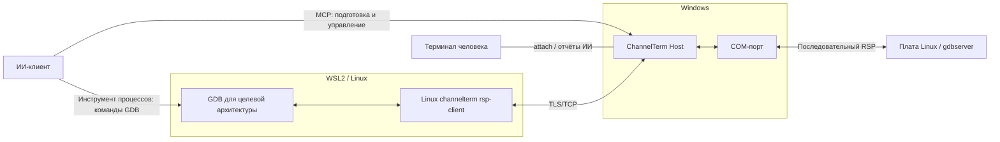
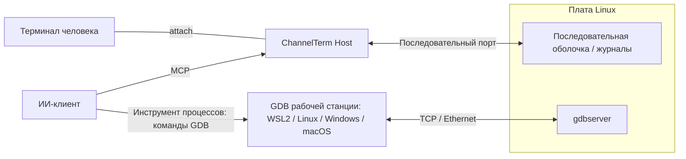

[English](README.md) | [Deutsch](README.de.md) | [Español](README.es.md) | [Français](README.fr.md) | [日本語](README.ja.md) | [한국어](README.ko.md) | [Русский](README.ru.md) | [简体中文](README.zh-CN.md) | [繁體中文](README.zh-TW.md)

# ChannelTerm

**Отлаживайте плату вместе с ИИ. Оставайтесь в том же терминале.**

ChannelTerm позволяет вам и ИИ-клиенту пользоваться одним реальным последовательным или SSH-терминалом. Читайте одинаковый вывод, следите за терминальными командами ИИ и управляйте платой по очереди. Программа работает в Windows, Linux и macOS и подключает внешних ИИ-клиентов через MCP.

С GDB ИИ может ставить точки останова, выполнять программы Linux по шагам и проверять переменные. Подключите последовательный порт в Windows и запустите GDB в WSL2 либо сохраните общую консоль, пока GDB использует Ethernet платы. [Выбрать схему отладки](#gdb-debugging).

> Это русскоязычная вводная страница. Источниками истины для поведения, параметров и совместимости
> являются английский [README](README.md), текущий исходный код и `channelterm --help`.

При коротком окне загрузки Host может прервать U-Boot и проверить приглашение. Для анализа сбоев экспортируйте диагностический ZIP с необязательным включением исходных байтов. [Работа с U-Boot и диагностикой](docs/getting-started/serial-terminal.md#enter-u-boot-and-export-evidence).

## Зачем нужен ChannelTerm?

Оставьте терминал открытым, пока ИИ использует то же соединение с устройством:

```text
                         +---- Human terminal
                         |
Serial device ---- Session
                         |
                         +---- AI / MCP client
```

Клиенты читают независимо: ИИ не расходует вывод, за которым вы следите. ChannelTerm показывает терминальные записи ИИ; для внешнего отладчика действуют отдельные [правила видимости](#gdb-debugging).

## Возможности

- **Общая консоль:** CLI человека и ИИ/MCP используют одну последовательную или SSH Session.
- **Наблюдение за работой:** команды терминала ИИ видны рядом с выводом устройства.
- **Отладка Linux:** управляемый GDB, последовательный мост или GDB по сети.
- **Передача файлов:** через общую последовательную Session с SHA-256 либо отдельные соединения SFTP/SCP.
- **Запуск через attach:** `channelterm attach` может автоматически создать локальный общий Host.

## Установка

Скачайте из [Releases](https://github.com/akira-init1/ChannelTerm/releases) архив для вашей ОС и
архитектуры и проверьте его по `SHA256SUMS` того же выпуска. Распакуйте архив и из полученного
каталога выполните `.\channelterm.exe install` в Windows или `./channelterm install` в Linux/macOS.
Для готовых бинарных файлов установка Go не требуется.

Для сборки из исходного кода требуется Go 1.26 или новее. Используйте поддерживаемый выпуск с
актуальными исправлениями и выполняйте сборку из корня репозитория:

```bash
git clone https://github.com/akira-init1/ChannelTerm.git
cd ChannelTerm
go build ./cmd/channelterm
./channelterm install
```

`install` копирует запущенный бинарный файл в стандартный каталог программ текущего пользователя,
создаёт команды `channelterm` и `cterm`, добавляет каталог в пользовательский PATH только при
необходимости и создаёт отсутствующую минимальную конфигурацию. Если PATH изменился, откройте новый
терминал. `channelterm uninstall` удаляет принадлежащие установщику команды и изменение PATH, но
сохраняет пользовательские данные. `channelterm uninstall --purge` требует явного подтверждения
перед удалением конфигурации, состояния устройств и локальных HTTP-учётных данных.

Поддерживаемые настольные цели: Windows, Linux и macOS на amd64/arm64. Подробнее:
[сборка и установка из исходного кода](docs/getting-started/build.md), полный контракт
[`install` / `uninstall`](docs/reference/cli.md#install-and-uninstall),
[расположения конфигурации](docs/reference/configuration.md) и
[сборка и тестирование](docs/development/building-and-testing.md).

## Быстрый старт: одна команда, один терминал

Выведите обнаруженные последовательные устройства, сохранённые Profile и, если доступен HTTP Host
по умолчанию, его Sessions:

```bash
channelterm list
```

Host может быть не запущен. Если он недоступен, `list` сообщает, что MCP offline, но продолжает
показывать локальные устройства и Profile.

Полный контракт параметров приведён в [справочнике CLI](docs/reference/cli.md#list).

Если к Session должен подключаться ИИ-клиент, один раз настройте поддерживаемый клиент перед
подключением:

```bash
channelterm init --mcp
```

Выберите HTTP или нажмите Enter, чтобы использовать HTTP по умолчанию. Конфигурация содержит
локальные учётные данные Bearer. Перезагрузите или перезапустите ИИ-клиент, если он не увидел
изменения сразу.

Затем выполните только команду для своей платформы:

```bash
# Windows
channelterm attach COM8 --baud 115200 --label board

# Linux
channelterm attach /dev/ttyUSB0 --baud 115200 --label board

# macOS
channelterm attach /dev/cu.usbserial-110 --baud 115200 --label board
```

Одна команда `attach` открывает последовательное устройство и подключает текущий терминал. Если на
стандартном endpoint ещё нет совместимого Host, команда автоматически запускает временный локальный
HTTP MCP Session Host. Типичный вывод при запуске:

```text
Shared Session created: SER-1 (0123456789abcdef0123456789abcdef)
[ChannelTerm] Temporary Session Host started; it and all shared Sessions stop when this attachment exits. Run 'channelterm mcp --transport http' separately for a persistent Host.
```

Для этого быстрого сценария не нужен отдельный терминал с MCP-сервером. Пока attachment открыт,
настроенный HTTP MCP-клиент может использовать `http://127.0.0.1:37099/mcp` и работать с той же
Session `SER-1`. Временный Host и все принадлежащие ему Sessions завершаются вместе с attachment,
который его создал. Используйте постоянный Host только тогда, когда Sessions должны продолжать
работать независимо от этого терминала.

`--label board` — необязательное отображаемое имя, а не идентификатор. Другим клиентам следует
использовать `SER-1` или полный непрозрачный ID Session.

### Частые сценарии

| Задача | Команда |
| --- | --- |
| Открыть общую последовательную Session и автоматически запустить временный Host | `channelterm attach COM8 --baud 115200` |
| Настроить поддерживаемый ИИ-клиент для общего HTTP Host | `channelterm init --mcp` |
| Оставить Host и Sessions работающими независимо от терминала | `channelterm mcp --transport http` |
| Вывести список или подключиться к существующей Session | `channelterm list --kind session`, затем `channelterm attach SER-1` |
| Открыть приватное последовательное соединение без MCP | `channelterm attach COM8 --private --baud 115200` |
| Наблюдать структурированные события Session | `channelterm events SER-1` |
| Открыть пошаговое меню передачи файлов в текущем общем attachment | Нажмите `Ctrl+]`, затем `f` |
| Отправить или получить данные через общую Session | `channelterm file send firmware.bin --session SER-1` или `channelterm file receive /tmp/log.txt ./log.txt --session SER-1` |

Постоянный Host — отдельный длительно работающий процесс. После сообщения
`MCP Streamable HTTP listening on http://127.0.0.1:37099/mcp` другие оболочки и настроенные
ИИ-клиенты могут создавать Sessions или подключаться к ним. Отсутствие последующего вывода —
нормальное поведение. Нажмите `Ctrl+C`, чтобы остановить Host и все его Sessions.

При обычной работе терминала, вне передачи файлов или управления отладчиком:

```text
Ctrl+C      Отправить 0x03 удалённому терминалу
Ctrl+] q    Выйти из этого CLI; принадлежащий ему временный Host также остановится
Ctrl+] ?    Показать локальную справку по escape-командам
```

Все локальные команды приведены в [справочнике CLI](docs/reference/cli.md#attach), а настройка клиентов и создание Sessions с помощью ИИ — в [руководстве MCP](docs/getting-started/mcp-server.md).

Чтобы получить переиспользуемые инструкции по workflow, установите встроенный
[Agent Skill `cterm-serial-debug`](docs/getting-started/mcp-server.md#install-the-bundled-agent-skill)
в клиенте с поддержкой Agent Skills. `channelterm init --mcp` настраивает MCP-клиенты,
но не устанавливает Skill.

HTTP Host требует Bearer token и по умолчанию слушает только loopback-адрес. Встроенные CLI-клиенты
автоматически читают token локального пользователя. Host также может
[слушать в доверенной локальной сети](docs/getting-started/mcp-server.md#listen-on-a-lan); удалённые
клиенты должны использовать доступный адрес Host и передавать тот же token в заголовке
`Authorization`. Не публикуйте endpoint в недоверенной сети без TLS и дополнительных средств
контроля сетевого доступа.

<a id="примеры-работы"></a>
<a id="отладка-встраиваемого-linux"></a>
<a id="ии-действует-человек-наблюдает"></a>
<a id="человек-вмешивается"></a>

## Общий терминал на практике

Подключённый CLI отображает команду агента как локальный блок активности `AI`. `terminal_exec` не добавляет эту команду в историю свободной оболочки Bash. Строки после блока остаются необработанным выводом терминала устройства; после освобождения кратковременной аренды команды человек снова может вводить данные:

```bash
root@board:~#

──────── AI ────────
[18:52:31] >> echo agent-check
────────────────────
agent-check
root@board:~# echo human-still-here
human-still-here
root@board:~#
```

Точный вывод команды зависит от подключённого устройства. Блок `AI` — локальное представление структурированных событий Session; он не вставляется ни в поток байтов устройства, ни в сохранённый терминальный вывод. Необработанные нажатия клавиш и интерактивные программы по-прежнему используют `terminal_write` и сохраняют обычное поведение истории устройства.

## Общая SSH-оболочка

Используйте авторизованный закрытый ключ или введите пароль по запросу. Для зашифрованного ключа запрашивается парольная фраза (ни она, ни пароль не сохраняются).
Для неизвестного сервера проверьте показанный отпечаток и введите `yes`, чтобы сохранить его открытый
ключ в `~/.ssh/known_hosts`; изменённые ключи отклоняются. Запросы требуют интерактивного терминала:

```bash
# Терминал 1: открыть оболочку, затем выполнить в ней uname -a.
channelterm ssh user@192.168.1.50

# Терминал 2: наблюдать и использовать ту же оболочку.
channelterm attach SSH-1
```

Оставьте первую команду работающей: при её завершении этот Host и его Sessions закрываются. Локальный порт по умолчанию должен быть свободен; для отдельного Host используйте `--listen` и показанный адрес attach. Пути ключей, проверка сервера, порты и текущие ограничения описаны в [руководстве SSH](docs/getting-started/ssh-terminal.md).

## Передача файлов по SSH

Используйте SFTP для передачи файлов и управления ими либо классический SCP для совместимых POSIX-серверов:

```bash
channelterm sftp user@192.168.1.50 ls /tmp
channelterm sftp user@192.168.1.50 put ./firmware.bin /tmp/firmware.bin
channelterm sftp user@192.168.1.50 get /tmp/log.txt ./log.txt
channelterm scp user@192.168.1.50 put ./release /tmp/release --recursive
```

Команды используют ту же аутентификацию по ключу/паролю и проверку сервера, что и SSH, но отдельное
соединение, независимое от терминальных Sessions. Для замены файлов нужен `--overwrite`.
Правила копирования каталогов, отмена и ограничения описаны в
[руководстве по передаче файлов](docs/getting-started/file-transfer.md#sftp-and-scp-over-ssh).

Передача файлов через общие терминальные Sessions использует небольшой протокол оболочки Linux.
Отдельные SSH-соединения для файлов используют SFTP или классический SCP.

<a id="ии-файлы-и-локальное-управление"></a>

## Передача файлов через общую Session

Та же общая последовательная Session может передавать обычные файлы и каталоги без ИИ-клиента и без отдельно устанавливаемого на плату агента передачи. В активном общем `attach` нажмите `Ctrl+]`, затем `f`, чтобы открыть пошаговое меню отправки/получения. Для каталогов используются стандартный tar и подтверждаемые блоки данных, позволяющие удобно отменять передачу. Те же операции доступны через команды:

```bash
channelterm file send firmware.bin --session SER-1
channelterm file receive /tmp/log.txt ./log.txt --session SER-1
channelterm file send ./build/release /tmp/release --session SER-1
channelterm file receive /var/log/myapp ./myapp --session SER-1
```

Для передачи нужны свободная оболочка Linux и утилиты из [руководства по передаче файлов](docs/getting-started/file-transfer.md). Проверяется SHA-256; вместо перезаписи существующего назначения выбирается новое имя. Во время передачи `Ctrl+C` в общем подключении запрашивает подтверждение отмены. Другие записи остаются заблокированными до завершения очистки и освобождения аренды.

<a id="gdb-debugging"></a>

## Удалённая отладка с GDB

Выберите путь от отладчика к программе Linux. Для каждого нужны совместимые с целью инструменты и соответствующие символы.

| Вариант | Соединение GDB | Консоль / Session при отладке |
| --- | --- | --- |
| [Последовательный мост](#gdb-serial-bridge) | GDB станции → ChannelTerm → порт платы; ниже пример Windows + WSL2 | Занята GDB до восстановления |
| [Консоль + TCP](#gdb-serial-tcp) | GDB станции → сеть платы; WSL2, Linux, Windows или macOS с совместимым GDB | Доступна для независимой работы с оболочкой/журналами |
| [Управляемый GDB/MI](docs/getting-started/gdb-debugging.md#managed-native-linux-prerequisites) | MCP управляет GDB; Host, оболочка, инструменты и ELF в одной нативной Linux-среде | Выбранная Session занята во время отладки |

<a id="gdb-serial-bridge"></a>

### Последовательный мост GDB: Windows + WSL2

**Windows подключает последовательный порт, WSL2 запускает GDB, ИИ координирует удалённую отладку.** Windows Host ChannelTerm держит открытыми COM-порт и общую Session. Совместимый с целью GDB в WSL2 подключается к Linux gdbserver платы через Linux-помощник `channelterm rsp-client` и аутентифицированный мост TLS/TCP.



Сохраните драйвер Windows и инструментарий Linux: последовательное устройство остаётся в Windows, а плате не нужен сетевой порт GDB.

1. В Windows настройте ИИ-клиент через `channelterm init --mcp` (HTTP) и подключите плату, например командой `channelterm attach COM8 --baud 115200`. Используйте подтверждённые параметры последовательного порта и оставьте владеющий Host запущенным.
2. Следуя [шагам подготовки](docs/getting-started/gdb-debugging.md#prepare-and-open), сохраните состояние TTY, подготовьте совместимый `gdbserver --once stdio` на плате и вызовите `debug_bridge_start` через MCP. Для запуска GDB в WSL2 ИИ также нужен инструмент выполнения процессов.
3. В WSL2 используйте Linux-версию ChannelTerm, совместимый GDB и соответствующий ELF. Сохраните секретный дескриптор соединения как `bridge.json` в файловой системе WSL (`chmod 600`). Сеть и пути описаны в [руководстве WSL2](docs/getting-started/gdb-debugging.md#connect-independent-gdb-from-wsl2). Замените путь к файлу ниже:

```text
(gdb) target remote | channelterm rsp-client --connection /home/EXAMPLE/private/bridge.json
(gdb) break main
(gdb) continue
(gdb) next
(gdb) backtrace
(gdb) detach
```

4. В Windows команды `channelterm gdb-list` и `channelterm gdb-list --json` показывают порты и состояния мостов. После GDB detach убедитесь, что плата вернулась в оболочку, и вызовите `debug_bridge_restore` с сохранённым состоянием TTY, чтобы продолжить работу с общим терминалом.

Для этого последовательного моста ИИ может публиковать реальные команды и наблюдения в подключённом терминале через `debug_bridge_report`. Записи явно отмечены как отчёты ИИ, а не полная автоматическая стенограмма GDB.

<a id="gdb-serial-tcp"></a>

### Общая последовательная консоль + GDB по Ethernet

Последовательная консоль остаётся доступной для общих журналов и команд оболочки, пока GDB использует сеть. Последовательный Host и GDB могут работать на одном или разных компьютерах; драйверы и целевой инструментарий выбираются независимо.



Чтобы продолжать ввод команд в последовательной оболочке, запускайте gdbserver независимо от неё. Загрузите соответствующий ELF в GDB и подключитесь через ограниченную сеть, как показано ниже (замените `TARGET_IP` и порт). Запуск цели, ввод/вывод программы и туннели SSH описаны в [процедуре консоль + TCP](docs/getting-started/gdb-debugging.md#shared-serial-console-with-tcp-gdb).

```text
(gdb) target remote TARGET_IP:2345
```

Этот TCP-путь подключается непосредственно к gdbserver без `rsp-client` и `debug_bridge_*`. Человек и ИИ видят общую последовательную активность; команды и результаты внешнего GDB остаются в выводе отладчика и не копируются автоматически в последовательный терминал.

CI проверяет управляемый GDB/MI и внешний мост с настоящими GDB/gdbserver на Linux PTY. Настройка, совместимость, варианты SSH и восстановление описаны в [полной процедуре](docs/getting-started/gdb-debugging.md).

## Как это работает

```text
Human CLI -----+
               +--> Session Host --> Session <--> Channel <--> Serial / SSH endpoint
AI via MCP ----+                         |
                                        +-- retained output, activity, events
                                        `-- serialized writes
```

Session Host владеет соединениями и управляет временем жизни Sessions. Serial или SSH Transport устанавливает независимый от протокола Channel; Session читает этот Channel, хранит ограниченный объём вывода, активности и событий в памяти и сериализует записи. Адаптеры CLI и MCP используют одно и то же поведение Core. Оформление, включая подсветку и блок активности `AI`, не изменяет сохранённые терминальные данные.

У читателей независимые курсоры. Записи необработанных данных сериализуются, но смысл команд оболочки не координируется. Аренды уровня приложения временно блокируют других писателей во время команд, передачи файлов и отладки. Владение и параллельная работа описаны в [общих Sessions](docs/getting-started/shared-session.md).

Общие ссылки вроде `SER-1` действуют только внутри процесса Host, которому принадлежат. Остановка Host закрывает его Sessions. Дополнительное подключение может завершиться независимо, но завершение подключения с собственным временным Host или владеющей команды SSH также закрывает их Sessions. Границы слоёв описаны в [обзоре архитектуры](docs/architecture/overview.md).

## Конфигурация

`config.toml` содержит управляемые пользователем последовательные профили и политику подключения.
`state.json` — состояние идентификации устройств, которым управляет ChannelTerm. `http-auth-token` —
секрет для аутентификации HTTP MCP-клиентов; не публикуйте его и не добавляйте в коммиты.

```powershell
# Сохранить и повторно использовать последовательный профиль.
channelterm serial --port COM8 --baud 115200 --save board
channelterm serial --profile board

# Использовать другой config.toml для этой операции.
channelterm serial --config ./channelterm.toml --profile board
```

Часто используемые параметры: `--profile`, `--save`, `--config`, `--port` и `--baud`. MCP Host также
поддерживает `--connection-policy ask|auto|deny`. Параметр `--config` меняет только выбранный
`config.toml`, но не стандартные `state.json` и `http-auth-token`. См. руководство по
[последовательным профилям](docs/getting-started/serial-profiles.md) и
[справочник по конфигурации](docs/reference/configuration.md).

## Документация

- [Индекс документации](docs/README.md)
- [Работа с последовательным терминалом](docs/getting-started/serial-terminal.md)
- [Работа с SSH-оболочкой](docs/getting-started/ssh-terminal.md)
- [Совместное использование Session](docs/getting-started/shared-session.md)
- [Передача файлов](docs/getting-started/file-transfer.md)
- [MCP-сервер](docs/getting-started/mcp-server.md)
- [Рабочий процесс отладки GDB](docs/getting-started/gdb-debugging.md)
- [Справочник CLI](docs/reference/cli.md)
- [Справочник инструментов MCP](docs/reference/mcp-tools.md)
- [Идентификаторы и ссылки](docs/reference/identifiers.md)
- [Обзор архитектуры](docs/architecture/overview.md)

Точные флаги команд и значения по умолчанию определяются выводом `--help` запущенной программы.

## Планы развития

Последовательные подключения и SSH PTY shell реализованы как Transports; также доступны отдельные файловые клиенты SFTP и традиционного SCP. Произвольный SSH exec, Telnet и более строгая координация нескольких писателей остаются направлениями развития, а не реализованными возможностями или обещаниями выпуска.

Сейчас ChannelTerm не реализует JTAG/OpenOCD, виртуальные последовательные устройства, встроенный ИИ или оркестрацию нескольких агентов.

## Лицензия

ChannelTerm распространяется по [лицензии Apache 2.0](LICENSE).
