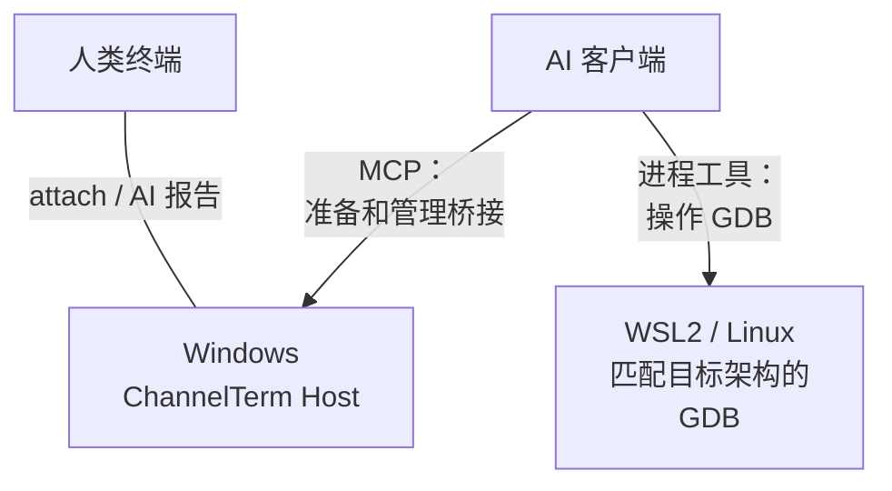
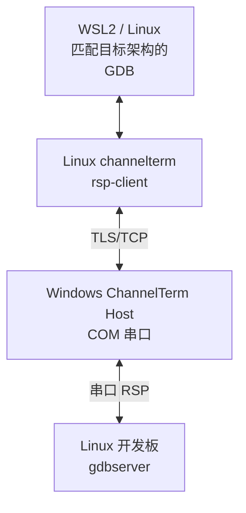
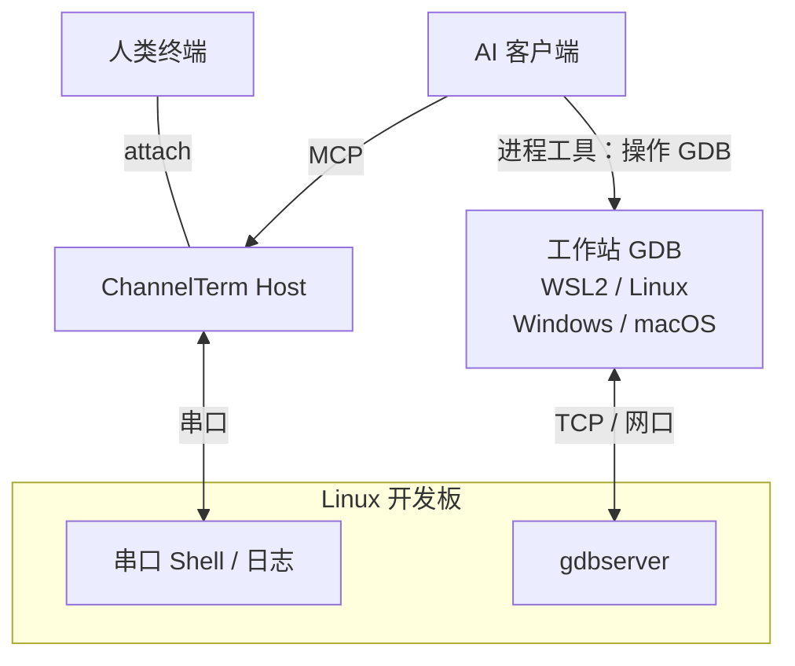

[English](README.md) | [Deutsch](README.de.md) | [Español](README.es.md) | [Français](README.fr.md) | [日本語](README.ja.md) | [한국어](README.ko.md) | [Русский](README.ru.md) | [简体中文](README.zh-CN.md) | [繁體中文](README.zh-TW.md)

# ChannelTerm

**让 AI 帮你调试开发板，你始终在同一个终端里。**

ChannelTerm 让你和 AI 客户端共享真实的串口或 SSH 终端：读取同一份设备输出、看到 AI 的终端命令，并轮流操作开发板。支持 Windows、Linux 和 macOS，通过 MCP 接入外部 AI 客户端。

也可以让 AI 使用 GDB 设置断点、单步执行 Linux 程序、检查变量。Windows 连串口、WSL2 跑 GDB；或者保留共享串口控制台，让 GDB 走开发板网口。[选择调试方案](#gdb-debugging)。

> 本文是简体中文入口。行为、参数和兼容性以英文 [README](README.md)、当前源码及
> `channelterm --help` 为准。

对于短暂的启动窗口，可由 Host 打断 U-Boot 并确认提示符。排查失败时可导出诊断 ZIP，按需包含原始字节。[U-Boot 与诊断操作流程](docs/getting-started/serial-terminal.md#enter-u-boot-and-export-evidence)。

## 为什么使用 ChannelTerm？

保持终端连接，让 AI 使用同一条设备连接协助操作：

```text
                         +---- Human terminal
                         |
Serial device ---- Session
                         |
                         +---- AI / MCP client
```

各客户端独立读取输出，AI 的读取不会消耗你正在看的数据。ChannelTerm 会在已连接终端中显示 AI 的终端写入；外部调试器输出的[显示范围](#gdb-debugging)另有说明。

## 支持的能力

- **共享控制台：**人类 CLI 与 AI/MCP 客户端共用一个串口或 SSH Session。
- **跟随操作：**在设备输出旁看到 AI 执行的终端命令。
- **调试 Linux 程序：**支持托管 GDB、串口桥接或网口 GDB 流程。
- **传输文件：**通过共享串口 Session 传输并校验 SHA-256，也可使用独立的 SFTP/SCP 连接。
- **一条命令接入：**`channelterm attach` 可自动创建本地共享 Host。

## 安装

从 [Releases](https://github.com/akira-init1/ChannelTerm/releases) 下载与你的操作系统和架构匹配的
压缩包，并与同一版本的 `SHA256SUMS` 核对。解压后，在解压目录中运行
`.\channelterm.exe install`（Windows）或 `./channelterm install`（Linux/macOS）。
使用预编译程序无需安装 Go。

从源码构建需要 Go 1.26 或更高版本。请使用当前仍受支持的补丁版本，然后在仓库根目录构建：

```bash
git clone https://github.com/akira-init1/ChannelTerm.git
cd ChannelTerm
go build ./cmd/channelterm
./channelterm install
```

`install` 会把当前运行的二进制复制到当前用户的标准程序目录，创建 `channelterm` 和 `cterm`
命令，仅在必要时把该目录加入用户 PATH，并在缺少配置时初始化最小配置。若命令提示 PATH 已更改，
请打开新终端。`channelterm uninstall` 会删除安装器管理的命令和 PATH 修改，但保留用户数据；
`channelterm uninstall --purge` 必须明确确认后才会删除配置、设备状态和本地 HTTP 认证信息。

支持的桌面目标为 Windows、Linux、macOS 的 amd64/arm64。详见
[从源码构建并安装](docs/getting-started/build.md)、
[`install` / `uninstall` 完整契约](docs/reference/cli.md#install-and-uninstall)、
[配置位置](docs/reference/configuration.md)和[构建与测试](docs/development/building-and-testing.md)。

## 快速开始：一条命令，一个终端

列出检测到的串口设备、已保存的 Profile，以及默认 HTTP Host 可用时其中的 Session：

```bash
channelterm list
```

Host 不必处于运行状态。如果无法连接，`list` 会将 MCP 报告为 offline，同时继续显示本机设备和
Profile。

完整参数契约见 [CLI 参考](docs/reference/cli.md#list)。

如果需要 AI 客户端加入 Session，请在接入前为受支持的客户端执行一次配置：

```bash
channelterm init --mcp
```

选择 HTTP，或直接按回车采用默认的 HTTP。配置中包含本机 Bearer 凭据；如果 AI 客户端没有立即
读取新配置，请重新加载或重启客户端。

然后只执行当前平台对应的一条命令：

```bash
# Windows
channelterm attach COM8 --baud 115200 --label board

# Linux
channelterm attach /dev/ttyUSB0 --baud 115200 --label board

# macOS
channelterm attach /dev/cu.usbserial-110 --baud 115200 --label board
```

这一条 `attach` 命令会打开串口并让当前终端接入。如果默认端点没有兼容的 Host，它还会自动
启动一个临时的本机 HTTP MCP Session Host。典型输出如下：

```text
Shared Session created: SER-1 (0123456789abcdef0123456789abcdef)
[ChannelTerm] Temporary Session Host started; it and all shared Sessions stop when this attachment exits. Run 'channelterm mcp --transport http' separately for a persistent Host.
```

快速使用时不需要另外打开一个终端运行 MCP 服务器。只要这个附件保持运行，已配置的 HTTP MCP
客户端就能通过 `http://127.0.0.1:37099/mcp` 操作同一个 `SER-1`。创建临时 Host 的附件退出后，
该 Host 及其全部 Session 都会停止。只有当 Session 必须独立于当前终端继续存在时，才需要单独
运行持久 Host。

`--label board` 只是可选显示名称，不是标识符。其他客户端应使用 `SER-1` 或完整 Session ID。

### 常用玩法

| 目标 | 命令 |
| --- | --- |
| 打开共享串口 Session，并自动启动临时 Host | `channelterm attach COM8 --baud 115200` |
| 为受支持的 AI 客户端配置共享 HTTP Host | `channelterm init --mcp` |
| 让 Host 和 Session 独立持续运行 | `channelterm mcp --transport http` |
| 列出或加入已有 Session | `channelterm list --kind session`，然后执行 `channelterm attach SER-1` |
| 打开不通过 MCP 共享的私有串口 | `channelterm attach COM8 --private --baud 115200` |
| 观察结构化 Session 活动 | `channelterm events SER-1` |
| 在当前共享附件中打开引导式文件传输菜单 | 先按 `Ctrl+]`，再按 `f` |
| 通过共享 Session 发送或接收文件 | `channelterm file send firmware.bin --session SER-1` 或 `channelterm file receive /tmp/log.txt ./log.txt --session SER-1` |

持久 Host 是一个单独长期运行的进程。它显示
`MCP Streamable HTTP listening on http://127.0.0.1:37099/mcp` 后，其他 Shell 和已配置的 AI
客户端就可以创建或加入 Session。就绪提示之后没有输出是正常现象；需要关闭 Host 及其全部
Session 时按 `Ctrl+C`。

普通终端操作期间（未处于文件传输或调试接管状态）：

```text
Ctrl+C      向远端终端发送 0x03
Ctrl+] q    退出当前 CLI；若它拥有临时 Host，该 Host 也会停止
Ctrl+] ?    显示本地转义帮助
```

完整本地快捷键见 [CLI 参考](docs/reference/cli.md#attach)；客户端配置和由 AI 创建 Session 的流程见 [MCP 使用流程](docs/getting-started/mcp-server.md)。

如需获得可复用的工作流指导，请在支持 Agent Skills 的客户端中安装仓库内置的
[`cterm-serial-debug` Agent Skill](docs/getting-started/mcp-server.md#install-the-bundled-agent-skill)。
`channelterm init --mcp` 只配置 MCP 客户端，不会安装 Skill。

HTTP Host 需要 Bearer token，默认只监听回环地址。内置 CLI 会读取本机用户 token；它也可以
[监听受信任的局域网](docs/getting-started/mcp-server.md#listen-on-a-lan)，远程客户端必须使用 Host
可达的局域网地址，并通过 `Authorization` 请求头发送相同的 token。不要把未经 TLS 和额外网络
访问控制保护的端点直接暴露到不可信网络。

<a id="使用场景"></a>
<a id="嵌入式-linux-调试"></a>
<a id="ai-操作人类观察"></a>
<a id="人类介入"></a>

## 共享终端实际示例

已连接的 CLI 会把 Agent 命令显示为本地 `AI` 活动块。`terminal_exec` 不会将该命令写入空闲 Bash 提示符的历史记录；活动块之后的内容仍是设备的原始终端输出，短期命令租约释放后，人类即可继续输入：

```bash
root@board:~#

──────── AI ────────
[18:52:31] >> echo agent-check
────────────────────
agent-check
root@board:~# echo human-still-here
human-still-here
root@board:~#
```

命令的具体输出取决于所连接的设备。`AI` 活动块是根据结构化 Session 事件生成的本地显示，不会插入设备字节流或存储的终端输出。原始按键和交互程序仍使用 `terminal_write`，保留设备原本的历史记录行为。

## 共享 SSH shell

使用已授权的私钥（加密私钥会提示输入口令），或按提示输入登录密码，两者均不保存。首次连接未知服务器时，核验显示的指纹后输入
`yes`，将服务器公钥保存到 `~/.ssh/known_hosts`；已知服务器的密钥发生变化时拒绝连接。交互提示需要真实终端：

```bash
# 终端 1：打开 shell，在远端提示符下运行 uname -a。
channelterm ssh user@192.168.1.50

# 终端 2：查看并使用同一个 shell。
channelterm attach SSH-1
```

保持第一个命令运行；退出它会关闭该 Host 及其 Session。默认本机共享端口必须空闲；如已占用，可用 `--listen` 指定另一个 Host，并使用输出中的 attach endpoint。私钥路径、主机校验、端口和当前限制见 [SSH 使用流程](docs/getting-started/ssh-terminal.md)。

## 通过 SSH 传输文件

使用 SFTP 传输和管理远端文件，或使用传统 SCP 连接兼容的 POSIX 服务器：

```bash
channelterm sftp user@192.168.1.50 ls /tmp
channelterm sftp user@192.168.1.50 put ./firmware.bin /tmp/firmware.bin
channelterm sftp user@192.168.1.50 get /tmp/log.txt ./log.txt
channelterm scp user@192.168.1.50 put ./release /tmp/release --recursive
```

这些命令复用 SSH 的密钥/密码认证与主机校验，使用独立连接，不占用终端 Session。
覆盖已有文件需要 `--overwrite`。目录规则、取消行为和协议限制见
[文件传输](docs/getting-started/file-transfer.md#sftp-and-scp-over-ssh)。

通过共享终端 Session 传输文件使用轻量的 Linux-shell 协议。独立 SSH 文件连接使用 SFTP 或传统 SCP。

<a id="ai文件与本地控制"></a>

## 通过共享 Session 传输文件

同一个共享串口 Session 也可以传输普通文件和目录，无需 AI 客户端，也无需在板端另行安装传输代理。在正在运行的共享 `attach` 中，先按 `Ctrl+]`，再按 `f`，即可打开引导式发送/接收菜单。目录传输使用标准 tar 和带确认、便于取消的数据分块；同样的操作也可通过命令完成：

```bash
channelterm file send firmware.bin --session SER-1
channelterm file receive /tmp/log.txt ./log.txt --session SER-1
channelterm file send ./build/release /tmp/release --session SER-1
channelterm file receive /var/log/myapp ./myapp --session SER-1
```

传输需要空闲的 Linux shell，以及[文件传输流程](docs/getting-started/file-transfer.md)列出的工具。传输会校验 SHA-256，并选择新名称以避免覆盖已有目标。传输期间，在共享附件中按 `Ctrl+C` 会询问是否取消；清理完成并释放租约前，其他写入者仍被阻止。

<a id="gdb-debugging"></a>

## 使用 GDB 远程调试

按调试器到 Linux 程序的连接方式选择方案。各方案均需使用兼容目标的工具和匹配的符号。

| 方案 | GDB 连接路径 | 调试时的控制台／Session |
| --- | --- | --- |
| [串口桥接](#gdb-serial-bridge) | 工作站 GDB → ChannelTerm → 板端串口；下方以 Windows + WSL2 为例 | 由 GDB 占用，恢复后继续使用 |
| [串口控制台 + TCP](#gdb-serial-tcp) | 工作站 GDB → 板端网口；WSL2、Linux、Windows、macOS 均可使用兼容的 GDB | 可继续进行独立的 shell／日志操作 |
| [托管 GDB/MI](docs/getting-started/gdb-debugging.md#managed-native-linux-prerequisites) | MCP 工具控制 GDB；Host、shell、工具和 ELF 须在同一原生 Linux 环境 | 所选 Session 在调试期间被占用 |

<a id="gdb-serial-bridge"></a>

### 串口 GDB 桥接：Windows + WSL2

**Windows 连串口，WSL2 跑 GDB，AI 协调远程调试。** Windows 上的 ChannelTerm Host 持有 COM 口和共享 Session；WSL2 中支持目标架构的 GDB，通过 Linux 版 `channelterm rsp-client` 和认证的 TLS/TCP 桥接，连接板端 Linux gdbserver。

**控制与观察**



**RSP 数据通路**



继续使用 Windows 串口驱动和 Linux 工具链：串口设备留在 Windows，板端也无需开放网络 GDB 端口。

1. 在 Windows 上运行 `channelterm init --mcp` 配置 AI 客户端（选择 HTTP），再连接开发板，例如 `channelterm attach COM8 --baud 115200`。串口参数以开发板实际配置为准，并保持所属 Host 运行。
2. 按[桥接准备步骤](docs/getting-started/gdb-debugging.md#prepare-and-open)保存 TTY 状态，在板端准备兼容的 `gdbserver --once stdio`，再通过 MCP 调用 `debug_bridge_start`。AI 还需要进程执行工具，才能在 WSL2 中运行 GDB。
3. 在 WSL2 中使用 Linux 版 ChannelTerm、兼容目标的 GDB 和匹配的 ELF。将私密连接描述保存为 WSL 文件系统中的 `bridge.json`（`chmod 600`）。网络和路径配置见 [WSL2 指南](docs/getting-started/gdb-debugging.md#connect-independent-gdb-from-wsl2)。请替换下方文件路径：

```text
(gdb) target remote | channelterm rsp-client --connection /home/EXAMPLE/private/bridge.json
(gdb) break main
(gdb) continue
(gdb) next
(gdb) backtrace
(gdb) detach
```

4. 在 Windows 上用 `channelterm gdb-list` 或 `channelterm gdb-list --json` 查看桥接端口与状态。GDB detach 后，确认板端已返回 shell，再携带保存的 TTY 状态调用 `debug_bridge_restore`，恢复共享终端使用。

使用此串口桥接时，AI 可通过 `debug_bridge_report` 将实际执行的命令和观察结果报告到已连接终端，方便你跟随调试。这些内容明确标记为 AI 报告，并非完整的 GDB 自动操作记录。

<a id="gdb-serial-tcp"></a>

### 共享串口控制台 + 网口 GDB 调试

串口供人和 AI 共享日志与 shell 操作，GDB 调试数据使用网口传输。串口 Host 与 GDB 可以在同一台电脑，也可以在不同电脑上，串口驱动与目标工具链可按各自环境选择。



如果需要继续在串口 shell 中执行命令，请让 gdbserver 独立于该交互 shell 运行。在工作站 GDB 中加载匹配的 ELF，再通过受限网络按下面的示例连接（替换 `TARGET_IP` 和端口）。板端启动、程序输入输出及 SSH 隧道配置详见[串口控制台 + TCP 流程](docs/getting-started/gdb-debugging.md#shared-serial-console-with-tcp-gdb)。

```text
(gdb) target remote TARGET_IP:2345
```

这条 TCP 路径直接连接 gdbserver，不使用 `rsp-client` 或 `debug_bridge_*`。人和 AI 都能看到共享串口活动；外部 GDB 的命令和结果保留在调试器自身输出中，不会自动同步到串口窗口。

CI 使用真实 GDB/gdbserver 验证 Linux PTY 上的托管 GDB/MI 和外部桥接。配置、兼容性、SSH 方案和恢复步骤见[完整流程](docs/getting-started/gdb-debugging.md)。

## 工作原理

```text
Human CLI -----+
               +--> Session Host --> Session <--> Channel <--> Serial / SSH endpoint
AI via MCP ----+                         |
                                        +-- retained output, activity, events
                                        `-- serialized writes
```

Session Host 拥有连接并管理 Session 生命周期。Serial 或 SSH Transport 建立协议无关的 Channel；Session 读取该 Channel，在内存中保留有界的输出、活动和事件，并串行化写入。CLI 与 MCP 适配器复用相同的 Core 行为。高亮和 `AI` 活动块等显示处理不会改变存储的终端原始数据。

读取者拥有独立游标。原始写入会串行化，但不会协调 shell 命令的语义；应用层租约会在命令执行、文件传输和调试期间暂时阻止其他写入者。所有权和并发规则见[共享 Session](docs/getting-started/shared-session.md)。

`SER-1` 等共享引用仅在所属 Host 进程内有效。停止 Host 会关闭其 Sessions。后来加入的连接可以单独退出，但退出拥有临时 Host 的连接或创建 Host 的 SSH 命令时，也会关闭其 Sessions。各层职责见[架构概览](docs/architecture/overview.md)。

## 配置

`config.toml` 保存用户维护的串口 Profile 和连接策略；`state.json` 是 ChannelTerm 自动维护的
设备身份状态；`http-auth-token` 是 MCP HTTP 客户端的认证密钥，请勿分享或提交。

```powershell
# 保存并复用串口 Profile。
channelterm serial --port COM8 --baud 115200 --save board
channelterm serial --profile board

# 本次操作使用另一个 config.toml。
channelterm serial --config ./channelterm.toml --profile board
```

常用参数包括 `--profile`、`--save`、`--config`、`--port` 和 `--baud`；MCP Host 还支持
`--connection-policy ask|auto|deny`。`--config` 只替换所选的 `config.toml`，不会移动默认的
`state.json` 或 `http-auth-token`。完整字段、优先级、校验和持久化行为见
[串口 Profile](docs/getting-started/serial-profiles.md)和[配置参考](docs/reference/configuration.md)。

## 文档

- [文档索引](docs/README.md)
- [Electron GUI 原型与开发](docs/development/electron-gui.md) — 自动连接或启动默认本机 Host，直接在 GUI 中创建串口和 SSH 会话。 支持浏览设备目录、串口双向传输文件及文件夹，并显示 GUI 进度。
- [串口终端流程](docs/getting-started/serial-terminal.md)
- [SSH shell 使用流程](docs/getting-started/ssh-terminal.md)
- [共享 Session](docs/getting-started/shared-session.md)
- [文件传输流程](docs/getting-started/file-transfer.md)
- [MCP Server](docs/getting-started/mcp-server.md)
- [GDB 调试流程](docs/getting-started/gdb-debugging.md)
- [CLI 参考](docs/reference/cli.md)
- [MCP 工具参考](docs/reference/mcp-tools.md)
- [标识符与引用](docs/reference/identifiers.md)
- [架构概览](docs/architecture/overview.md)

准确的命令参数及默认值以运行程序的 `--help` 输出为准。

## 路线图

串口与 SSH PTY shell 已实现为 Transport；专用 SFTP 和传统 SCP 文件客户端也已提供。任意 SSH exec、Telnet 和更强的多写入者协调仍是未来方向，不属于已实现功能或版本承诺。

ChannelTerm 目前尚未实现 JTAG/OpenOCD、虚拟串口设备、内置 AI 或多 Agent 编排。

## 许可

ChannelTerm 使用 [Apache License 2.0](LICENSE)。
