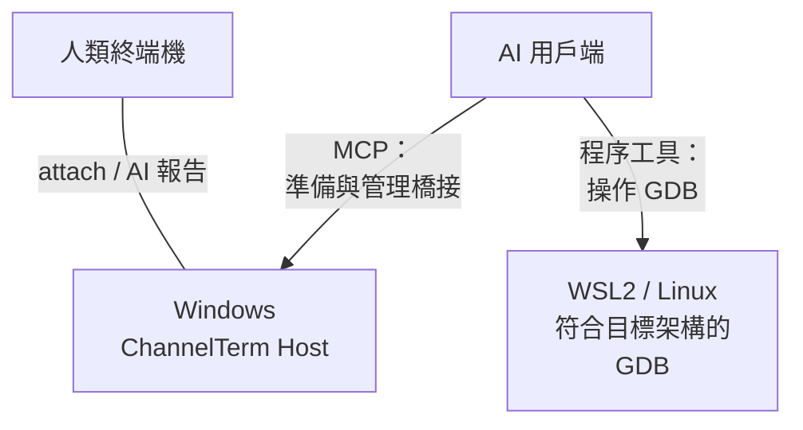
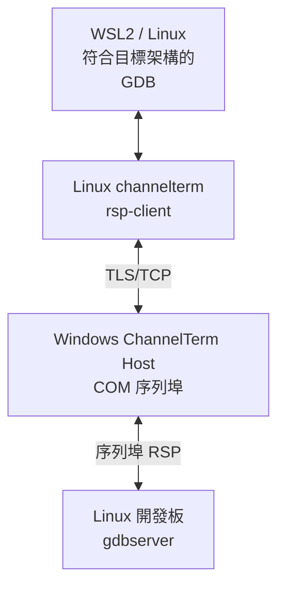
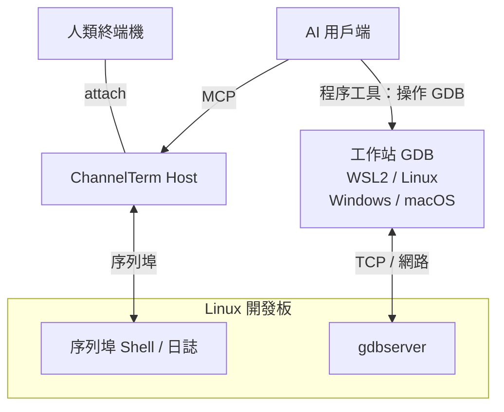

[English](README.md) | [Deutsch](README.de.md) | [Español](README.es.md) | [Français](README.fr.md) | [日本語](README.ja.md) | [한국어](README.ko.md) | [Русский](README.ru.md) | [简体中文](README.zh-CN.md) | [繁體中文](README.zh-TW.md)

# ChannelTerm

**讓 AI 幫你除錯開發板，你始終在同一個終端機裡。**

ChannelTerm 讓你與 AI 用戶端共享真實的序列埠或 SSH 終端機：讀取相同的裝置輸出、查看 AI 的終端機命令，並輪流操作開發板。支援 Windows、Linux 與 macOS，透過 MCP 接入外部 AI 用戶端。

也可以讓 AI 使用 GDB 設定中斷點、逐步執行 Linux 程式、檢查變數。Windows 連序列埠、WSL2 跑 GDB；或保留共享序列埠主控台，讓 GDB 走開發板網路。[選擇除錯方案](#gdb-debugging)。

> 本文是繁體中文入口。行為、參數與相容性以英文 [README](README.md)、目前原始碼及
> `channelterm --help` 為準。

對於短暫的啟動視窗，可由 Host 中斷 U-Boot 並確認提示符。排查失敗時可匯出診斷 ZIP，按需包含原始位元組。[U-Boot 與診斷操作流程](docs/getting-started/serial-terminal.md#enter-u-boot-and-export-evidence)。

## 為什麼使用 ChannelTerm？

保持終端機連線，讓 AI 使用同一條裝置連線協助操作：

```text
                         +---- Human terminal
                         |
Serial device ---- Session
                         |
                         +---- AI / MCP client
```

各用戶端獨立讀取輸出，AI 的讀取不會消耗你正在看的資料。ChannelTerm 會在已連接終端機中顯示 AI 的終端機寫入；外部除錯器輸出的[顯示範圍](#gdb-debugging)另有說明。

## 支援的能力

- **共享主控台：**人類 CLI 與 AI/MCP 用戶端共用一個序列埠或 SSH Session。
- **跟隨操作：**在裝置輸出旁看到 AI 執行的終端機命令。
- **除錯 Linux 程式：**支援託管 GDB、序列埠橋接或網路 GDB 流程。
- **傳輸檔案：**透過共享序列埠 Session 傳輸並驗證 SHA-256，也可使用獨立的 SFTP/SCP 連線。
- **一條命令接入：**`channelterm attach` 可自動建立本機共享 Host。

## 安裝

從 [Releases](https://github.com/akira-init1/ChannelTerm/releases) 下載符合你的作業系統與架構的
壓縮檔，並與同一版本的 `SHA256SUMS` 核對。解壓縮後，在解壓縮目錄中執行
`.\channelterm.exe install`（Windows）或 `./channelterm install`（Linux/macOS）。
使用預先編譯的程式無需安裝 Go。

從原始碼建置需要 Go 1.26 或更新版本。請使用目前仍受支援的修補版本，然後在儲存庫根目錄建置：

```bash
git clone https://github.com/akira-init1/ChannelTerm.git
cd ChannelTerm
go build ./cmd/channelterm
./channelterm install
```

`install` 會將目前執行的二進位檔複製到目前使用者的標準程式目錄，建立 `channelterm` 與 `cterm`
命令，只在需要時將該目錄加入使用者 PATH，並在缺少設定時初始化最小設定。若命令提示 PATH 已變更，
請開啟新的終端機。`channelterm uninstall` 會刪除安裝器管理的命令與 PATH 變更，但保留使用者資料；
`channelterm uninstall --purge` 必須明確確認後才會刪除設定、裝置狀態與本機 HTTP 驗證資訊。

支援的桌面目標為 Windows、Linux、macOS 的 amd64/arm64。詳見
[從原始碼建置並安裝](docs/getting-started/build.md)、
[`install` / `uninstall` 完整契約](docs/reference/cli.md#install-and-uninstall)、
[設定位置](docs/reference/configuration.md)與[建置及測試](docs/development/building-and-testing.md)。

## 快速開始：一條命令，一個終端機

列出偵測到的序列埠裝置、已儲存的 Profile，以及預設 HTTP Host 可用時其中的 Session：

```bash
channelterm list
```

Host 不必處於執行狀態。若無法連線，`list` 會將 MCP 回報為 offline，同時繼續顯示本機裝置與
Profile。

完整參數契約請參閱 [CLI 參考](docs/reference/cli.md#list)。

若需要 AI 用戶端加入 Session，請在連入前為支援的用戶端執行一次設定：

```bash
channelterm init --mcp
```

選擇 HTTP，或直接按 Enter 採用預設的 HTTP。設定包含本機 Bearer 憑證；若 AI 用戶端沒有立即
讀取新設定，請重新載入或啟動用戶端。

接著只執行目前平台對應的一條命令：

```bash
# Windows
channelterm attach COM8 --baud 115200 --label board

# Linux
channelterm attach /dev/ttyUSB0 --baud 115200 --label board

# macOS
channelterm attach /dev/cu.usbserial-110 --baud 115200 --label board
```

這一條 `attach` 命令會開啟序列埠並讓目前終端機連入。如果預設端點沒有相容的 Host，它也會
自動啟動暫時的本機 HTTP MCP Session Host。典型輸出如下：

```text
Shared Session created: SER-1 (0123456789abcdef0123456789abcdef)
[ChannelTerm] Temporary Session Host started; it and all shared Sessions stop when this attachment exits. Run 'channelterm mcp --transport http' separately for a persistent Host.
```

快速使用時不必另外開一個終端機執行 MCP 伺服器。只要此附件保持執行，已設定的 HTTP MCP 用戶端
即可透過 `http://127.0.0.1:37099/mcp` 操作同一個 `SER-1`。建立暫時 Host 的附件離開後，該 Host
與其所有 Session 都會停止。只有 Session 必須獨立於目前終端機持續存在時，才需要另外執行持久
Host。

`--label board` 只是選用顯示名稱，不是識別碼。其他用戶端應使用 `SER-1` 或完整 Session ID。

### 常用方式

| 目標 | 命令 |
| --- | --- |
| 開啟共用序列埠 Session，並自動啟動暫時 Host | `channelterm attach COM8 --baud 115200` |
| 為支援的 AI 用戶端設定共用 HTTP Host | `channelterm init --mcp` |
| 讓 Host 與 Session 獨立持續執行 | `channelterm mcp --transport http` |
| 列出或加入既有 Session | `channelterm list --kind session`，接著執行 `channelterm attach SER-1` |
| 開啟不透過 MCP 共用的私有序列埠 | `channelterm attach COM8 --private --baud 115200` |
| 觀察結構化 Session 活動 | `channelterm events SER-1` |
| 在目前共用附件中開啟引導式檔案傳輸選單 | 先按 `Ctrl+]`，再按 `f` |
| 透過共用 Session 傳送或接收檔案 | `channelterm file send firmware.bin --session SER-1` 或 `channelterm file receive /tmp/log.txt ./log.txt --session SER-1` |

持久 Host 是獨立且長時間執行的程序。它顯示
`MCP Streamable HTTP listening on http://127.0.0.1:37099/mcp` 後，其他 Shell 與已設定的 AI
用戶端即可建立或加入 Session。就緒訊息之後沒有輸出是正常現象；需要關閉 Host 及其所有
Session 時按 `Ctrl+C`。

一般終端機操作期間（未處於檔案傳輸或除錯接管狀態）：

```text
Ctrl+C      將 0x03 傳送到遠端終端
Ctrl+] q    離開目前 CLI；若它擁有暫時 Host，該 Host 也會停止
Ctrl+] ?    顯示本機跳脫說明
```

完整本機快捷鍵見 [CLI 參考](docs/reference/cli.md#attach)；用戶端設定與由 AI 建立 Session 的流程見 [MCP 使用流程](docs/getting-started/mcp-server.md)。

若要取得可重複使用的工作流程指引，請在支援 Agent Skills 的客戶端中安裝儲存庫內附的
[`cterm-serial-debug` Agent Skill](docs/getting-started/mcp-server.md#install-the-bundled-agent-skill)。
`channelterm init --mcp` 只會設定 MCP 客戶端，不會安裝 Skill。

HTTP Host 需要 Bearer token，預設僅監聽回環位址。內建 CLI 會讀取本機使用者 token；它也可以
[監聽受信任的區域網路](docs/getting-started/mcp-server.md#listen-on-a-lan)，遠端用戶端必須使用 Host
可連線的區域網路位址，並透過 `Authorization` 標頭傳送相同的 token。請勿將沒有 TLS 與額外
網路存取控制保護的端點直接暴露到不受信任的網路。

<a id="使用情境"></a>
<a id="嵌入式-linux-除錯"></a>
<a id="ai-操作人類觀察"></a>
<a id="人類介入"></a>

## 共用終端機實際範例

已連線的 CLI 會將 Agent 命令顯示為本機 `AI` 活動區塊。`terminal_exec` 不會將該命令寫入閒置 Bash 提示符的歷程記錄；區塊之後的內容仍是裝置的原始終端機輸出，短期命令租約釋放後，人類即可繼續輸入：

```bash
root@board:~#

──────── AI ────────
[18:52:31] >> echo agent-check
────────────────────
agent-check
root@board:~# echo human-still-here
human-still-here
root@board:~#
```

命令的實際輸出取決於所連線的裝置。`AI` 活動區塊是依據結構化 Session 事件產生的本機顯示，不會插入裝置位元組串流或儲存的終端機輸出。原始按鍵與互動程式仍使用 `terminal_write`，保留裝置原本的歷程記錄行為。

## 共用 SSH shell

使用已授權的私鑰（加密私鑰會提示輸入口令），或依提示輸入登入密碼，兩者均不儲存。首次連線至未知伺服器時，核驗顯示的指紋後輸入
`yes`，將伺服器公鑰儲存至 `~/.ssh/known_hosts`；已知伺服器的金鑰發生變更時拒絕連線。互動提示需要實際終端機：

```bash
# 終端機 1：開啟 shell，在遠端提示符下執行 uname -a。
channelterm ssh user@192.168.1.50

# 終端機 2：查看並使用同一個 shell。
channelterm attach SSH-1
```

保持第一個命令執行；結束它會關閉該 Host 及其 Session。預設本機共用連接埠必須閒置；若已占用，可用 `--listen` 指定另一個 Host，並使用輸出中的 attach endpoint。私鑰路徑、主機驗證、連接埠與目前限制見 [SSH 使用流程](docs/getting-started/ssh-terminal.md)。

## 透過 SSH 傳輸檔案

使用 SFTP 傳輸及管理遠端檔案，或使用傳統 SCP 連線至相容的 POSIX 伺服器：

```bash
channelterm sftp user@192.168.1.50 ls /tmp
channelterm sftp user@192.168.1.50 put ./firmware.bin /tmp/firmware.bin
channelterm sftp user@192.168.1.50 get /tmp/log.txt ./log.txt
channelterm scp user@192.168.1.50 put ./release /tmp/release --recursive
```

這些命令沿用 SSH 的金鑰/密碼驗證與主機核驗，使用獨立連線，不占用終端 Session。
覆寫現有檔案需要 `--overwrite`。目錄規則、取消行為及協定限制請見
[檔案傳輸](docs/getting-started/file-transfer.md#sftp-and-scp-over-ssh)。

透過共用終端 Session 傳輸檔案使用輕量的 Linux-shell 協定。獨立 SSH 檔案連線使用 SFTP 或傳統 SCP。

<a id="ai檔案與本機控制"></a>

## 透過共用 Session 傳輸檔案

同一個共用序列埠 Session 也能傳輸一般檔案與目錄，無需 AI 用戶端，也無需在板端另行安裝傳輸代理。在執行中的共用 `attach` 中，先按 `Ctrl+]`，再按 `f`，即可開啟引導式傳送/接收選單。目錄傳輸使用標準 tar 與帶確認、便於取消的資料區塊；相同操作也能透過命令完成：

```bash
channelterm file send firmware.bin --session SER-1
channelterm file receive /tmp/log.txt ./log.txt --session SER-1
channelterm file send ./build/release /tmp/release --session SER-1
channelterm file receive /var/log/myapp ./myapp --session SER-1
```

傳輸需要閒置的 Linux shell，以及[檔案傳輸流程](docs/getting-started/file-transfer.md)列出的工具。傳輸會驗證 SHA-256，並選擇新名稱以避免覆寫既有目標。傳輸期間，在共用附件中按 `Ctrl+C` 會詢問是否取消；清理完成並釋放租約前，其他寫入者仍被阻擋。

<a id="gdb-debugging"></a>

## 使用 GDB 遠端除錯

依照除錯器到 Linux 程式的連線方式選擇方案。各方案均需使用相容目標的工具與相符的符號。

| 方案 | GDB 連線路徑 | 除錯時的主控台／Session |
| --- | --- | --- |
| [序列埠橋接](#gdb-serial-bridge) | 工作站 GDB → ChannelTerm → 板端序列埠；下方以 Windows + WSL2 為例 | 由 GDB 占用，還原後繼續使用 |
| [序列埠主控台 + TCP](#gdb-serial-tcp) | 工作站 GDB → 板端網路；WSL2、Linux、Windows、macOS 均可使用相容的 GDB | 可繼續進行獨立的 shell／日誌操作 |
| [託管 GDB/MI](docs/getting-started/gdb-debugging.md#managed-native-linux-prerequisites) | MCP 工具控制 GDB；Host、shell、工具與 ELF 須在同一原生 Linux 環境 | 所選 Session 在除錯期間被占用 |

<a id="gdb-serial-bridge"></a>

### 序列埠 GDB 橋接：Windows + WSL2

**Windows 連序列埠，WSL2 跑 GDB，AI 協調遠端除錯。** Windows 上的 ChannelTerm Host 持有 COM 埠與共享 Session；WSL2 中支援目標架構的 GDB，透過 Linux 版 `channelterm rsp-client` 與經驗證的 TLS/TCP 橋接，連接板端 Linux gdbserver。

**控制與觀察**



**RSP 資料通路**



繼續使用 Windows 序列埠驅動程式與 Linux 工具鏈：序列埠裝置留在 Windows，板端也無需開放網路 GDB 連接埠。

1. 在 Windows 上執行 `channelterm init --mcp` 設定 AI 用戶端（選擇 HTTP），再連接開發板，例如 `channelterm attach COM8 --baud 115200`。序列埠參數以開發板實際設定為準，並保持所屬 Host 執行。
2. 按照[橋接準備步驟](docs/getting-started/gdb-debugging.md#prepare-and-open)儲存 TTY 狀態，在板端準備相容的 `gdbserver --once stdio`，再透過 MCP 呼叫 `debug_bridge_start`。AI 還需要程序執行工具，才能在 WSL2 中執行 GDB。
3. 在 WSL2 中使用 Linux 版 ChannelTerm、相容目標的 GDB 與相符的 ELF。將私密連線描述儲存為 WSL 檔案系統中的 `bridge.json`（`chmod 600`）。網路與路徑設定見 [WSL2 指南](docs/getting-started/gdb-debugging.md#connect-independent-gdb-from-wsl2)。請替換下方檔案路徑：

```text
(gdb) target remote | channelterm rsp-client --connection /home/EXAMPLE/private/bridge.json
(gdb) break main
(gdb) continue
(gdb) next
(gdb) backtrace
(gdb) detach
```

4. 在 Windows 上用 `channelterm gdb-list` 或 `channelterm gdb-list --json` 查看橋接連接埠與狀態。GDB detach 後，確認板端已返回 shell，再帶入儲存的 TTY 狀態呼叫 `debug_bridge_restore`，恢復共享終端機使用。

使用此序列埠橋接時，AI 可透過 `debug_bridge_report` 將實際執行的命令與觀察結果回報到已連接終端機，方便你跟隨除錯。這些內容明確標記為 AI 報告，並非完整的 GDB 自動操作紀錄。

<a id="gdb-serial-tcp"></a>

### 共享序列埠主控台 + 網路 GDB 除錯

序列埠供人與 AI 共享日誌與 shell 操作，GDB 除錯資料使用網路傳輸。序列埠 Host 與 GDB 可以在同一台電腦，也可以在不同電腦上，序列埠驅動程式與目標工具鏈可依各自環境選擇。



如果需要繼續在序列埠 shell 中執行命令，請讓 gdbserver 獨立於該互動 shell 執行。在工作站 GDB 中載入相符的 ELF，再透過受限網路依照下列範例連線（替換 `TARGET_IP` 與連接埠）。板端啟動、程式輸入輸出與 SSH 通道設定詳見[序列埠主控台 + TCP 流程](docs/getting-started/gdb-debugging.md#shared-serial-console-with-tcp-gdb)。

```text
(gdb) target remote TARGET_IP:2345
```

這條 TCP 路徑直接連接 gdbserver，不使用 `rsp-client` 或 `debug_bridge_*`。人與 AI 都能看到共享序列埠活動；外部 GDB 的命令與結果保留在除錯器自身輸出中，不會自動同步至序列埠視窗。

CI 使用真實 GDB/gdbserver 驗證 Linux PTY 上的託管 GDB/MI 與外部橋接。設定、相容性、SSH 方案與還原步驟見[完整流程](docs/getting-started/gdb-debugging.md)。

## 運作原理

```text
Human CLI -----+
               +--> Session Host --> Session <--> Channel <--> Serial / SSH endpoint
AI via MCP ----+                         |
                                        +-- retained output, activity, events
                                        `-- serialized writes
```

Session Host 擁有連線並管理 Session 生命週期。Serial 或 SSH Transport 建立協定無關的 Channel；Session 讀取該 Channel，在記憶體中保留有界的輸出、活動及事件，並序列化寫入。CLI 與 MCP 介面層重用相同的 Core 行為。醒目提示和 `AI` 活動區塊等顯示處理不會改變儲存的終端機原始資料。

讀取者擁有獨立游標。原始寫入會序列化，但不會協調 shell 命令的語意；應用層租約會在命令執行、檔案傳輸及除錯期間暫時阻擋其他寫入者。所有權與並行規則見[共用 Session](docs/getting-started/shared-session.md)。

`SER-1` 等共用參照僅在所屬 Host 程序內有效。停止 Host 會關閉其 Sessions。後來加入的連線可以單獨退出，但退出擁有臨時 Host 的連線或建立 Host 的 SSH 命令時，也會關閉其 Sessions。各層職責見[架構概觀](docs/architecture/overview.md)。

## 設定

`config.toml` 儲存使用者維護的序列埠 Profile 與連線原則；`state.json` 是 ChannelTerm 自動維護的
裝置身分狀態；`http-auth-token` 是 MCP HTTP 用戶端的驗證密鑰，請勿分享或提交。

```powershell
# 儲存並重複使用序列埠 Profile。
channelterm serial --port COM8 --baud 115200 --save board
channelterm serial --profile board

# 本次操作使用另一個 config.toml。
channelterm serial --config ./channelterm.toml --profile board
```

常用參數包括 `--profile`、`--save`、`--config`、`--port` 與 `--baud`；MCP Host 也支援
`--connection-policy ask|auto|deny`。`--config` 只會替換所選的 `config.toml`，不會移動預設的
`state.json` 或 `http-auth-token`。完整欄位、優先順序、驗證與持久化行為請參閱
[序列埠 Profile](docs/getting-started/serial-profiles.md)與[設定參考](docs/reference/configuration.md)。

## 文件

- [文件索引](docs/README.md)
- [Electron GUI 原型與開發](docs/development/electron-gui.md) — 自動連線或啟動預設本機 Host，直接在 GUI 中建立序列埠和 SSH 工作階段。 支援瀏覽裝置目錄、序列埠雙向傳輸檔案及資料夾，並顯示 GUI 進度。
- [序列埠終端流程](docs/getting-started/serial-terminal.md)
- [SSH shell 使用流程](docs/getting-started/ssh-terminal.md)
- [共享 Session](docs/getting-started/shared-session.md)
- [檔案傳輸流程](docs/getting-started/file-transfer.md)
- [MCP Server](docs/getting-started/mcp-server.md)
- [GDB 除錯流程](docs/getting-started/gdb-debugging.md)
- [CLI 參考](docs/reference/cli.md)
- [MCP 工具參考](docs/reference/mcp-tools.md)
- [識別碼與引用](docs/reference/identifiers.md)
- [架構概覽](docs/architecture/overview.md)

確切的命令參數與預設值以執行中程式的 `--help` 輸出為準。

## 路線圖

序列埠與 SSH PTY shell 已實作為 Transport；專用 SFTP 與傳統 SCP 檔案用戶端也已提供。任意 SSH exec、Telnet 與更強的多寫入者協調仍是未來方向，不屬於已實作功能或版本承諾。

ChannelTerm 目前尚未實作 JTAG/OpenOCD、虛擬序列埠裝置、內建 AI 或多 Agent 協作調度。

## 授權

ChannelTerm 採用 [Apache License 2.0](LICENSE)。
