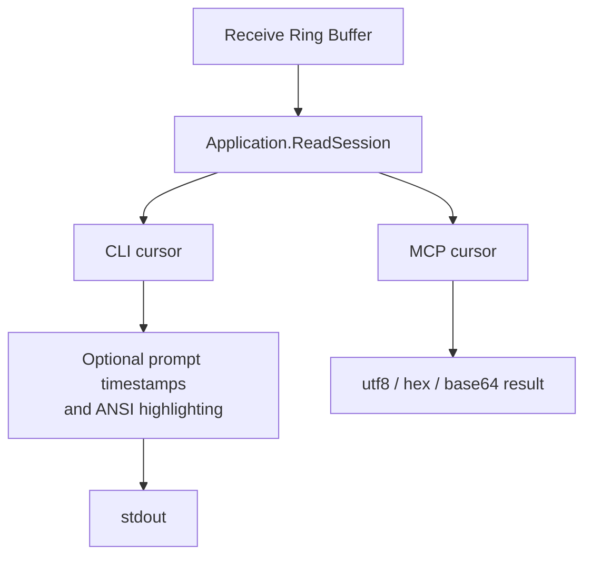
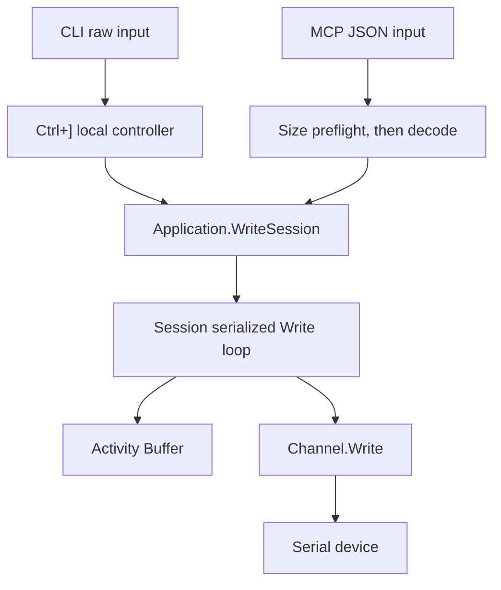
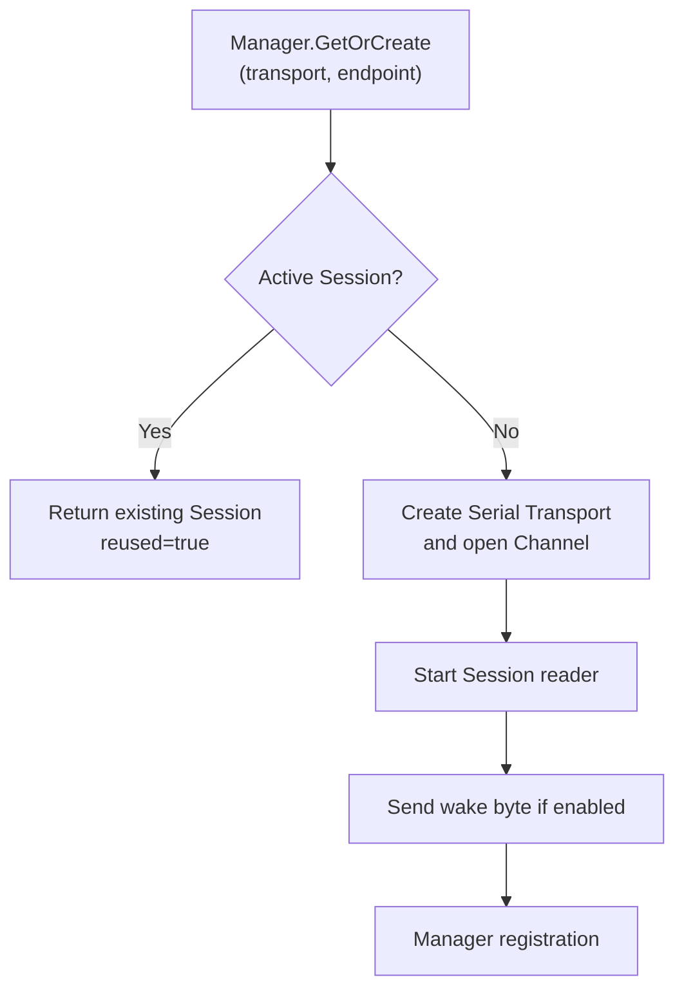
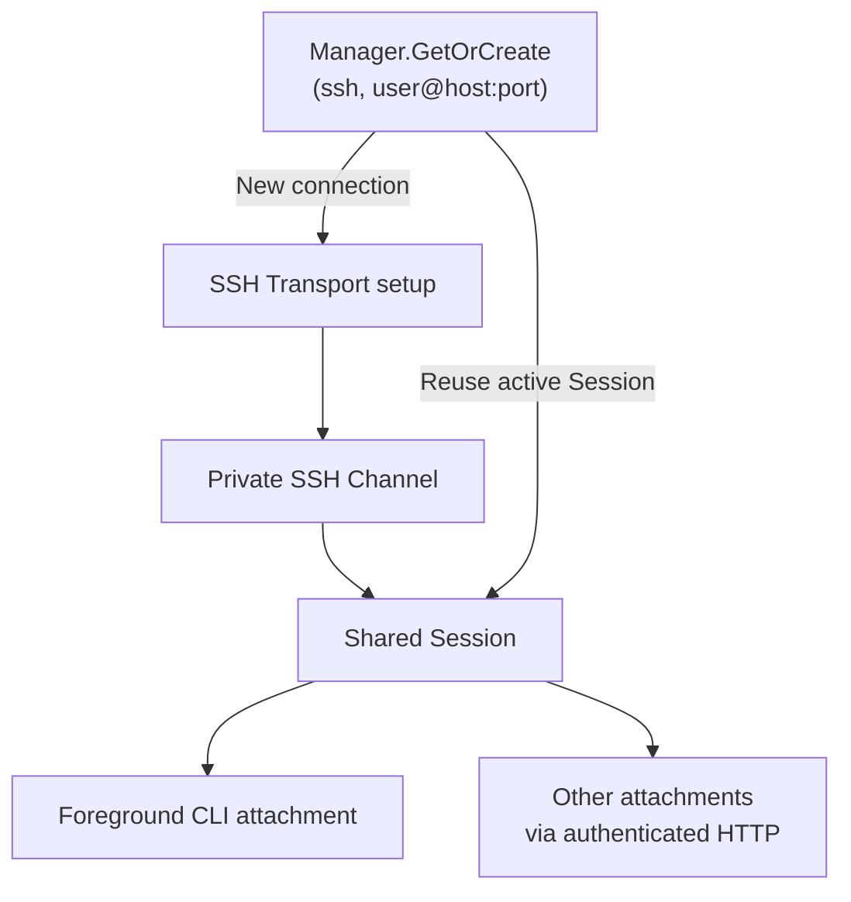
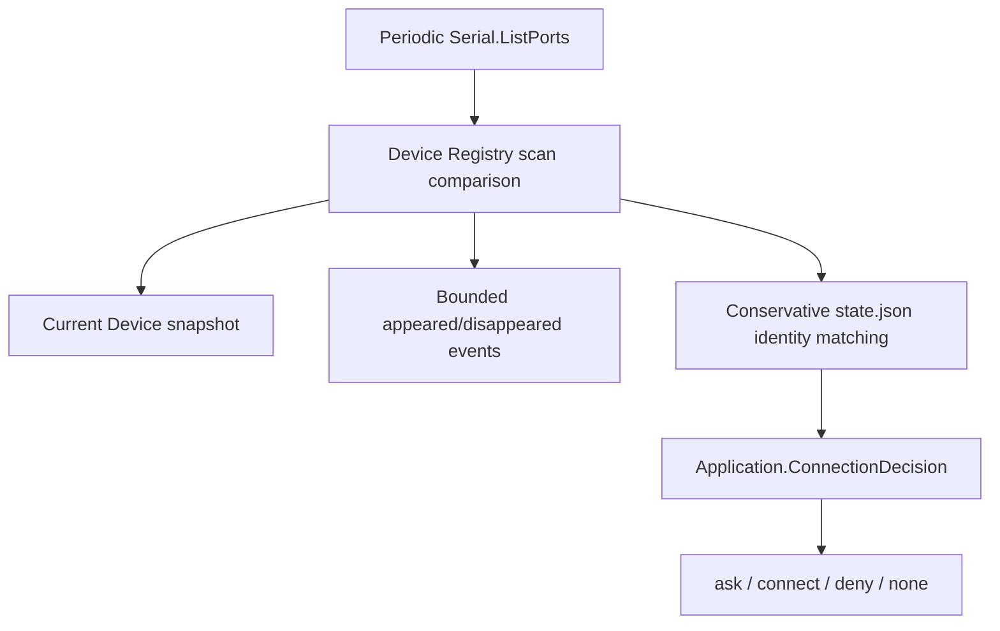
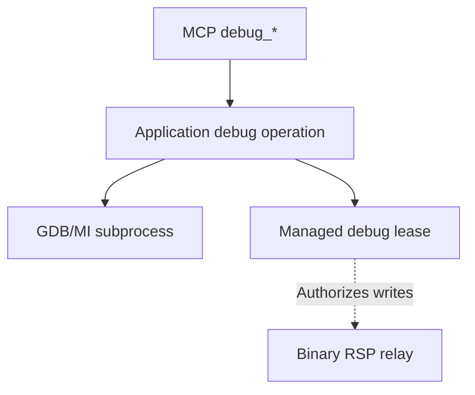
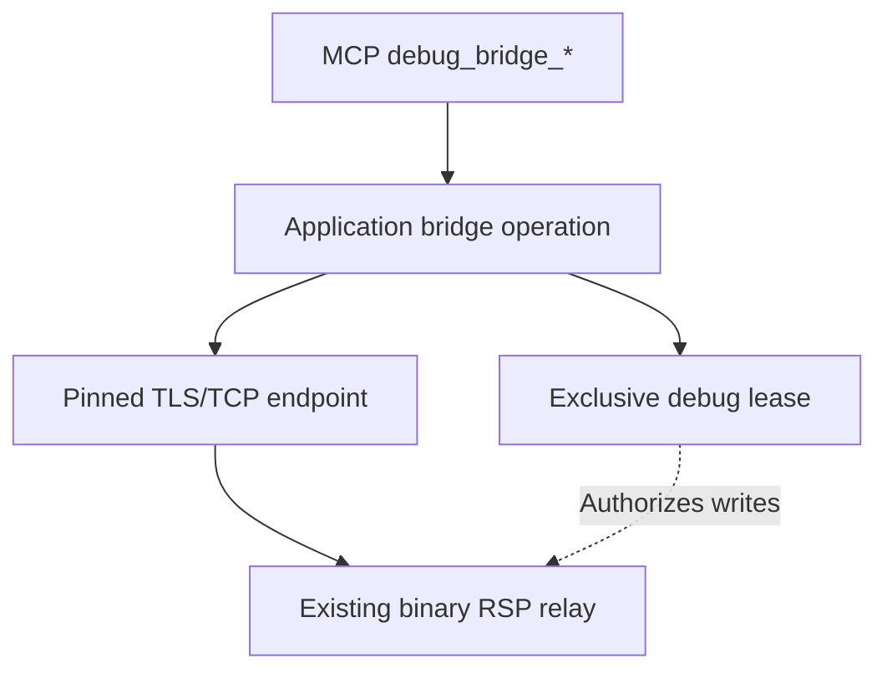

# Runtime Data Flow

## Serial output

The single reader stores raw bytes independently of client presentation:

```text
OS serial driver -> Serial Channel.Read -> Session reader goroutine
  -> 16 MiB receive Ring Buffer
```

Clients then read through Application with independent cursors:



One Session goroutine is the only continuous reader of a Channel. Consumers copy bounded chunks by
independent absolute cursor. Slow consumers cannot block the Channel reader; they receive
`dropped: true` if overwritten output passes their cursor.

## Terminal input

The foreground SSH owner inserts one bounded, ordered CLI write worker between its local input
controller and the existing MCP/Application write path. Local quit cancels the owner and closes
its Manager to release a blocked Channel write, then joins the worker before restoring terminal
state. File shortcuts wait for earlier queued input. Ordinary attachments remain synchronous;
Session still owns write serialization and no Core contract depends on this presentation choice.



`Ctrl+C` is ordinary remote data in the normal CLI raw-input path. While the Host reports an active
`file-transfer` lease, it instead opens a default-No local cancellation confirmation in any bundled
attachment. The transfer owner blocks at its next safe boundary while the Host keeps the lease; a
negative answer resumes it, while a positive answer stops it before the next block and waits for
lease release. The Host also withdraws an unanswered cross-client confirmation at its own deadline,
independently of client cleanup or lease renewal; the checkpoint revalidates its original transfer
before continuing. A locally confirmed cancellation also cancels an outstanding protocol-marker read;
raw-block cleanup uses an independent context so it can restore the remote TTY before release.
File-transfer lease expiry instead marks the original Session unavailable for writes and new
operations before asynchronous closure. Unconfirmed recovery requests the same local closure;
neither path treats loss of writer ownership as proof of remote recovery. The
[Application lifecycle](../modules/application.md) owns these decisions above Session serialization.
`Ctrl+]` commands remain local. Prompt timestamps are per-CLI presentation state and are inserted
only before recognized shell prompts after Session reads, so they never enter the Ring Buffer or MCP
cursor path. Session serializes each complete write, including short-write retries, so concurrent
payload bytes do not interleave. This does not coordinate writer intent: Session provides no writer
ownership, exclusive lease, transaction, priority, arbitration, or shell-state coordination.
Activity records actor and confirmed bytes but actor metadata is not sent to the device.

## Session events

```text
Manager / CLI attachment / Application lease / CLI file transfer
                              |
                              v
                    Session Event Buffer
                              |
                 +------------+------------+
                 v                         v
        CLI events JSON Lines       MCP terminal_session_events
```

Events are structured state, not terminal bytes. Each observer advances its own event cursor; a slow
observer can lose only old retained events (`dropped: true`) and never blocks the serial reader,
Session writer, or another observer. File-transfer reporting traverses the existing MCP attachment
only to publish status on the host-owned Session; payload I/O remains on the existing raw read/write
path.

## Serial open and reuse

Resolve settings before asking the Manager to open or reuse a Session:

```text
CLI flags / MCP input -> Application.OpenSerial
  -> load/create TOML and resolve profile -> apply explicit overrides
  -> save resolved profile if requested -> Manager.GetOrCreate
```



Concurrent opens for the same exact endpoint wait on one in-progress open. Failed and closed
Sessions do not permanently reserve the endpoint.

## SSH open and sharing

The CLI validates settings and reserves its sharing listener before opening SSH:

```text
channelterm ssh USER@HOST
  -> resolve key/trust paths and validate config via Transport
  -> reserve loopback listener -> Application.OpenSSH -> Manager.GetOrCreate
```



Only a new connection runs the Transport setup sequence:

```text
Private key / trust loading -> TCP -> authentication -> PTY -> shell
  -> private SSH Channel (channel.Stream, optional channel.Resizer)
```

Session retains the existing reader, buffers, cursors, and serialized writes.

Key parsing, host-key verification, and all SSH-library objects stay inside SSH Transport;
Application and CLI exchange ordinary settings, paths, and context-aware interaction callbacks.
Transport verifies host identity and persists explicitly approved unknown keys; CLI handles fingerprint
confirmation and hidden password entry through cancellable local-console adapters. A future GUI can
provide those callbacks without terminal I/O. Channel and Session remain library-neutral.

The foreground SSH command owns the Manager and Host. Exiting that command closes its Sessions;
closing a secondary attachment only detaches that client. The default sharing listener is
`127.0.0.1:37099`; an occupied listener fails before connecting to SSH. `--listen` can select a
separate loopback Host. SSH does not add discovery, saved profiles, or MCP opening tools.

Dedicated file operations follow a separate path:

```text
CLI sftp/scp -> app.RunSSHFiles -> SSH Transport.OpenFiles
  -> authenticated dedicated connection -> SFTP subsystem or legacy SCP exec
  -> application-owned local files / remote file operations -> connection close
```

These operations do not create a terminal Session, require a PTY, open a local MCP listener, acquire
a Session write lease, or insert file bytes into terminal history. Authentication callbacks and host
trust are shared with the terminal connection implementation. The operation context remains active
throughout file I/O; cancelling it closes only that file connection. A future GUI can use the same
application use case without a terminal attachment.

With optional SHA-256 verification, Application compares the source digest with a reread of the
closed destination before counting a file or committing an SFTP safe replacement. SFTP readback
uses its existing subsystem. SCP uses fixed checksum exec channels on the same dedicated SSH
connection after each file's protocol acknowledgement; its hash utility is checked before copying.
The operation context also covers verification. See [Application Module](../modules/application.md#dedicated-ssh-file-operations)
for digest callbacks, completion counts, and mutation limits.

The size-control path is separate from shared terminal bytes:

```text
owner's local terminal (Linux/macOS SIGWINCH; Windows 250 ms size polling)
    -> CLI terminalinput watcher (latest valid changed dimensions)
    -> Application.ResizeSession(id, cols, rows)
    -> Session.Resize(cols, rows)
    -> optional channel.Resizer on the private SSH Channel
    -> existing backend shell.WindowChange(rows, cols)
    -> remote PTY / foreground application's window-change notification
```

Only the foreground SSH command installs this watcher; attaching never grants resize authority.
A startup recheck catches changes during connection setup. Cleanup cancels notifications, closes
SSH I/O to release any blocked request, then joins the watcher and unregisters its signal/timer.
The Channel and Session base interfaces, shared byte path, and MCP tools are unchanged.

## Device discovery



The first successful scan is a baseline and emits no appearance events. A transient later scan
failure preserves the last known presence state. Discovery and policy evaluation never open a
Transport; a client remains responsible for an approved explicit open.

## Shared HTTP attachment

```text
Physical serial endpoint
          |
          v
   Serial Transport
          |
          v
    Serial Channel
          |
          v
 host-owned Session
          |
          +--> CLI Attachment through MCP
          `--> MCP Client
```

The host Manager shares one active Session for an exact `transport + endpoint` pair within that host
process. Each Client or Attachment maintains independent output and activity cursors. Closing one
MCP connection releases only that Client; `terminal_close` or Session Host shutdown closes the
shared Channel and its underlying serial resource.

## CLI file transfer

```text
local file <--> bounded CLI chunks
                     |
                     v
        file-transfer Application lease
                     |
                     v
          existing Session read/write
                     |
                     v
                  Channel
                     |
                     v
                serial driver
                     |
                     v
        Linux shell: stty + dd
                     |
                     v
             wc -c + sha256sum
```

Serial Transport establishes the Channel before this runtime I/O path begins. The file-transfer
use case is layered above Session and does not access Serial Transport directly. A
CLI attachment uses the Host's lease and lease-authorized write tools as byte-oriented clients of
the host-owned Session. Existing `terminal_write` input is unchanged.

At each safe block boundary, the lease owner calls the Host checkpoint. A separate attachment can
move that checkpoint through `running -> confirming -> resumed/cancelled`, allowing cross-process
cancellation without sending confirmation bytes to the board. An unanswered confirmation returns
to `running` at the Host deadline; an accepted cancellation cannot take that transition. See
[Application Module](../modules/application.md) for timing and identity checks. Payloads are bounded
raw chunks, and other readers retain independent cursors. While the lease is active, other writers receive an
immediate busy error instead of waiting or interleaving bytes.

A missing, expired, or replaced owner cannot use the leased-write path. Application closes the
host-owned Session if lease expiry finds a Channel write still in flight or if bounded protocol
recovery times out. `Channel.Close` releases the blocked write before a later open creates a
replacement Session. See [Application Module](../modules/application.md) for the lifecycle details
and [File Transfer](../getting-started/file-transfer.md) for the user workflow.

## User-space GDB

Management and write authorization:



The RSP byte path uses the existing Session and Channel:

```text
GDB/MI subprocess -> private Unix socket -> binary RSP relay
  -> Session cursor / leased Write -> existing Channel and sole reader
  -> Bash PTY -> gdbserver stdio -> inferior
```

The relay preserves binary bytes and ACKs; an overwritten cursor is fatal. Inferior standard I/O
is isolated from the PTY. MI records form a separate bounded debug-event cursor stream. The existing
Session event stream carries `DEBUG_STATE` and lease boundaries for CLI presentation. Raw Session
history remains unchanged. See [Application](../modules/application.md#user-space-debug-operations)
for timeout, final-ACK, recovery, and subprocess ownership details.


## External GDB bridge

Management and write authorization:



External debugger traffic follows this separate byte path:

```text
External GDB -> rsp-client -> pinned TLS/TCP endpoint -> binary RSP relay
  -> Session cursor / leased Write -> existing serial Channel -> target
```

Authentication precedes all Session I/O. Only one authorized data connection is admitted; the acceptor
retains its bind and logical address reservation until bridge finalization. A current helper also
authenticates one control TLS socket on that same listener. Its random challenge/response loop is
separate from the unchanged RSP stream and supplies liveness evidence to Application's lease monitor.
The control connection reuses the bridge listener; it does not open another listening port.
Later data clients cannot reconnect or take over. The external operator prepares gdbserver and
controls GDB independently. No terminal history is replayed at startup, and no MI subprocess
participates in this path. TCP disconnect
retains the lease; a separately confirmed shell/TTY probe may restore terminal use. Otherwise
explicit close, expiry, or uncertain recovery closes the Session. See
[Application](../modules/application.md#external-serial-rsp-bridge) for concurrency and cleanup.

An independent observation path is `external Codex driver -> MCP debug_bridge_report -> Application
validation -> Session event ring -> CLI attach/events and MCP event cursors`. It carries selected
commands/results/states labelled as Codex reports, not complete audit evidence. It never joins the
serial byte path, starts GDB, parses RSP, or changes the relay lifecycle on reporting failure.
