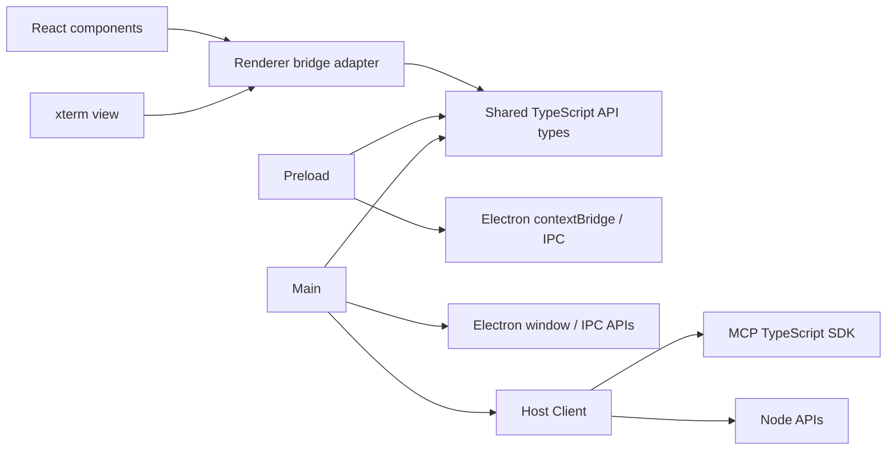
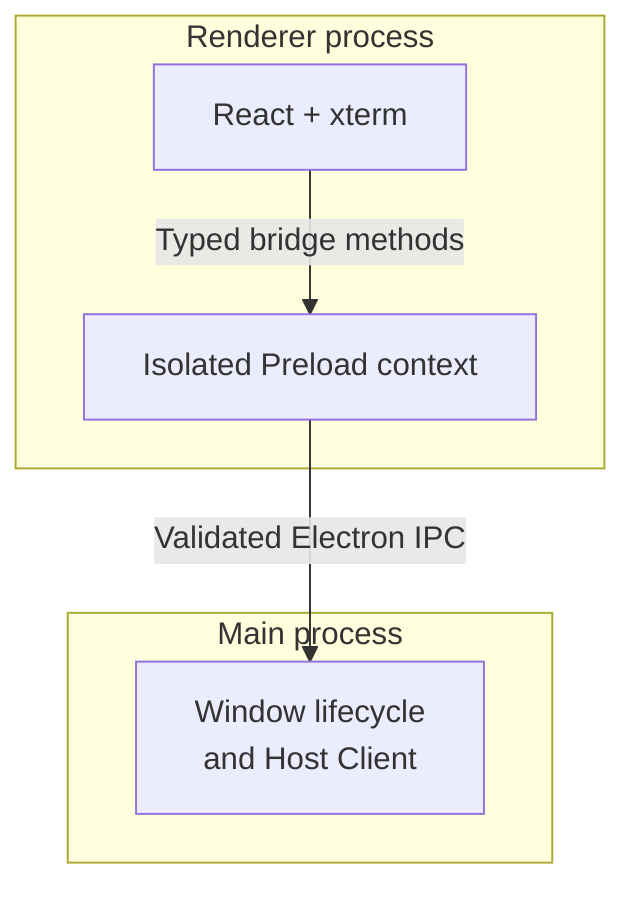
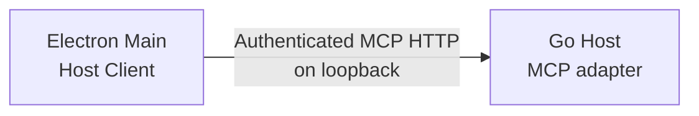

# Electron GUI Architecture

The Electron prototype is an independent desktop client of a ChannelTerm Host. It automatically
connects to the default local Host and starts its fixed-path companion when that listener is absent.
It attaches to shared Sessions and can request serial or SSH creation from the Host. The Go Host retains the authoritative Application, leases,
Session Manager, Channels, and device connections. See the [overall architecture](overview.md)
and [repository map](repository-map.md) for Go ownership and the detailed source layout.

The [Electron engineering rules](../../gui/electron/AGENTS.md) supplement the root rules for
Electron/React/xterm contributions. This document owns the architecture and current behavior;
the scoped rules define review requirements without claiming that all future test cases or
features already exist.

## Code dependencies



These are source imports, not process or network links. Renderer code imports no Main, Node,
filesystem, child-process, or MCP implementation. Shared types describe the small GUI bridge;
they are not another Host business protocol or a public multi-GUI SDK. React manages views;
the dedicated xterm component manages rendering, local fitting, and input events. Host Client
has no React dependency and never parses CLI output.

The permitted import direction follows these boundaries:

| Owner | Permitted dependencies and boundary |
| --- | --- |
| Renderer feature views and application shell | React/xterm, renderer-local UI, renderer bridge adapter, and shared contracts; no Main/Preload implementations or privileged APIs. |
| Renderer bridge adapter | Shared contracts and the typed `window.channelterm` surface; no MCP HTTP or credentials. |
| Preload | Shared contracts and Electron contextBridge/IPC; no Host Client or business policy. |
| Main | Electron/system APIs, shared contracts, and Host Client; no renderer implementation. |
| Host Client | Shared contracts, MCP SDK, and required Node APIs; no React, xterm, or view state. |
| Shared contracts and locale resources | Serializable types, pure menu descriptions/validators, English message definitions, and generated catalog data; no React, Electron, Node runtime, or process-specific imports. |

Renderer currently has `terminal`, `sessions`, and `transfers` features; `components/App` composes their views.
Feature-local hooks, state, and tests can be added when responsibility or verification requires
them. Cross-feature reusable UI belongs in `components`; feature internals are not a shared
service layer. Devices or MCP-related views require actual supported functionality before new
modules are added. They would use the same bridge boundary, not direct Host requests from React.
The current structure requires no global state framework, DI container, or plugin system.

## Workbench layout and display states

The renderer uses a dark terminal workbench with a `#101318` terminal, `#181d25` Session
sidebar, muted slate chrome, and blue selection accents. xterm retains its dark ANSI palette.
Native window chrome is requested in dark mode independently of the OS theme; there is no
theme switcher or custom title bar. This is application-defined styling.

The native title bar and minimum window size (760 × 500) remain unchanged. The application
area has a 32 px application menu bar, a flexible workspace, and a 24 px full-width status bar.
The menu bar places menus on the left and three compact left/right/bottom layout toggles on the right,
without an application name, logo, or preview banner. The original slate/blue styling and
locally drawn pane-outline icons remain independent of VS Code assets.
**Session, Host, Terminal, View, Window, Settings, Help** expose the implemented actions described
in the [menu reference](../reference/gui-menus.md). Renderer popovers and the native Electron
application menu share finite action IDs, state hints, and Lingui catalogs. Language switching
updates all supported menu languages without resizing xterm. The renderer
strip remains the visible Windows/Linux menu surface; macOS also has its native system menu.
The official Lingui CLI maintains PO catalogs and compiles shared resource imports before both
esbuild and Vite run. Each process owns its own Lingui instance; there is no cross-process
translation loader or credential access. See the [maintenance workflow](../development/electron-gui.md#menu-translations-lingui-590).
A 48 px activity rail toggles the Session sidebar without changing the attachment. The sidebar
defaults to 260 px, or 210 px with a 40 px rail at viewport widths of 900 px or less. Its edge
is a draggable, keyboard-focusable separator: Left/Right adjust by 10 px, Home/End select the
allowed limits, and double-click restores the current viewport's default. Width is clamped
between 180 and 480 px with additional viewport bounds to keep the terminal usable. When both
sidebars are visible, each is capped at half the width remaining after reserving 320 px for the
terminal and the activity rail. The secondary sidebar starts hidden, displays current Session
metadata, and has the same width controls on its left edge. This is window-local view state;
hiding either sidebar preserves its preferred width, while reopening the GUI resets it.
The terminal takes the remaining width and height. Its header contains independent terminal tabs
and a New Tab button. Each tab owns an attachment or an empty Session chooser. Selecting a Session
fills the selected empty tab, activates an existing view for that Session, or adds a tab. To attach
the same Session again, first create an empty tab. The close icon performs **Close tab (detach)**;
closing the last tab leaves the window and Host connection open. Background terminals retain their
xterm buffers and cursors; selection changes do not detach them.

Serial creation includes common baud-rate presets and a Custom option for integer rates
from 1 to 4,000,000. The default
remains 115200. Presets are suggestions, not a guarantee that a particular driver or device can
use the rate; Host validation remains authoritative. Data bits, parity, stop bits and flow control
retain their finite selectors. The CLI already accepts custom rates through `--baud`.
Serial presentation includes the [common terminal encodings](../getting-started/serial-terminal.md#character-encoding-description-and-hexadecimal-view), text/read-only hex view,
and an optional local description. The compact encoding button in the attached serial header
opens the same presentation settings. Applying them reattaches this client and replays only
retained Host output; it does not clear Host buffers, reset the device, or close the shared Session.
Up to 64 Session preferences are retained per window until Host disconnection; they are not
saved profiles or shared metadata. Descriptions allow one line of at most 512 UTF-8 bytes without
control characters. No SSH setup, electrical serial settings, or MCP schemas change.

Main's attachment-local codec decodes legacy bytes after transfer-byte suppression and adds
optional text to the bounded output response; the original bytes remain available for inspection.
It uses native streaming CJK decoders, complete-pair Big5/HKSCS decoding, and iconv-lite single-byte
codepages to preserve split supplementary characters and avoid browser ISO/DOS alias limitations.
Renderer formats hex or renders the supplied text; no Node codec dependency enters Renderer.
The finite encoding catalog and codec are independent of Serial/SSH connection setup.
The file dialog's Base64/raw selector is separate from terminal character encoding. Main validates
the finite wire value and passes a fixed `--wire` argument to the companion CLI; no new command
execution capability or MCP interface is exposed. Base64 is the default for both clients.
The UTF-8 path still passes raw bytes to xterm. Missing output resets decoder and parser state;
malformed device text uses replacement characters. Hex view prints received bytes and safe ASCII,
never interpreting remote escapes; offsets count observed bytes and restart after a gap. Rows may
end at read boundaries. Main independently rejects terminal writes in hex view and validates all
settings. For text input, Main's `iconv-lite` encoder rejects lossy conversion before queueing and
sends encoded bytes through the existing authenticated base64 write path. Lease checks and
no-replay behavior remain unchanged. File transfers and other clients always retain raw bytes.

The sidebar provides case-insensitive local search by reference, label, endpoint, or transport,
and collapsible Serial, SSH, and Other groups. Group counts reflect the filtered rows; the
overall count still reflects all Host Sessions. Filtering or collapsing rows never detaches
the selected Session. Group expansion and search are temporary view state, not saved profiles.
Rows use two compact lines: label/reference, then endpoint and state. A reference is shown on
the second line only when a distinct custom label occupies the first; there is no duplicate
reference-only third line. The list scrolls independently, keeping search and the compact bottom Host panel visible. Host status,
configured endpoint, and connect/disconnect live in that panel. Reopen a collapsed sidebar
using the activity rail to access these controls. Long endpoints and Session labels truncate
visually with their full value available on hover.
The status bar distinguishes no attachment, enabled input, paused input, lease read-only,
and an unavailable Session. These labels report client snapshots, not write authority. The
terminal has no separate input-hint box or command composer. Input remains directly in xterm.
Dragging only refits local xterm cells; it neither detaches nor sends a remote resize request.
No baud rate, throughput, recent-connection history, or other unavailable metadata is invented.

The status bar's **Copy for AI** action sends only the captured attachment and resolved language
through a fixed IPC method. Main fetches current target metadata, revalidates ownership, validates
single-line field bounds and formats a localized plain-text clipboard message. No terminal content,
credentials or AI-service connection enters this path. The display abbreviates the opaque ID while
the clipboard retains it in full; see the [target copy contract](../reference/gui-menus.md#window-action-contracts).

| State | Display and supported next action |
| --- | --- |
| Host disconnected | Compact terminal hint to connect; Session refresh is disabled. |
| Connecting / attaching / detaching / disconnecting | Named progress text; connection and Session actions are disabled until the operation completes. |
| Host connection failed or lost | Safe error notice, offline status, and **Retry connection**; stale Session entries are removed on connection loss. |
| Connected with no Sessions | **No Sessions available** and **Session > New Connection...**; serial setup is available, while SSH requires the standalone Host API. |
| Connected with Sessions but no attachment | **Select a Session**; open Sessions are selectable, closed entries are disabled. |
| Attached | xterm occupies the workspace, the selected Session is marked, and **Close tab (detach)** is available. |
| Lease / rejected input / closed Session / output loss | Existing notices and recovery semantics remain visible; input status reflects the available snapshot. Output-loss notices only belong to the attached view. |

Empty states use a small heading and one actionable hint, without a welcome hero or onboarding
steps. Notices scroll within at most 25% of the workspace height to retain terminal space.
Window resizing only fits local xterm cells; it does not issue remote PTY resize requests.
The measured terminal container has no padding; spacing sits outside it so FitAddon does not
overestimate the available cell area. Application styles do not target xterm's internal
`.terminal` class.

The right sidebar displays the selected Session reference/label, endpoint, transport, state,
opaque ID, and active lease type from existing snapshots. It provides no MCP/Agent controls.
The bottom panel starts hidden and has **File transfers** and **Session status** tabs. View menu
actions can open either tab even with no transfer history. A newly observed transfer or a local
start/resume opens File transfers; later progress updates do not reopen a manually hidden panel.
The top divider resizes the bottom panel from 100 px to 45% of the workspace, with Up/Down,
Home/End, pointer dragging and double-click reset. Tab arrow keys and Home/End change tabs.
Hiding panels or changing tabs keeps transfer observation and cancellation state mounted and
never closes an attachment or changes a Host lease. Transfer labels remain 12 px with 6 px tracks.

Layout shortcuts use a renderer capture listener and the same finite action dispatcher as menus
and toolbar buttons. The listener excludes dialogs, menus, text editors, IME and AltGr; assigned
chords in xterm are consumed before terminal input, without device writes. Shared pure validation
limits stored bindings and native-menu display hints to three layout and two terminal clipboard actions. No OS-global
shortcut or Electron accelerator is registered. Settings stores validated bindings in renderer
local storage; no credentials or Host configuration are persisted there. See the
[shortcut contract](../reference/gui-menus.md#layout-shortcuts) for defaults, focus rules and recovery.

Terminal clipboard actions use two fixed Main-owned text IPC methods, validating the trusted
caller, current attachment and the existing 64 KiB UTF-8 limit. Renderer copies only xterm's
selection, rechecks view identity/writability after clipboard reads, and pastes through xterm
and the ordinary bounded Host write path. No browser permission or arbitrary clipboard format
is exposed. Display preferences are validated local state; font updates refit the existing
terminal and do not replace its parser, output cursor or attachment.

Paste containing CR or LF opens an attachment-local preview before xterm receives the text.
Menu, shortcut and native paste events share the Main clipboard read and 64 KiB limit. Confirmation
is single-use and rechecks the original xterm instance, visibility and input epoch; a lease/read-only
transition invalidates the draft even after input becomes available again. Detach discards the draft.
Accepted input still uses xterm newline/bracketed-paste processing and Main's encoding/Host authority.
No queued draft is replayed after a state change. Preview text is local React state, never Host history.

The terminal view's semantic highlighter consumes the shared default definitions and modifies only
the bytes sent to its xterm instance. It retains at most 8 KiB of an incomplete line, with a 50 ms
timer releasing unknown prompts raw; blocked rendering/event-loop work can delay that timer.
Per-line matching is capped at 2048 candidates and 512 rendered spans; excessive/unsafe lines pass
through raw. Split UTF-8, remote ANSI state, alternate screens and data-loss resets retain explicit
handling. HEX bypasses this layer. Disposal cancels the timer and discards unfinished local styling.

Plain mode disables new semantic insertion and overlays black/white colors on the pinned xterm
DOM renderer, including retained cells, TrueColor, inverse and OSC-selected backgrounds. It does
not remove terminal control sequences or change parser attributes, so returning to the default
style restores retained color state. This scoped CSS depends on the pinned DOM renderer and must
be revalidated before upgrading xterm or adding a canvas/WebGL renderer. Selection and decorations
remain separate; cursor colors are handled explicitly. Style changes neither recreate attachments
nor replay device bytes. Font/style preferences stay in the existing local display settings.

## State ownership

Explicit **Close shared Session...** is separate from all view cleanup. After a target-specific
confirmation, a narrow attachment-bound IPC method asks the existing authenticated Host
`terminal_close` tool to close the shared Session. Main validates the handle and blocks local
file-work/tab-handoff conflicts; Application retains closure authority, including the existing
ability to close a leased Session. No credentials, lease-release capability or Host-stop action
are added. See the [close contract](../reference/gui-menus.md#window-action-contracts).

| Owner | State and lifetime |
| --- | --- |
| Go Host | Authoritative Application, Session/Transport/device lifecycle, Lease decisions, retained output, and serialized writes. |
| Main / Host Client | Window registry, one authenticated client and file adapters per window, credentials, request cancellation, and independent attachment handles/cursors. Closing these resources does not close the shared Session. |
| Preload | Narrow IPC forwarding; no separate Session, authentication, or Lease state. |
| React views | Selection, connection/status displays, safe errors, and Host snapshots for presentation. Cached Lease state can disable input but cannot authorize a write. |
| Terminal view / xterm | Terminal parser, bounded display history, render pacing, local input queue, and view-owned listeners/observers. Raw output does not flow through global React state. |

Client queues and attachment generations coordinate local work only. They are not a second
writer arbiter or Session Manager. Reattachment and cleanup must reject stale completions; a
write whose result is uncertain is not replayed automatically. xterm's visible state and the
Host's bounded retained bytes do not establish a complete historical terminal-state snapshot.

## Windows and tab handoff

Main owns up to 16 BrowserWindows, including provisional handoff destinations. Each window owns
its Host Client, connection generation, native-dialog/file capabilities, and menu snapshot. Renderer
owns up to 32 tabs per window, selected tab, layout, input-pause notices, and xterm controls keyed by
tab ID. Host Client bounds attachments to 32; changing presentation at that limit requires first
closing a tab because replacement attaches before detaching the previous view. Read cursors,
codecs, cancellation and write queues belong to individual attachments, even for the same Session.
A process-wide startup coordinator reuses the same local Host; creating a window never creates a
second Session or a second Host manager. New windows inherit the source language preference and,
when connected, connect to the same configured Host. Later locale/layout changes are window-local.
Display and shortcut defaults still use the existing local storage; live windows keep their own state.

**Move Tab to New Window** captures the clicked attachment, including a background tab. Main
checks ownership and the source file-operation gate, blocks new source writes, and waits for accepted
writes to settle. It creates a hidden destination with its own authenticated client and attaches the
same opaque Session ID, without scanning/opening a device. The destination receives only the new
attachment, presentation settings, pause state and a single-use move ID through its own IPC surface.
Its xterm view acknowledges after the first Host read and render callback; only then does Main commit,
detach the source handle and show the destination. Before commitment, failure, reload, window closure,
or a 20-second deadline discards the destination and retains the source attachment. No uncertain input
is replayed. There is at most one pending move from a window. Provisional destinations cannot write,
create connections or run file operations. IPC validates both caller ownership and target attachment.

Moving rebuilds xterm from up to 64 KiB of recent Host output. A translated notice explicitly says
that full screen/parser state and older history may be unavailable. It does not serialize an xterm
snapshot, copy old queued input, or promise lossless history. Hidden tabs pause reads after any pending
read/render completes; selecting them resumes the same cursor and reports Host overwrite normally.
Their xterm scrollback remains bounded to 5,000 lines. Closing or disconnecting one window cancels
only its client resources; other windows and shared Sessions continue. App exit closes all GUI
clients. Active owned file operations block that window's close/disconnect and app exit, while other
windows remain independent. No drag-and-drop tabs, terminal splits or saved window/tab restoration
are implemented. See the [menu contracts](../reference/gui-menus.md#window-action-contracts).

## File operations

Each window's Main file adapters own native local selection capabilities and one in-flight desktop file
operation. Renderer receives an opaque selection ID and display basename, not unrestricted file
access. IDs are bound to Session/direction, expire after ten minutes, are cleared on disconnect, and are consumed on start.
For serial operations, the adapter invokes the fixed app-owned CLI using argument arrays and a Main-only credential
environment, without a shell or PATH lookup. It reads bounded JSON records, never human progress
or stderr. The CLI reuses Application transfers and the existing authenticated Host/Lease path.
No new MCP tool, HTTP upload endpoint, raw device connection, or TypeScript transfer protocol is added.

Optional resumable transfers use the same companion and Lease. Main adds a finite `resumable`
boolean, lists bounded checkpoint summaries using `file jobs --json`, and resumes only a validated
24-hex job ID on the captured Session. Paths and peer bindings remain in the Go client checkpoint
store; Renderer receives only basename, direction, kind, confirmed bytes, total and phase. The CLI
revalidates Host/serial endpoint binding and source/prefix checksums after GUI or Host restart.
The separate Resume dialog never reconnects, grants authority or replays an uncertain publication.
All menu surfaces share `file.resume`; unknown/closed/leased serial targets stay unavailable.

For SSH Sessions, `ssh-files.ts` invokes the same fixed CLI's dedicated SFTP/SCP commands with
bounded JSON-line progress. Main revalidates the live Session endpoint and native selection before
launch. Authentication is local to that separate connection: renderer-entered secrets use private
stdin, never arguments, environment variables or history. Local key/trust paths remain CLI-owned;
no Host credential retrieval or new Host/MCP endpoint is introduced. GUI copies always verify
SHA-256. Single-file SFTP resume delegates prefix validation and final verification to Application;
SCP and directories do not resume. Main retains at most 32 display records, with the latest eight
shown in the panel; these records are not persistent checkpoints. Completion requires the CLI's
completion record and successful exit. Cancellation terminates only the dedicated child, leaving
partial files for explicit recovery, with no Session Lease or terminal-byte suppression. Serial
and dedicated SSH operations share that window's busy gate. Renderer reload/crash cleanup cancels
the owned SSH child and clears its display history, so a disconnected view cannot strand an
uncancellable background transfer.

For serial transfers, Host Client separately reads structured Session events for UI progress and cursor-based terminal
presentation. It refreshes events after each raw read before exposing bytes, so a published Lease
boundary precedes suppression. Event loss suppresses uncertain bytes and reports display loss;
Evicting old hidden ranges conservatively suppresses the older prefix and reports display loss.
Host buffers and other clients' raw cursors remain unchanged. State is bounded to 64 observed
Sessions, 32 transfer records and 1024 hidden ranges per Session. The GUI panel is collapsible and
vertically resizable; terminal space remains primary. Completion requires lease release as well as
verification. Cancellation uses Host confirmation IDs, rechecks the actual transfer after opening
confirmation, and cannot silently target a replacement. The themed Renderer dialog receives only
a single-use Main confirmation ID; Main retains the Host request and Session binding. Escape and
dialog dismissal are negative answers, as are disconnect/reload/close cleanup; Host expiry remains
the fallback if cleanup cannot reach the server. Running owned operations block disconnect,
reconnect and window/app close; abnormal process exit still relies on existing Host recovery.
For blocked close/quit attempts, Main sends a fixed payload-free notification through Preload.
Renderer deduplicates it into one themed notice and opens the transfer panel. Dismissal grants no
close permission, cancels no operation and never schedules a deferred close.

## Processes and communication

Inside Electron, UI calls cross an isolated context and then a process boundary:



Menu state flows from Renderer through a validated fixed IPC method to Main's native menu
builder. Native selections flow back through a fixed, filtered Preload subscription to the same
renderer dispatcher used by toolbar and context-menu actions. Only known IDs and bounded display
hints cross that boundary. Main's separate fixed quit method uses normal client cleanup. See the
[menu targeting/security contract](../reference/gui-menus.md#targeting-state-and-security).

Main connects to the separately running Host:



Within the Go Host, the request path is:

```text
MCP adapter -> Tool Registry -> authoritative Application
  -> Session / Manager -> Channel (established I/O)
```

Application owns leases and use cases. Session I/O uses MCP Streamable HTTP. SSH creation uses
the separate authenticated [desktop Host API](../reference/gui-host-api.md) and the same
Application; serial scanning/creation uses existing MCP tools.

A Transport establishes the Channel before attachment; it is not an additional hop for every byte.
Preload is an isolated context, not a third application process. Main may launch a detached
standalone Go Host, but closing the GUI never stops that Host or its shared Sessions. Renderer sandboxing and `contextIsolation` are enabled, and `nodeIntegration`
is disabled. The production UI is served through a restricted `channelterm://app/` scheme.

## Existing Host contracts

| GUI operation | Existing MCP tool / behavior |
| --- | --- |
| Connect | SDK initialization; require server name `channelterm`; authenticated Session listing |
| Refresh | `terminal_list_sessions`; project display metadata and public lease summary only |
| Scan / create serial | `terminal_list_serial_ports` / `terminal_open_serial`, explicit settings and `wake:false` |
| Create SSH | Main POSTs bounded settings to the fixed authenticated `/gui/v1/ssh` route; no MCP schema changes |
| Attach / detach | `terminal_session_attach` / `terminal_session_detach` with actor `user` |
| Initial output | `terminal_read` without cursor, Base64, at most 64 KiB |
| Further output | `terminal_read` with Main-owned cursor and a one-second Host wait |
| Ordinary input | `terminal_write`, UTF-8, actor `user`; no delimiter inserted |
| Close GUI | Cancel requests and close MCP client; best-effort detach event only |

The authoritative schemas remain in [MCP tools](../reference/mcp-tools.md). The attachment tools
record events; they do not grant leases or reference-count Session ownership. GUI attachment IDs
are local stale-request guards, never Session IDs or write capabilities. GUI uses opaque Session
IDs returned by the Host; short references, labels, and endpoints are display metadata.

Only one output read per attachment is outstanding. The renderer waits for xterm's write callback before requesting
the next chunk, bounding queued output. Base64 preserves raw bytes, including UTF-8 split across
chunks. JavaScript rejects cursors outside its exact integer range rather than rounding them.
On `dropped`, xterm resets its parser/screen before displaying retained bytes and the UI keeps a
visible data-loss notice. Initial attachment shows only the recent 64 KiB snapshot.
Main marks that snapshot and gap recovery as replay. Renderer consumes historical cursor/status
and device-attribute queries at xterm's parser without sending their answers back to the device.
Live queries retain xterm's normal responses, including sequences split across read chunks.
Stored Host bytes and user keystrokes are not filtered or rewritten by this replay guard.

Each input payload and each input queue is limited to 64 KiB. Main serializes each attachment's requests;
the Host still arbitrates all clients. The Session list is refreshed every 1.5 seconds. A displayed
lease disables local input but is never treated as authorization. The Host validates each ordinary
write, including races after a refresh. Failed input and later queued input are discarded, never
replayed automatically. A timeout or disconnect can leave delivery uncertain.

The current ordinary-write busy error can have MCP code `tool_error`. On a tool error the adapter
queries structured Session/lease state rather than parsing human-readable diagnostics. A lease
that ends before that query can leave only a generic rejection message; the adapter never infers
success or retries. EOF, missing/closed Session, authentication failures, and transport failures
stop the affected work and are surfaced to the UI. Reconnection is explicit.

## Security and lifecycle

Main reads the existing Host token or process environment override. No credential goes through
Preload, React, URL parameters, local storage, or renderer error messages. The prototype permits
only numeric loopback HTTP endpoints, refuses redirects, bounds request durations, and requires
the expected MCP server identity. It never opens devices directly; only the fixed local companion startup path may start a Host, and
explicit scanning/creation requests are forwarded to the authoritative Host.
The existing Host authentication, CORS, and Origin checks are unchanged.

Every IPC call checks the exact owning WebContents, its main frame and trusted page URL, argument
count, and relevant input limits. The bridge has no arbitrary tool invocation, lease mutation,
Session close, file access, or process-launch API. Navigation, popups, webviews, downloads, and
permission requests are denied. Production CSP denies renderer network connections. See
[Electron's security guidance](https://www.electronjs.org/docs/latest/tutorial/security).

Detach, reload, renderer failure, disconnect, and window close cancel client work. Closing the GUI
never calls `terminal_close`, releases somebody else's lease, or shuts down the Host. If the Host
advertises attachment-owned lifetime, the UI warns that its original owner may stop it. An absent
lifetime header follows the current Host contract for a separately started persistent Host; it is
not a promise that a remote process will remain running.

## Multiple frontends and release boundaries

Electron is the implemented GUI. Qt is only a possible future independent frontend; there is no Qt
project or shared GUI framework. CLI, Electron, and a future Qt GUI must reuse the authoritative
Host use cases, not copy Core or construct another lease coordinator for shared Sessions. Frontends
must not depend on one another or require a Core rewrite.

The CLI build uses Go only. The GUI build uses Node/npm and emits Main, Preload, renderer assets,
and license notices independently. Go is needed by GUI integration tests, not by its production
build. No CLI release workflow changes. There is no installer, auto-update system, or release job.

Main permits startup only for `http://127.0.0.1:37099/mcp`. A TCP refusal permits one launch;
an occupied listener is authenticated through the existing Host Client. Authentication, protocol
or probe errors never trigger another process or port. Concurrent GUI instances rely on the
exclusive Host listener bind; a losing process exits and both clients may authenticate the winner.
Main waits for readiness with bounded, cancellable probes. It neither retries device writes nor
opens a device during startup. Manual disconnect does not trigger automatic reconnection.

The executable is `dist/host/channelterm[.exe]` for source builds and
`resources/host/channelterm[.exe]` for a future packaged distribution. Main never searches PATH,
runs a shell/compiler, accepts an executable from Renderer, or forwards child output. The existing
Host creates/loads its own credential; Main reads it after readiness. Startup errors are sanitized.
The standalone Host survives GUI exit so CLI/MCP can continue sharing Sessions; stopping the Host
explicitly closes its Sessions. Packaging must include the matching native companion and notices.

Targets remain Windows, Linux, and macOS on amd64/arm64 (Electron/Node calls amd64 `x64`). Dependencies
are JavaScript except the platform-provided Electron/build-tool binaries; Go's CGO-free release
boundary is unchanged. Electron runtime packaging, native launch, signing/notarization, and installer
validation are separate per-platform work. Windows desktop tests do not prove Linux/macOS behavior
or arm64 compatibility. See [GUI development](../development/electron-gui.md) for reproducible checks.

## Current gaps

No MCP SSH-open, remote PTY resize, or client-file transfer orchestration API exists. SSH creation
uses the separate desktop Host API. The serial file UI invokes the existing CLI and observes Host
events; it adds no upload API. Local xterm fitting does not resize the Host's SSH PTY. Debug leases
are observed, not managed; serial transfer cancellation uses existing Host control tools.
There is no built-in Agent, installer, persistence of terminal output, tab dragging, terminal splitting,
or complete terminal-state migration. None of these gaps is filled by bypassing Application or changing MCP schemas.
