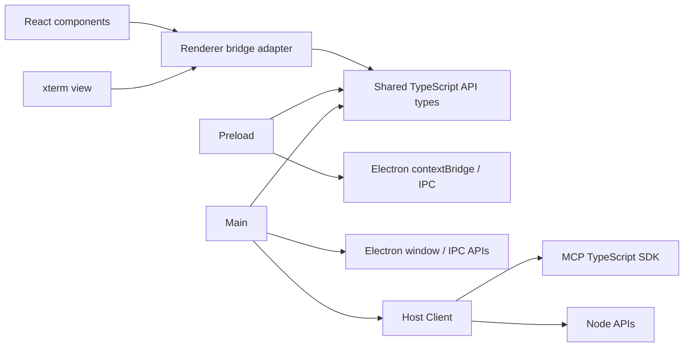
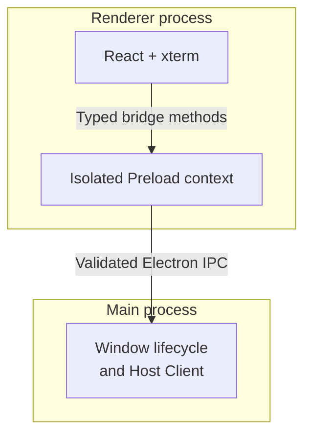
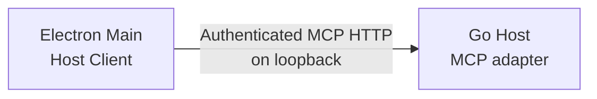

# Electron GUI Architecture

The Electron prototype is an independent desktop client of an already-running ChannelTerm Host.
It attaches to shared Sessions and can request serial or SSH creation from the Host. The Go Host retains the authoritative Application, leases,
Session Manager, Channels, and device connections. See the [overall architecture](overview.md)
and [repository map](repository-map.md) for Go ownership and the detailed source layout.

The [Electron engineering rules](../../gui/electron/AGENTS.md) supplement the root rules for
Electron/React/xterm contributions. This document owns the architecture and current behavior;
the scoped rules define review requirements without claiming that all future test cases or
features already exist.

## Code dependencies



These are source imports, not process or network links. Renderer code imports no Main, Node,
filesystem, child-process, or MCP implementation. Shared types describe the small GUI bridge;
they are not another Host business protocol or a public multi-GUI SDK. React manages views;
the dedicated xterm component manages rendering, local fitting, and input events. Host Client
has no React dependency and never parses CLI output.

The permitted import direction follows these boundaries:

| Owner | Permitted dependencies and boundary |
| --- | --- |
| Renderer feature views and application shell | React/xterm, renderer-local UI, renderer bridge adapter, and shared contracts; no Main/Preload implementations or privileged APIs. |
| Renderer bridge adapter | Shared contracts and the typed `window.channelterm` surface; no MCP HTTP or credentials. |
| Preload | Shared contracts and Electron contextBridge/IPC; no Host Client or business policy. |
| Main | Electron/system APIs, shared contracts, and Host Client; no renderer implementation. |
| Host Client | Shared contracts, MCP SDK, and required Node APIs; no React, xterm, or view state. |
| Shared contracts and locale resources | Serializable types, pure menu descriptions/validators, English message definitions, and generated catalog data; no React, Electron, Node runtime, or process-specific imports. |

Renderer currently has `terminal` and `sessions` features; `components/App` composes their views.
Feature-local hooks, state, and tests can be added when responsibility or verification requires
them. Cross-feature reusable UI belongs in `components`; feature internals are not a shared
service layer. Devices or MCP-related views require actual supported functionality before new
modules are added. They would use the same bridge boundary, not direct Host requests from React.
The current structure requires no global state framework, DI container, or plugin system.

## Workbench layout and display states

The renderer uses a dark terminal workbench with a `#101318` terminal, `#181d25` Session
sidebar, muted slate chrome, and blue selection accents. xterm retains its dark ANSI palette.
Native window chrome is requested in dark mode independently of the OS theme; there is no
theme switcher or custom window-control API. This is application-defined styling.

The native title bar and minimum window size (760 × 500) remain unchanged. The application
area has a 32 px application menu bar, a flexible workspace, and a 32 px full-width status bar.
The menu bar contains only menus, without an application name, logo, or preview banner.
**Connection, Session, Terminal, View, Settings, Help** expose the implemented actions described
in the [menu reference](../reference/gui-menus.md). Renderer popovers and the native Electron
application menu share finite action IDs, state hints, and Lingui catalogs. Language switching
updates all supported menu languages without resizing xterm. The renderer
strip remains the visible Windows/Linux menu surface; macOS also has its native system menu.
The official Lingui CLI maintains PO catalogs and compiles shared resource imports before both
esbuild and Vite run. Each process owns its own Lingui instance; there is no cross-process
translation loader or credential access. See the [maintenance workflow](../development/electron-gui.md#menu-translations-lingui-590).
A 48 px activity rail toggles the 260 px Session sidebar without changing the attachment.
At viewport widths of 900 px or less, the rail/sidebar shrink to 40/210 px and secondary
labels are hidden. The terminal takes the remaining width and height; its 52 px header
shows the single current attachment as a tab-shaped title. The close icon performs **Close tab (detach)**,
not Session close. There is no multi-tab state or background terminal.

The sidebar provides case-insensitive local search by reference, label, endpoint, or transport,
and collapsible Serial, SSH, and Other groups. Group counts reflect the filtered rows; the
overall count still reflects all Host Sessions. Filtering or collapsing rows never detaches
the selected Session. Group expansion and search are temporary view state, not saved profiles.
The list scrolls independently, keeping search and the bottom Host panel visible. Host status,
configured endpoint, and connect/disconnect live in that panel. Reopen a collapsed sidebar
using the activity rail to access these controls. Long endpoints and Session labels truncate
visually with their full value available on hover.
The status bar distinguishes no attachment, enabled input, paused input, lease read-only,
and an unavailable Session. These labels report client snapshots, not write authority. The
bottom terminal hint describes direct xterm input; it is not a separate command composer.
No baud rate, throughput, recent-connection history, or other unavailable metadata is invented.

| State | Display and supported next action |
| --- | --- |
| Host disconnected | Compact terminal hint to connect; Session refresh is disabled. |
| Connecting / attaching / detaching / disconnecting | Named progress text; connection and Session actions are disabled until the operation completes. |
| Host connection failed or lost | Safe error notice, offline status, and **Retry connection**; stale Session entries are removed on connection loss. |
| Connected with no Sessions | **No Sessions available** and **Connection > New connection**; serial setup is available, while SSH requires the standalone Host API. |
| Connected with Sessions but no attachment | **Select a Session**; open Sessions are selectable, closed entries are disabled. |
| Attached | xterm occupies the workspace, the selected Session is marked, and **Close tab (detach)** is available. |
| Lease / rejected input / closed Session / output loss | Existing notices and recovery semantics remain visible; input status reflects the available snapshot. Output-loss notices only belong to the attached view. |

Empty states use a small heading and one actionable hint, without a welcome hero or onboarding
steps. Notices scroll within at most 25% of the workspace height to retain terminal space.
Window resizing only fits local xterm cells; it does not issue remote PTY resize requests.
The measured terminal container has no padding; spacing sits outside it so FitAddon does not
overestimate the available cell area. Application styles do not target xterm's internal
`.terminal` class.

The layout leaves the right edge of the workspace as the design location for a future MCP
activity panel and the area above the status bar for a future file-transfer manager. These
are design reservations only: no blank panels, inactive tabs, feature modules, buttons, or Host
capabilities are implemented. Any later panel must preserve terminal space and use supported
Host contracts through the existing Main/Preload boundary.

## State ownership

| Owner | State and lifetime |
| --- | --- |
| Go Host | Authoritative Application, Session/Transport/device lifecycle, Lease decisions, retained output, and serialized writes. |
| Main / Host Client | Client connection and credentials, request cancellation, local attachment handles, and independent output cursors. Closing these resources does not close the shared Session. |
| Preload | Narrow IPC forwarding; no separate Session, authentication, or Lease state. |
| React views | Selection, connection/status displays, safe errors, and Host snapshots for presentation. Cached Lease state can disable input but cannot authorize a write. |
| Terminal view / xterm | Terminal parser, bounded display history, render pacing, local input queue, and view-owned listeners/observers. Raw output does not flow through global React state. |

Client queues and attachment generations coordinate local work only. They are not a second
writer arbiter or Session Manager. Reattachment and cleanup must reject stale completions; a
write whose result is uncertain is not replayed automatically. xterm's visible state and the
Host's bounded retained bytes do not establish a complete historical terminal-state snapshot.

## Processes and communication

Inside Electron, UI calls cross an isolated context and then a process boundary:



Menu state flows from Renderer through a validated fixed IPC method to Main's native menu
builder. Native selections flow back through a fixed, filtered Preload subscription to the same
renderer dispatcher used by toolbar and context-menu actions. Only known IDs and bounded display
hints cross that boundary. Main's separate fixed quit method uses normal client cleanup. See the
[menu targeting/security contract](../reference/gui-menus.md#targeting-state-and-security).

Main connects to the separately running Host:



Within the Go Host, the request path is:

```text
MCP adapter -> Tool Registry -> authoritative Application
  -> Session / Manager -> Channel (established I/O)
```

Application owns leases and use cases. Session I/O uses MCP Streamable HTTP. SSH creation uses
the separate authenticated [desktop Host API](../reference/gui-host-api.md) and the same
Application; serial scanning/creation uses existing MCP tools.

A Transport establishes the Channel before attachment; it is not an additional hop for every byte.
Preload is an isolated context, not a third application process. The Go Host is not a child owned
by this prototype. Renderer sandboxing and `contextIsolation` are enabled, and `nodeIntegration`
is disabled. The production UI is served through a restricted `channelterm://app/` scheme.

## Existing Host contracts

| GUI operation | Existing MCP tool / behavior |
| --- | --- |
| Connect | SDK initialization; require server name `channelterm`; authenticated Session listing |
| Refresh | `terminal_list_sessions`; project display metadata and public lease summary only |
| Scan / create serial | `terminal_list_serial_ports` / `terminal_open_serial`, explicit settings and `wake:false` |
| Create SSH | Main POSTs bounded settings to the fixed authenticated `/gui/v1/ssh` route; no MCP schema changes |
| Attach / detach | `terminal_session_attach` / `terminal_session_detach` with actor `user` |
| Initial output | `terminal_read` without cursor, Base64, at most 64 KiB |
| Further output | `terminal_read` with Main-owned cursor and a one-second Host wait |
| Ordinary input | `terminal_write`, UTF-8, actor `user`; no delimiter inserted |
| Close GUI | Cancel requests and close MCP client; best-effort detach event only |

The authoritative schemas remain in [MCP tools](../reference/mcp-tools.md). The attachment tools
record events; they do not grant leases or reference-count Session ownership. GUI attachment IDs
are local stale-request guards, never Session IDs or write capabilities. GUI uses opaque Session
IDs returned by the Host; short references, labels, and endpoints are display metadata.

Only one output read is outstanding. The renderer waits for xterm's write callback before requesting
the next chunk, bounding queued output. Base64 preserves raw bytes, including UTF-8 split across
chunks. JavaScript rejects cursors outside its exact integer range rather than rounding them.
On `dropped`, xterm resets its parser/screen before displaying retained bytes and the UI keeps a
visible data-loss notice. Initial attachment shows only the recent 64 KiB snapshot.

Each input payload and each input queue is limited to 64 KiB. Main serializes this client's requests;
the Host still arbitrates all clients. The Session list is refreshed every 1.5 seconds. A displayed
lease disables local input but is never treated as authorization. The Host validates each ordinary
write, including races after a refresh. Failed input and later queued input are discarded, never
replayed automatically. A timeout or disconnect can leave delivery uncertain.

The current ordinary-write busy error can have MCP code `tool_error`. On a tool error the adapter
queries structured Session/lease state rather than parsing human-readable diagnostics. A lease
that ends before that query can leave only a generic rejection message; the adapter never infers
success or retries. EOF, missing/closed Session, authentication failures, and transport failures
stop the affected work and are surfaced to the UI. Reconnection is explicit.

## Security and lifecycle

Main reads the existing Host token or process environment override. No credential goes through
Preload, React, URL parameters, local storage, or renderer error messages. The prototype permits
only numeric loopback HTTP endpoints, refuses redirects, bounds request durations, and requires
the expected MCP server identity. It never opens devices directly or starts a Host;
explicit scanning/creation requests are forwarded to the authoritative Host.
The existing Host authentication, CORS, and Origin checks are unchanged.

Every IPC call checks the exact owning WebContents, its main frame and trusted page URL, argument
count, and relevant input limits. The bridge has no arbitrary tool invocation, lease mutation,
Session close, file access, or process-launch API. Navigation, popups, webviews, downloads, and
permission requests are denied. Production CSP denies renderer network connections. See
[Electron's security guidance](https://www.electronjs.org/docs/latest/tutorial/security).

Detach, reload, renderer failure, disconnect, and window close cancel client work. Closing the GUI
never calls `terminal_close`, releases somebody else's lease, or shuts down the Host. If the Host
advertises attachment-owned lifetime, the UI warns that its original owner may stop it. An absent
lifetime header follows the current Host contract for a separately started persistent Host; it is
not a promise that a remote process will remain running.

## Multiple frontends and release boundaries

Electron is the implemented GUI. Qt is only a possible future independent frontend; there is no Qt
project or shared GUI framework. CLI, Electron, and a future Qt GUI must reuse the authoritative
Host use cases, not copy Core or construct another lease coordinator for shared Sessions. Frontends
must not depend on one another or require a Core rewrite.

The CLI build uses Go only. The GUI build uses Node/npm and emits Main, Preload, renderer assets,
and license notices independently. Go is needed by GUI integration tests, not by its production
build. No CLI release workflow changes. There is no installer, auto-update system, or release job.

A future self-contained GUI distribution can bundle the matching platform's Go Host executable
as a companion, together with its notices. It must not require a separate manual CLI installation
or copy Core sources. Before adding automatic startup, define authenticated existing-Host discovery,
single-owner startup coordination, executable/version selection, and ownership-aware shutdown;
a failed probe alone must not start another Host on the same device. This prototype avoids that
ambiguity by connecting only to the configured running Host.

Targets remain Windows, Linux, and macOS on amd64/arm64 (Electron/Node calls amd64 `x64`). Dependencies
are JavaScript except the platform-provided Electron/build-tool binaries; Go's CGO-free release
boundary is unchanged. Electron runtime packaging, native launch, signing/notarization, and installer
validation are separate per-platform work. Windows desktop tests do not prove Linux/macOS behavior
or arm64 compatibility. See [GUI development](../development/electron-gui.md) for reproducible checks.

## Current gaps

No MCP SSH-open, remote PTY resize, or client-file transfer orchestration API exists. SSH creation
uses the separate desktop Host API. There is no remote resize or file-transfer UI. Local xterm fitting
does not resize the Host's SSH PTY. Existing file-transfer and debug leases are observed, not managed.
There is no built-in Agent, automatic Host startup, installer, persistence of terminal output, or
multi-tab terminal UI. None of these gaps is filled by bypassing Application or changing MCP schemas.
