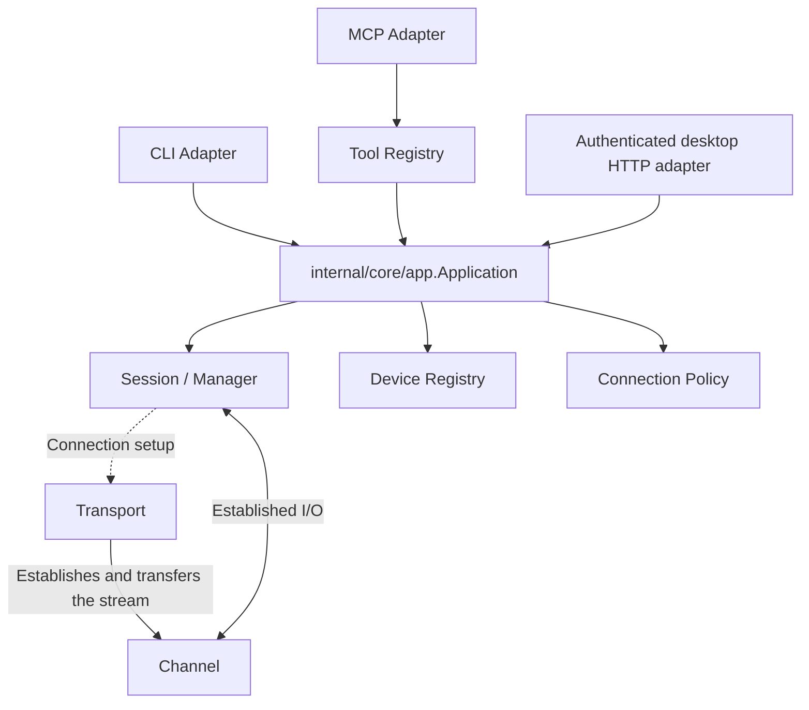

# Architecture Overview

ChannelTerm is shared terminal-session infrastructure for human and AI access to terminal-like
transports. The current implementation is serial-first and is primarily focused on hardware,
embedded-system, and terminal debugging, while the Core remains transport-neutral.



The Transport-to-Channel arrows show connection establishment and ownership transfer. Once open,
Session reads and writes the Channel directly; Transport is not an extra runtime I/O hop.

Application also owns bounded U-Boot entry operations and diagnostic ZIP archives. U-Boot matching
uses a fresh Session output cursor and the existing application writer lease; it never opens a
second Transport. Diagnostic capture observes Session bytes without altering them. MCP exposes
operation/results and bounded archive downloads; CLI saves downloads on the caller's machine.
Archives live in bounded Host memory, with no new listener or Session protocol-specific logic.

`cmd/channelterm` is the composition root. It creates process cancellation and passes standard
streams to `internal/cli/command`. The CLI owns argument syntax, status text, raw console mode,
escape commands, highlighting, HTTP host setup, and MCP client attachment.

Default highlight definitions are adapter-side presentation data shared with the desktop client;
the [repository map](repository-map.md) identifies their canonical owner. Go embeds the JSON and
Electron imports it as data, without depending on Go code or moving presentation into Core.
Each frontend owns stream/terminal rendering; these definitions never transform Session or MCP
output. The desktop's bounded byte highlighter applies them before local xterm rendering.

`internal/install` is an adapter-side operating-system integration boundary. It installs the
currently running executable for one user, owns the `cterm` command alias and any PATH entry it
adds, and records that ownership in a platform-local manifest. It reuses `internal/core/config` to
initialize or purge known configuration files, but it does not define configuration semantics and
does not participate in terminal runtime data flow.

`internal/mcp` converts the protocol-neutral Tool Registry to MCP stdio or Streamable HTTP. MCP
transport disconnects do not own Session lifecycle. `internal/mcp/terminal` owns public tool names,
JSON-shaped schemas, encoding, and result translation; it calls `internal/core/app.Application` for
implemented use cases.

`internal/core/app.Application` is the adapter-neutral use-case boundary. It coordinates profile
resolution, serial and SSH Session open/reuse, Session reads/writes/close, serial and profile discovery,
Device Registry reads, and connection decisions. It returns structured Core values and never formats
CLI or MCP output. Application retains the shared Session Manager directly for transport-neutral
Session operations; `SerialService` is limited to serial configuration and open/reuse orchestration.

The core service boundary contains:

- `session`: lifecycle, Session Manager ownership, raw output retention, activity retention,
  structured event retention, and write serialization.
- `channel`: established protocol-neutral byte-stream I/O and lifecycle state.
- `debugger`: local GDB/MI process control, bounded protocol parsing, and a binary RSP relay.
- `device`: current discovery state, device identity state, and a bounded device-event stream.
- `connectionpolicy`: a pure discovery-response decision; it never connects.
- `tool`: a protocol-neutral callable contract and registry.
- `config`: connection profiles, discovery policy, user preferences, TOML persistence, and managed
  state paths. Preferences are adapter-local and never enter Session or Transport configuration.
- `transport`: protocol-specific Channel establishment.
- `transport/serial`: opens serial-backed Channels and enumerates local serial endpoints.

The concrete SSH implementation lives in `internal/transport/ssh`, outside `internal/core`.
It owns key/trust-file parsing, verified trust persistence, authentication, PTY interactive shell
Channels, and dedicated SFTP/SCP file clients. Application
composes it through plain configuration and the Core Transport contract; `golang.org/x/crypto/ssh`
types remain private to the implementation. Context-aware callbacks carry password input and explicit
unknown-host approval from adapters; Core never performs CLI or GUI interaction. Established I/O crosses only the existing Channel
interface, so Channel and Session are independent of the SSH backend.

Dependency direction is one way: Core packages do not import CLI or MCP packages. A Transport
establishes a protocol connection and transfers the live resource to a Channel. A Channel owns
protocol-neutral read/write/close and lifecycle state but no retained history. A Session is the only
continuous Channel reader and owns retained output. Presentation transformations never enter stored
output.

The shared access boundary is:

```text
Physical endpoint -> Transport -> Channel -> Session -> Client / Attachment
```

Multiple Clients can share a Session within one owning Manager. Readers keep independent output,
activity, and structured-event cursors. Session serializes complete write payloads so concurrent
bytes do not interleave, but the Session layer has no ownership, transaction, priority, arbitration,
or shell-state model. Application-level leases provide temporary exclusive writing for selected
operations such as terminal command execution and file transfer.

## Shared Session arbitration and GUI integration

The owning Host keeps Sessions in its Manager. Its `newMCPRegistryWithPolicy` composition
creates one Application and passes it to `terminal.NewTools`. Ordinary and leased writes,
lease acquisition/renewal/release, file-transfer cancellation/checkpoints, and lease summaries
in `terminal_list_sessions` all reach that Application's lease coordinator. The MCP HTTP
handler reuses the registry across clients; a new protocol connection does not create another
Application. See [Application](../modules/application.md) for lease and recovery semantics.

Shared CLI attachment and SSH foreground input use `mcpAttachSession` and its
`sshOwnerAttachment` wrapper to call those Host tools. These are client adapters, not owners of
the Core Session or arbitration state. Their local owner token, transfer ID, and output cursors
do not authorize writes independently; the Host validates each request. Output remains readable
while a valid lease is held. File-transfer lease expiry closes the original Session locally,
so another client cannot restore access by reconnecting to the same Host entry.

Multiple Applications are not inherently competing writers. The SSH command's separate setup
Application shares the Host Manager but only opens the connection and performs resize; foreground
writes use the Host tools. Local `serial` and private attachment use an Application with their own
Manager. Discovery/target-resolution Applications do not write shared Sessions. The serial wake
write occurs on a connection candidate before Manager registration, outside shared-client access.

The Electron client and any future GUI must preserve these boundaries:

- An external GUI can use the existing authenticated MCP HTTP Host tools for shared access,
  including reads/events, writes, leases, and file-transfer controls. CLI attachment code provides
  an implementation reference; it is internal code, not a public GUI client SDK.
- An embedded adapter must receive the existing authoritative Application for shared operations.
  If exposing MCP, use `terminal.NewTools` with that same instance. Constructing another
  `app.New` with the same Manager creates a separate lease coordinator and must not be used to
  write or manage leases for those shared Sessions. Independent Session collections may retain
  independent Applications; no process-wide singleton is required.
- Do not obtain a Session from Manager and call `Session.Write`, access Channel writes directly,
  or substitute GUI-local locks for Host lease checks. Session payload serialization alone does
  not enforce operation ownership. Query Host lease state rather than treating a local cache as
  permission to write. Close and resize retain their existing policies.

The [Electron GUI](electron-gui.md) attaches to existing Sessions through authenticated MCP HTTP,
with integration coverage using a disposable Go Host and in-memory terminal. Existing interfaces
do not supply an MCP SSH-open or resize tool, or a tool that starts CLI file-send/receive orchestration; those
operations currently have CLI/Core entry points. GUI file selection, transfer orchestration,
and a reusable public client SDK are not implemented here. These gaps do not require a second
arbitrator or a new GUI protocol in the current architecture.

## Current implementation boundaries

Serial and SSH PTY shells are concrete Transports. SSH is opened by the CLI and shared through
the existing authenticated HTTP Host and Session tools; no SSH-specific MCP tool is added.
Stream Channel categories such as file and debug/JTAG are representable but not implemented. The
repository has no public Go SDK, TUI adapter, or persistent terminal log. The Electron frontend is
independent of the CLI build; Qt is a possible future frontend, not an implementation. Session
lifecycle and file-transfer state are available through the bounded Session Event Stream; it is not a Channel
multiplexer or a persistent event log.

## Future direction

The Channel boundary permits future debug/JTAG or remote-network streams without adding protocol
assumptions to Session. Arbitrary SSH exec, Telnet, OpenOCD, and a dedicated file Transport/Channel remain
architectural directions, not current features or commitments. The current CLI file transfer is an
application-layer Linux shell protocol carried over an existing serial Session; it is not another
Transport.

## Managed user-space debugging

Application owns a debug operation above an existing Session, including exclusive lease ownership,
gdbserver startup, heartbeat, cancellation, and verified shell restoration. The debugger service
owns GDB/MI and relays raw RSP through direct Session-service calls. The private Unix socket accepts
only the exact owned GDB PID and user. This managed MI mode uses no TCP listener or loopback MCP recursion.
The initial backend is native Linux only and requires all processes and the ELF in one environment.
See [Application](../modules/application.md#user-space-debug-operations).


## External RSP bridge

A separate Application operation leases an already-open serial Session and exposes a single
credential-authenticated TLS/TCP stream. `internal/core/debugger` supplies endpoint authentication
and the same byte relay used by managed MI. The CLI `rsp-client` adapts GDB's pipe to the authenticated
connection and answers a separate authenticated control heartbeat on the same endpoint; it never
starts or controls GDB. Application uses fresh liveness evidence for automatic
management renewal. MCP retains explicit lifecycle management. Target preparation and debugger control remain with the external operator. No additional Transport, Session reader,
Agent Runtime, or RSP implementation is introduced. Failure/recovery ownership remains in
[Application](../modules/application.md#external-serial-rsp-bridge).
