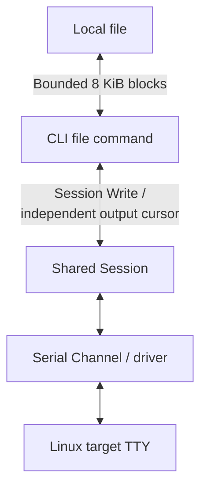

# File Transfer

This guide covers the existing shared-terminal transfer workflow below and
[dedicated SFTP/SCP connections](#sftp-and-scp-over-ssh).

ChannelTerm can stream a regular file or a directory through an existing shared Session without an
AI client or a separately installed board-side transfer program. The board side remains an ordinary
interactive Linux shell.

Agents copying programs or debugging ELFs use this same CLI workflow. MCP exposes its transfer
control/events, but has no client-file upload tool. Do not build a separate Base64/heredoc transfer
with `terminal_write`; those writes are ordinary input and may be displayed and echoed. If the CLI,
local file, or owning HTTP Host is inaccessible, report the missing access instead. With WSL/Windows
interop, local paths and the HTTP credential belong to the OS running the chosen CLI executable.

## Preconditions

- The remote shell is idle, its input line is empty, and it accepts POSIX-style shell commands.
  A recalled history command or other unsubmitted input is rejected before transfer starts. Press
  `Ctrl+C` at the ordinary shell prompt to clear that line, then reopen the transfer menu.
- The board provides `mkdir`, `stty`, `dd`, `wc`, `sha256sum`, and `sleep`.
  The default Base64 mode also requires `base64` (including `-d`) and `tr`.
  BusyBox or GNU userland may provide these commands. Send uses `iflag=fullblock` when available;
  minimal BusyBox builds use one-byte input blocks to count the exact payload without that option.
  Directory transfer also requires `tar`;
  ChannelTerm checks `command -v tar` and does not install it.
- The serial settings already match the board. File transfer does not change baud rate, data bits,
  parity, stop bits, or flow control.
- Other Clients may keep reading with their independent Session cursors. ChannelTerm acquires a
  Host-side `file-transfer` lease that blocks its other writers during transfer; it cannot prevent
  unsolicited output or writers that bypass ChannelTerm.

First create or join a shared serial Session in one terminal:

```powershell
channelterm attach COM8 --baud 115200
```

The default `attach` workflow starts the local loopback Session Host automatically when necessary.
There is no need to start `channelterm mcp` manually or configure an AI client.

In another terminal, send a file to the board:

```powershell
channelterm file send firmware.bin
```

With no remote destination, this command-oriented path stores the file as
`/tmp/cterm/mcp-files/firmware.bin`. ChannelTerm creates `/tmp/cterm/mcp-files/` when it is absent
and reuses the directory when it already exists. Supply a remote destination explicitly to save
somewhere else.

In a third terminal, observe the shared transfer state without rendering raw file bytes:

```powershell
channelterm events SER-1
```

Automation clients must use `terminal_wait_file_transfer`, not raw-output `terminal_wait`, to
observe a final transfer result. See [MCP Server](mcp-server.md#waiting-for-a-file-transfer) for the
workflow and [MCP tools](../reference/mcp-tools.md#terminal_wait_file_transfer) for the result
schema.

Receive a file from the board:

```powershell
channelterm file receive /tmp/log.txt ./log.txt
```

The same commands automatically recognize directories. No separate directory command is needed:

```powershell
channelterm file send .\build\release /tmp/release
channelterm file receive /var/log/myapp ./myapp
```

When more than one shared Session is open, select one explicitly:

```powershell
channelterm file send firmware.bin --session SER-1
channelterm file receive /tmp/log.txt ./log.txt --session SER-1
```

`--endpoint` selects a non-default Session Host endpoint. The file command never starts a host or
opens a Serial Transport itself; it attaches to an already-open Session and leaves that Session open
afterward.

### Manual resume for serial files and directories

Opt in when starting a transfer. Without `--resumable`, the existing cleanup behavior is unchanged.

```powershell
channelterm file send .\build\release /tmp/release --session SER-1 --resumable
channelterm file receive /var/log/myapp .\myapp --session SER-1 --resumable
channelterm file jobs --json
channelterm file resume JOB_ID --session SER-2
```

Replace `JOB_ID` with the printed checkpoint ID. In Electron, enable **Keep a checkpoint for
manual resume** in the send/receive dialog. After interruption, reconnect the Host and open the
same serial endpoint manually, then choose **Session > Resume transfer** (also available in a
Session's context menu). The list is filtered by Host URL and serial endpoint, not the old Session
ID or `SER-N` reference. It shows up to 128 incomplete records; each start still acquires the
ordinary Host file-transfer Lease. Neither GUI nor CLI reconnects or retries writes automatically.
The GUI progress bar uses Host events for these operations, including transfers initiated by CLI/MCP
clients using the CLI workflow.

Resume requires an absolute device path. Uploads keep a local immutable snapshot; directory
snapshots are tar archives. Later edits to the original local source do not alter that snapshot.
Directory downloads retain a remote tar snapshot under `/tmp/.channelterm-transfer-JOB_ID/`;
file downloads reread the original remote file and reject any size or SHA-256 change. Snapshots
require additional free disk space, potentially as large as the source, plus publication staging.
Board reboot or `/tmp` cleanup can destroy a remote directory snapshot; this is not recoverable.
GUI/Host restarts preserve client checkpoints, but do not preserve or reopen the live Session.

Before resuming, the source snapshot and confirmed prefix are verified. Downloads sync local
bytes before recording progress; uploads record only acknowledged 8 KiB boundaries. An incomplete
final block is not counted as confirmed. Unconfirmed trailing bytes are trimmed only after prefix
verification and an explicit resume request; the remaining source is then transferred. File
contents, checksums and progress count original bytes, independent of Base64 framing. Resume
uses the saved wire mode; `file resume` rejects attempts to change it with `--wire`.

Uploads stage beside the destination in `.channelterm-transfer-JOB_ID/`. Resumable file publication
requires peer `ln -T`; directory publication requires `mv -nT` and `tar`. These options prevent a
newly appearing directory from turning publication into an unintended nested copy. Unsupported
tools fail closed; the required publication flags are probed in owned staging before payload streaming.
Other processes must not modify the source, staging or destination during the
operation; a ChannelTerm Lease does not lock the board filesystem against unrelated programs.
Downloads stage beside the local destination and use an exclusive rename on supported desktop
platforms; filesystems without that operation fail closed. Existing names select an unused `_N`
sibling, and publication refuses replacement.

The checkpoint is marked `publishing` before the final filesystem operation. If its outcome is
uncertain, the job remains visible with **inspect the destination manually**, and Resume is disabled.
Inspect the final path and retained snapshot before starting a new job; ChannelTerm does not repeat
the rename/extraction or declare success from an unconfirmed result. A successful publication leaves
a small completion receipt and removes owned payload staging. Cleanup failure is reported separately
from the recorded completed state. Interrupted jobs retain their payloads until explicitly dealt with;
there is no automatic expiry or background resume. See [checkpoint storage](../reference/configuration.md#paths)
before manually removing an abandoned job; never remove its published destination as cleanup.

### Transfer encoding and compatibility

GUI and CLI transfers default to `base64`. The application sends bounded ASCII payload records
through the same Session and lease, confirms each block, and verifies SHA-256 over the original
file bytes. Terminal character encoding does not affect files. Base64 adds roughly one third to
payload size plus framing overhead. The device's existing TTY flow-control settings are preserved,
so configure XON/XOFF consistently at both ends. Missing peer Base64 tools fail before file
creation; there is no automatic fallback or write replay.

For a compatible eight-bit link without XON/XOFF, select **Raw** in the GUI file dialog or use:

```powershell
channelterm file send firmware.bin /tmp/firmware.bin --session SER-1 --wire raw
channelterm file receive /tmp/log.txt ./log.txt --session SER-1 --wire raw
```

`--wire base64` selects the default explicitly. This intentional default change requires older
devices without Base64 support to use `--wire raw`; no remote tools are installed automatically.
Raw mode retains its original 8 KiB byte protocol and is unsafe with XON/XOFF because DC1/DC3
are flow signals. Base64 uses 2 KiB sub-blocks within the same bounded streaming loop; progress
still counts confirmed original bytes. Extremely long quoted paths that would exceed the safe
command-line bound are rejected in Base64 mode. No MCP tool name, parameter, or result changes.

For every send, ChannelTerm creates a missing remote parent hierarchy with `mkdir -p` before it
writes the file or directory. An existing hierarchy is reused. `send` and `receive` never silently
overwrite their target. If the requested remote or local name exists, ChannelTerm chooses the first
free sibling using `_1`, `_2`, and so on, preserving extensions including `backup.tar.gz` and
`.env`. `receive` writes and verifies a temporary local file first, then installs it only when the
chosen destination remains absent. Confirm both paths before running the command. A non-default Host
endpoint is a terminal-control boundary and must be trusted. The HTTP Host requires a Bearer token
but does not provide TLS or per-tool authorization. The feature does not change the loopback-only
default listener.

Each transfer uses one non-interactive child shell. Interactive Bash removes the bootstrap from its
current in-memory history only when its fresh token identifies that entry; `HISTIGNORE` and disabled
history never cause deletion of an earlier user command. Other POSIX shells may retain one
recognizable bootstrap entry. Internal probing, chunking, verification, and cleanup commands run in
the child rather than becoming separate interactive-history entries.
Existing history entries from older clients or ordinary terminal input are not retroactively removed.

Child-shell startup has a 15-second deadline. A missing readiness response triggers bounded recovery
instead of keeping terminal input locked indefinitely; an unresponsive recovery closes the Session.
Startup/recovery timeouts are reported as failures even when closing the Session also cancels the attachment.
This startup deadline does not limit transfer duration. Ordinary commands typed or sent with
`terminal_write` retain the shell's normal history behavior. Agents requiring history-free command
execution at an idle Bash prompt should use `terminal_exec`.

## Electron file picker and progress

On an open serial Session, choose **Session > Send to device** or **Receive from device**;
the Session context menu binds the same actions to the clicked Session. These actions require
an idle POSIX Linux shell and the preconditions above, not a bootloader or an arbitrary serial
protocol. The picker initially queries `.` in a temporary child shell, inheriting the terminal's
actual current directory. Double-click a directory, use Up, or enter a device path. This navigation
does not run `cd` in the interactive parent. **Terminal directory** queries its current location
again rather than guessing it from prompt text. Queries briefly reserve the existing file-transfer
lease. Pending interactive input is rejected; clear it yourself at the ordinary prompt first.

For send, choose a local file or folder and browse the destination directory. For receive, select
a device file/folder and choose a local destination folder; without an entry selected, the action
receives the displayed directory. Existing targets retain the CLI's `_N` collision policy. Regular
files and directories are supported; links and special entries are disabled. Listings include hidden
entries, show at most 256 entries with a truncation notice, and require `od` and `tr` in addition
to the existing shell tools. Listing has a 30-second operation deadline plus bounded cleanup.
UTF-8 names are supported; control-character names and unsafe local Windows aliases are rejected.
There is no remote rename/delete, pagination, filesystem watch, or persistent browser state.

The collapsible GUI panel renders confirmed byte progress from Host events, including transfers
started by other CLI/AI clients through the existing managed workflow. It does not embed a CLI
progress bar or render the transfer's raw payload into xterm. The final result waits for verification
and lease release. The GUI observes up to 16 listed open serial Sessions, keeps at most 64 local
status rows, and displays the latest eight. Event loss is reported as unknown rather than invented
success. This is bounded live observation, not a durable task history.

Cancel opens a dark in-app confirmation using the Host's confirmation and safe-boundary protocol.
Continue is initially focused; Escape or dismissing the overlay continues the transfer. Only the
explicit Cancel transfer button confirms cancellation. Main binds the answer to the original
Host request and Session, consumes it once, and withdraws pending confirmation on disconnect or
window reload/close. An expired request is rejected rather than applied to a replacement transfer.
While a GUI file operation is
running, disconnect/reconnect and app exit are rejected until it finishes or is cancelled. Closing
a tab still only detaches the view. A crash or lost Host connection cannot guarantee target cleanup;
the existing lease-expiry and recovery rules below remain authoritative. No uncertain operation is
automatically retried. File dialog errors do not imply that restarting a transfer is safe.

## Attach shortcut

While attached, press `Ctrl+] f` to open a local file-transfer menu. It uses the same shared
Session, Application transfer implementation, 8 KiB streaming, SHA-256 verification, and Host-side
`file-transfer` lease as the `channelterm file` command.

```text
Ctrl+] f
File transfer:
  s  Send PC -> Board
  r  Receive Board -> PC
  Esc  Cancel
Select:
```

Press `s` or `r` once; no Enter is required. Invalid keys remain local, and `Esc` closes only the
menu. Send prompts for a local path and defaults the board destination to
`/tmp/cterm/user-files/<local-basename>`. Receive prompts for a board path and defaults the local
destination to `./<remote-basename>` relative to the directory where `attach` started. Board paths
use POSIX syntax; local paths use the current platform's rules.

Normal attach `Ctrl+C` goes to the board. During a transfer, ordinary keys are discarded locally and
`Ctrl+C` instead opens `[ChannelTerm] Cancel file transfer? [y/N]:`. Only `y` or `Y` confirms; every
other answer resumes. The Host retains its lease while the question is pending, so another
ChannelTerm writer cannot enter the shell protocol.

When cancelling a transfer owned by another client, the Host gives the confirmation request 30
seconds. An unanswered request is withdrawn even if the prompting client disappears and the
transfer owner continues renewing its lease. The owner may continue only if its original transfer
and lease remain valid; it may instead have completed, expired, or closed independently. This
confirmation timeout does not cancel the transfer, release the lease, or close the Session. A
confirmed cancellation is never undone by that timer.

The CLI also limits its local answer window and rejects late answers. After its timeout notice,
the next key only dismisses the notice and is not sent to the device. The Host remains authoritative:
if a request is no longer valid, the CLI reports the rejection or unavailable status rather than
claiming that transfer resumed. Start a new confirmation only for a still-active transfer.

A confirmed cancellation stops at a safe block boundary, restores the target TTY, removes temporary
transfer data, releases the lease, and reports the last confirmed byte count. If the transfer client
disappears, lease expiry blocks new input and operations, then closes the original Session even
while it is waiting for READY, ACK, or receive data. An unconfirmed recovery also closes the Session,
including output loss or protocol errors rather than only timeouts. This stops local access; it
does not establish that the remote program exited or its TTY recovered. Inspect and recover device
state independently before reconnecting. A new connection alone does not establish safety.

## Transfer flow

The client uses the existing shared terminal path:



On the target, Base64 records decode/encode a bounded block and acknowledge it without
entering raw TTY mode. Explicit raw mode follows this sequence:

```text
Save TTY mode -> stty raw/no-echo -> dd reads or writes a chunk
  -> restore saved TTY mode -> acknowledge the block
```

Final verification uses `wc -c` and `sha256sum`; send and receive differ as described below.

The Serial Transport established the Channel before transfer; ongoing I/O uses that Channel.
For each raw chunk, the shell saves its TTY mode, enters raw/no-echo mode, transfers one bounded block,
restores the saved mode, and acknowledges the block with a per-transfer token. In both modes progress advances
only after acknowledgement. Start, progress, completion, cancellation, and failure are published as
structured Session events rather than inserted into raw terminal output.

The CLI displays a 20-cell ASCII progress bar with confirmed percentage, byte counts, speed, and
ETA. A successful regular-file transfer then reports both SHA-256 values, verification status, and
the saved path. Cancellation and failure report the last confirmed byte count and reason instead.

Shared attachments suppress only ChannelTerm's internal transfer range while continuing to advance
their own output cursors. Ordinary board output and independent MCP readers remain raw and
unchanged; suppressed protocol data is not replayed after the transfer ends.

For send, ChannelTerm hashes bytes as it reads the local file. After the final chunk, the board
computes the stored size with `wc -c` and digest with `sha256sum`; both must match.

For receive, the board announces size and digest before streaming. ChannelTerm writes to a temporary
file beside the selected destination, hashes the stream, and installs it at that path only after
the digest matches. An existing name selects a free `_N` sibling; if the final destination check
finds that path occupied, the operation refuses to overwrite it. A failed receive removes its
temporary file. This is separate from the explicit overwrite options of SFTP/SCP below; destination
checks do not lock the filesystem against unrelated writers.

## Protocol and concurrency limits

The protocol is deliberately shell-oriented rather than a new board agent. Control markers are ASCII
lines containing a random token; payloads use Base64 by default or raw bytes with `--wire raw`.
Neither mode loads the complete file into memory. Control records are bounded to 64 KiB.

Session still guarantees byte serialization for each individual write. Above it, the Host holds one
exclusive `file-transfer` lease for the complete CLI command. Other ChannelTerm writers fail
immediately with a clear locked-session error, while the leased command uses its opaque owner
capability for every write. Confirmed cleanup releases the lease after success, failure, or
cancellation and preserves the connection. If cleanup cannot be confirmed, the client requests
closure and does not release the lease for reuse. If the close request fails, renewal stops and
Host-side lease expiry closes the Session. Unlike earlier behavior, an expired file-transfer lease
never permits a replacement operation on the original Session. These controls cannot
stop shell prompt hooks, unsolicited device output, or writers that bypass ChannelTerm, so keep the
endpoint itself quiescent. Independent `attach`, `terminal_read`, and `terminal_wait` readers remain
valid, although a receive transfer's wire records are visible in their raw Session output and may
not be suitable for terminal rendering.

In raw mode, if the command is interrupted while a send chunk is waiting for bytes, ChannelTerm pads only that
announced 8 KiB-or-smaller interval and waits for the shell to restore its saved TTY mode before
releasing the lease. Directory transfers use the same acknowledged block boundary, then remove their
temporary target archive instead of draining the untransferred remainder. If the Session or device
disappears, reconnect locally and run `stty sane` on the board console if its terminal mode was not
restored.

Directory tar streams use temporary target-side archives to make every raw-terminal interval
bounded. PC-to-board creates a hidden archive beside the destination, then extracts into a hidden
staging directory. Board-to-PC creates its archive under target `/tmp` and extracts received blocks
into a hidden local staging directory. The target needs enough temporary free space for the archive
and, during a send extraction, the staged directory. A staged directory is renamed only after the
full stream and extraction succeed. Local extraction rejects absolute or parent-traversal paths and
rejects symlinks, hard links, devices, FIFOs, sockets, and other special entries. Directory progress
counts tar-stream bytes. Both endpoints compute SHA-256 over those exact tar bytes before reporting
success, so corruption is rejected even when the damaged stream remains a valid tar archive.
Extraction and staging commit must also succeed. The digest verifies the transferred archive bytes;
it is not a canonical content hash that remains stable across separate tar creation runs.

The current implementation does not provide resume, compression, zip, incremental synchronization,
sparse-file preservation, permissions/ownership preservation, symlink or hard-link handling,
per-chunk checksums, coordination with writers that bypass the Host, or non-Linux shell support.

## SFTP and SCP over SSH

Use these commands for a server with an SFTP subsystem or a POSIX shell and legacy `scp` executable.
The client runs on Windows, Linux, and macOS without requiring local OpenSSH programs. Each command
authenticates a separate connection with the same password/key and host-trust rules as
[SSH terminal login](ssh-terminal.md#prerequisites). No shared terminal Session is needed.

```powershell
channelterm sftp user@192.168.1.50 ls /tmp
channelterm sftp user@192.168.1.50 mkdir /tmp/my-transfer
channelterm sftp user@192.168.1.50 put .\firmware.bin /tmp/my-transfer/firmware.bin
channelterm sftp user@192.168.1.50 get /tmp/my-transfer/firmware.bin .\download.bin
channelterm sftp user@192.168.1.50 stat /tmp/my-transfer/firmware.bin
channelterm sftp user@192.168.1.50 rename /tmp/my-transfer/firmware.bin /tmp/my-transfer/old.bin
channelterm sftp user@192.168.1.50 rm /tmp/my-transfer/old.bin
channelterm sftp user@192.168.1.50 rmdir /tmp/my-transfer
```

Replace the user and address with your actual server. `ls` defaults to `.` when no path is supplied.
Paths containing spaces must be quoted. Relative remote paths use the server's starting directory;
there is no wildcard or tilde expansion. Missing parent directories are not created automatically.
Remote `..` components are resolved by the server, including when a preceding component is a
symlink; appended child names do not change that interpretation.

For directories, explicitly add `--recursive` (`-r`). Legacy SCP has the same put/get command shape:

```powershell
channelterm sftp user@192.168.1.50 put .\release /tmp/release --recursive
channelterm scp user@192.168.1.50 get /tmp/release .\received-release --recursive
```

If the destination already names a directory, the source basename is appended. Existing files or
tree entries are rejected by default; choose `--overwrite` to replace files or merge directories.
SCP is explicitly the legacy wire protocol, whereas current OpenSSH `scp` normally uses SFTP.
Use SFTP unless the server requires legacy SCP. SCP's remote existence guard is not atomic against
unrelated writers. SFTP has exclusive file creation, but preflight type checks still do not lock
the filesystem against other processes. Avoid concurrent changes to source/destination trees.

Ctrl+C cancels the file connection without closing any independently running terminal Session.
`--operation-timeout 2m` provides an overall deadline, including authentication prompts. The ordinary
`--timeout` applies only to setup, excluding prompt wait time. Interrupted or failed transfers can
leave partial files and directories; with overwrite enabled a previous file can be truncated.
Inspect the target before retrying. SFTP can manually resume a single regular file as described
below; there is no SCP/directory resume, rollback, automatic reconnect, or atomic tree replacement.
SSH protects transport integrity. To additionally check file content, opt into
`--verify=sha256` (the default is `none`):

```powershell
channelterm sftp user@192.168.1.50 put .\firmware.bin /tmp/firmware.bin --verify=sha256
channelterm scp user@192.168.1.50 get /tmp/firmware.bin .\download.bin --verify=sha256
```

Verification applies to every regular file, including empty files and files in recursive copies.
SFTP uploads hash the source stream and read the closed remote destination back; this requires
remote read permission and adds a full-file return trip. SFTP downloads hash the incoming stream
and reread the closed local destination. SFTP-only accounts work without a shell or hash utility.
SCP runs a fixed remote `sha256sum` command using the same dedicated SSH connection and compares
it with the local digest. The remote POSIX shell must find `sha256sum` in PATH; this prerequisite
is checked before transferring anything. Missing tools, read errors, and mismatches fail explicitly.

Both terminal and redirected output show `Verifying SHA-256`, the local and remote digests, and
`Verify: SHA-256 matched` when equal. The file is counted as completed only after verification and
any replacement succeed. Ctrl+C and `--operation-timeout` cover checksum work as well. Hashing adds
I/O and takes time after the payload bar stops advancing. It does not promise physical disk
durability or lock either file against concurrent writers. Keep source and destination stable.
Without safe replacement, a verification failure leaves the destination for inspection.

For SFTP, protect an existing destination during copying with explicit staged replacement:

```bash
channelterm sftp user@192.168.1.50 put ./firmware.bin /tmp/firmware.bin --overwrite --safe-replace --verify=sha256 --operation-timeout 2m
```

This also works for `get` and recursive copies, one file at a time. Each file is copied to a random
`.channelterm-*.part` sibling and renamed only after a successful copy, close, and requested
verification. A checksum failure preserves the old destination and attempts staging cleanup.
Upload requires
the server's POSIX rename extension; unsupported servers fail before staging. Downloads sync the
temporary file first; atomic visibility depends on the local OS/filesystem. No delete-first
fallback is used. The destination directory must permit creating and renaming files. Replacement
creates a new file: previous permissions, ownership, ACLs, and hard-link identity are not preserved.
There is no whole-tree rollback; earlier completed files remain replaced. On disconnection, a
remote staging file can remain and its path is reported for inspection. A lost rename response
can mean the replacement succeeded even though the operation reports an error; inspect before retrying.

`--keepalive-interval 10s --keepalive-count 3` can detect an unresponsive SSH connection. It does
not detect a stuck file operation on a server that still answers probes; use `--operation-timeout`
for an overall limit. Both shell and file connections leave keepalive disabled by default.

SFTP payload copying currently uses sequential 32 KiB reads/writes. Throughput can be limited by
network round-trip time even when link bandwidth is high; parallel request pipelining is not a
current guarantee. Test representative file sizes and network latency before treating this workflow
as a bulk synchronization tool.

In an interactive output terminal, SFTP/SCP put/get uses the serial transfer bar style, for example
(illustrative values):

```text
SFTP put: Ctrl+C cancels.
File 1: "firmware.bin" (0 completed)
[##########----------] 50.0%  4 MiB / 8 MiB  2 MiB/s  ETA 2s
```

The bar refreshes in place at most five times per second during each file's payload. File boundaries
and the final frame always display. For recursive copies, the percentage, speed and ETA belong to
the current file, while the completed-file count advances across the tree. Empty files also finish
at 100%. Success is shown only after closing/acknowledging/verifying/replacing the file, not merely after its
last payload byte. Ctrl+C still cancels immediately without a confirmation menu. Failure/cancellation
prints the partial counts and explains possible partial or temporary files. Redirected output omits
the animated bar; requested verification reports are still printed before completion/error messages.

Only regular files and directories are uploaded. SFTP downloads reject symlinks and special entries.
Legacy SCP may follow remote symlinks according to the server's scp behavior; received names still
undergo local containment checks. Downloads reject traversal, unsafe Windows aliases, case-insensitive
duplicates, more than 100,000 entries, and nesting beyond 128 components. Local files/directories
are created with 0600/0700 modes subject to the operating system. Ownership, timestamps, ACLs,
sparse-file layout, and full permission preservation are not transfer contracts.

For acceptance testing, use a new disposable directory: round-trip binary and empty files, names
with spaces/Unicode, and a nested tree using `--verify=sha256`; compare hashes of the local source
and download. Also check that a missing remote `sha256sum` rejects verified SCP before copying. Verify
that existing-target writes fail without overwrite, missing sources fail, nonempty `rmdir` fails,
and Ctrl+C interrupts an active operation. Record the client version, protocol, exact error, and
whether authentication or transfer failed; never record passwords or private-key contents.

These commands do not add MCP tools or persistent connection profiles. rsync, FTP/FTPS, an
interactive SFTP REPL, and remote-to-remote copies are not implemented.

### Resume a single SFTP file

After an interruption, repeat the original put/get with the same source and destination and
`--resume`:

```bash
channelterm sftp user@192.168.1.50 put ./firmware.bin /tmp/firmware.bin --resume
channelterm sftp user@192.168.1.50 get /tmp/firmware.bin ./download.bin --resume
```

The client compares the entire existing destination with the source prefix before appending.
A different prefix or a destination larger than the source fails without writing file data.
A missing destination starts from zero; an already complete file is still verified. Resume
always performs full SHA-256 destination readback, so uploads require remote read permission.
The progress bar starts at the verified offset, while speed and result bytes count only newly
transferred bytes. Prefix checks and final verification can take time without advancing the bar.

This mode accepts only a single regular file. It cannot combine with `--recursive`, `--overwrite`
or `--safe-replace`, and SCP rejects it. Keep both files stable during transfer; there is no
snapshot, persistent job database or automatic retry. Cancellation retains the partial destination
for another explicit attempt. A final checksum failure also retains the file for inspection.

### Electron SFTP/SCP progress and resume

Select an open SSH Session and choose **Session > Send to device / Receive from device** (also available
on its context menu). Choose SFTP or legacy SCP, enter a literal remote path, and use the native
picker for the local file/directory or download folder. Enable the directory option for recursive
downloads. The destination's parent must exist. Relative paths use the SSH server's starting
directory, not the selected terminal's current directory.

Authentication uses a separate connection from the desktop computer. Enter any required password,
key/passphrase and known-hosts path again; Host-side credentials are not retrieved. Key and trust
paths refer to the desktop computer. Unknown hosts fail: establish trust separately using the CLI
before retrying. Credentials are passed privately to the fixed Go file client, never saved in
transfer history. The GUI always verifies SHA-256; SCP therefore requires remote `sha256sum`.

The transfer panel shows current-file bytes, progress, speed and verification state. Cancel stops
this dedicated connection immediately and can leave a partial file; the terminal Session remains
independent. To resume, repeat the selection with the same paths and enable **Resume an existing
partial file (SFTP)**. This is separate from **Session > Resume transfer**, which lists serial checkpoints.
SCP and directory transfers have progress but no resume option. Existing files otherwise fail
rather than being overwritten. Only one desktop file operation runs at a time; active operations
block Host changes and normal app close. SSH display history is bounded and is not persisted.
