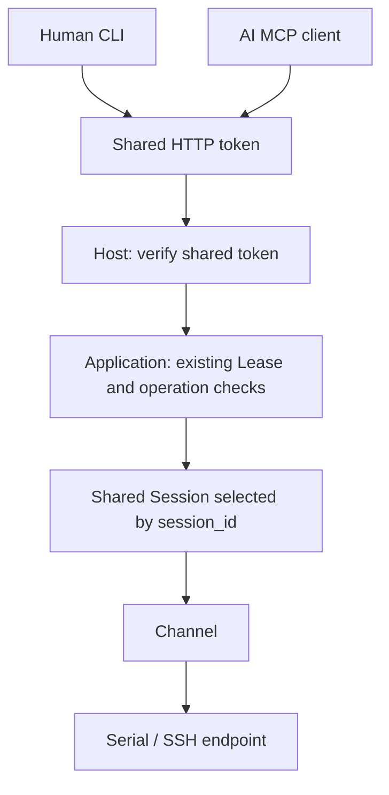
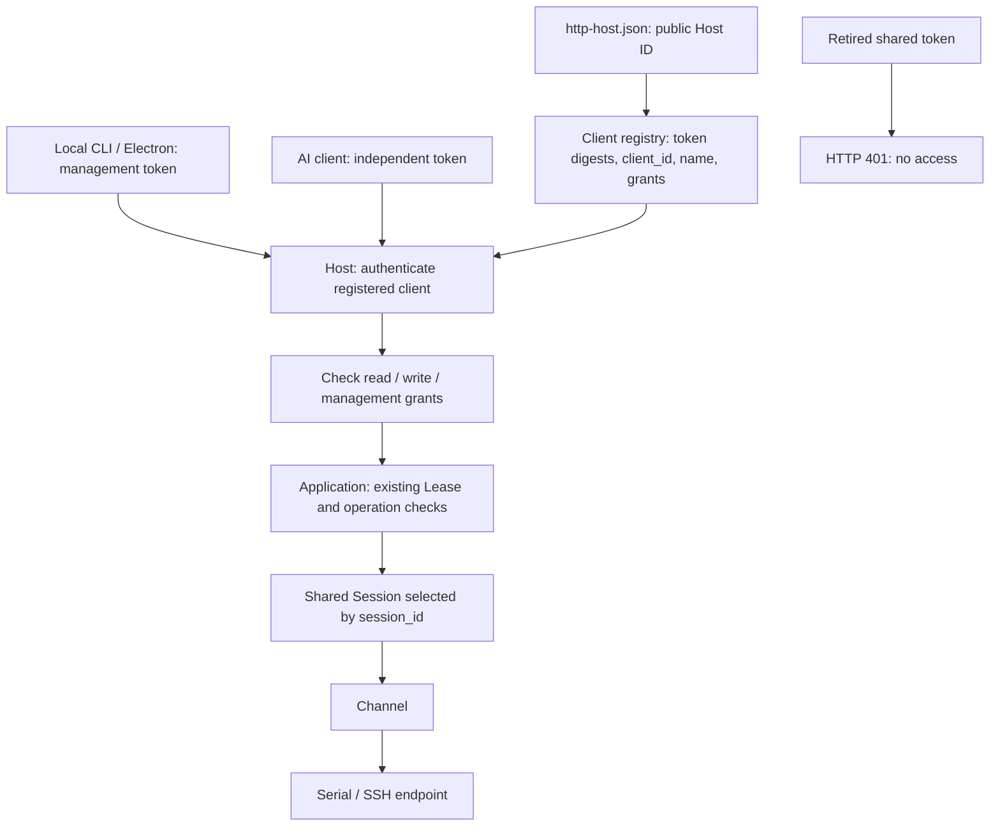

# HTTP Authentication Migration

Compare v0.4.2 with the current unreleased authentication architecture, then choose the upgrade
path for CLI, Electron and AI clients. This guide owns migration steps and compatibility differences;
current storage and identifier contracts remain in the [configuration reference](../reference/configuration.md#independent-http-client-credentials)
and [identifier reference](../reference/identifiers.md).

## Architecture change: v0.4.2 to the current unreleased implementation

The purpose of this change is to identify the client initiating an operation and allow a local
operator to grant or revoke one AI client's access independently. In v0.4.2, possession of the
shared token did not distinguish human and AI clients; a caller-provided `actor` label was not
authenticated identity. The new implementation binds credentials to public client identities
and checks their grants before admitting an operation.

These diagrams show HTTP access. Stdio retains the local OS account's trust boundary. The Electron
client shown in the second diagram was not part of v0.4.2.

**v0.4.2: clients share the same credential.**



**Current implementation: independent client credentials and a separate Host identity.**



| Contract | v0.4.2 | Current unreleased implementation |
| --- | --- | --- |
| HTTP credentials | One shared token | Separate local management and registered AI credentials |
| Client identity | No credential-bound public client ID | Registered token identifies a public `client_id` and source |
| AI writes | No per-client grant check; existing operation/Lease checks still apply | Read-only until an explicit Host-wide write grant; no management grant |
| Individual revocation | Cannot revoke one holder of a shared token independently | Revoke writes or remove that client's registration for subsequent requests |
| Host identity and registry | No separate Host identity or independent-client registry | Persistent public Host ID selects the registry independently of tokens |
| Old shared token | Accepted | Rejected with 401, including read requests |
| HTTP `init --mcp` / `--mcp-show` | Load or create the shared token | Require an explicit independent client credential |
| `session_id` | Addresses a live shared terminal, not an authorization capability | Same meaning; knowing an ID grants no access |
| Terminal data path | Application / Session / Channel / Transport responsibilities | Same ownership boundaries; operation events gain authenticated provenance |

This changes authentication, authorization and provenance, not the underlying shared-terminal
ownership model. It adds registration and migration state in exchange for independent client
control. A write grant currently covers the whole Host. Revocation does not stop an accepted
operation; per-Session AI pause, cross-call control and human takeover are not implemented.
See [current data flow](../architecture/data-flow.md#http-client-attribution) for layer ownership.

The earlier development-only arrangement that accepted the old token as read-only and used its
hash to locate the registry is **neither v0.4.2 nor the current architecture**. Hash-based paths now
exist only as migration inputs; the running upgraded Host does not depend on the retired token.

## Choose the upgrade path

- **From v0.4.2:** there are no independent client registrations to preserve. The upgraded Host
  creates its new identity and local management credential. Register an independent credential
  for each AI client, update its configuration, and explicitly grant writes when intended. The old
  shared token is not converted into an authorized client credential.
- **From an unreleased build with independent registrations:** migration preserves those existing
  independent tokens, client IDs and grants. This preservation does not apply to the old shared
  token itself. Default and explicitly selected legacy-domain migration are described below.

## Upgrade and verify

Upgrade the Host and bundled CLI/Electron together. Finish device operations, then stop old Hosts
and local credential-administration commands before migration. Old processes retain their old
permissions and registrations until stopped; upgrading files alone does not revoke them. Existing
Sessions belong to the old process and are not restored by an upgrade.

On first use without `http-host.json`, the new version imports the registration table selected by
the existing default `http-auth-token`, preserving all client IDs, names, grants, credential digests
and any valid local management token. It never registers the old shared token. The new Host rejects
that token with HTTP 401 for both reads and writes. If only the old token exists, first use creates
a fresh identity and local management registration; AI clients need new independent credentials.

For custom legacy domains or multiple old registration tables, migration refuses to guess. Select
the intended authentication directory with `CHANNELTERM_HOST_CONFIG_DIR` and run
`channelterm clients migrate --legacy-token-file PATH` before initialization. PATH contains the old
shared token, not an AI token; the matching old table must be in the selected directory. Keep
separate domains in separate directories. Explicit migration refuses to overwrite an initialized
Host or merge unrelated domains. Repair corrupt files or an invalid/revoked local credential
before retrying; failed validation never publishes a new identity.

After starting the new Host, verify existing independent credentials and grants still work, and
that the old shared token receives 401. Once verified, old `http-auth-token`, its `.lock`, and the
selected old `http-clients-<SHA-256-of-old-token>.json` / `.local-token` / adjacent lock files can be
removed or archived privately: they are retained as backups, never consulted again after migration.
Keep `http-host.json`, `http-clients-H-<id>.json` and its `.local-token`. Deleting old backups is not
part of automatic migration. Downgrading can re-enable old authorization and cannot read new-domain
changes; do not run old and new versions against the same live authentication state.

For local CLI/Electron, unset an override containing the retired shared token to use the independent
local management credential. For each AI client, use local administration under the Host account
and matching `CHANNELTERM_HOST_CONFIG_DIR`:

```powershell
channelterm clients add --name "Board debugging agent" --kind agent --credential-file ./agent-token
channelterm clients list
channelterm clients grant CL-<ID-from-add>
```

`add` prints only public registration JSON and refuses to overwrite the credential file. The new
agent is read-only until `grant`; this grant covers device operations on the whole Host, not a
single Session. Give the issued token only to that client. In a separate client-configuration shell,
set `CHANNELTERM_HTTP_AUTH_TOKEN` from this private file and use `channelterm init --mcp-show codex`
(or the other supported client name) to generate the matching configuration. The printed
configuration contains the secret: keep it private. Update the existing client entry/header;
`init --mcp` intentionally does not replace existing entries. Reload that client afterward.
Pass the same independent credential to any CLI transfer executor so attribution is preserved.

Verify a list/read succeeds before granting; a write must return `permission_denied`. After the
explicit grant, test an intended safe operation on the selected target. `clients revoke CL-...`
restores read-only access for new requests; `clients remove CL-...` rejects all future requests.
Revocation does not stop an already accepted command/transfer/debug operation. End it through its
normal cancellation/recovery path first, then revoke. Do not treat a permission error as proof that
previous device actions stopped or retry uncertain writes automatically.

Agent grants allow the caller's capability-bound device/lease/debug workflows. They do not permit
arbitrary `terminal_close`, cancellation of another transfer, or desktop configuration/SSH
management routes. New unclassified tools default to management-only. Observation and
attachment/detachment bookkeeping remain available without write permission. Raw output, Session
IDs and sharing are unchanged. Stdio and local process execution retain the local OS account's
trust; credentials do not sandbox an AI with access to that account or private configuration.
