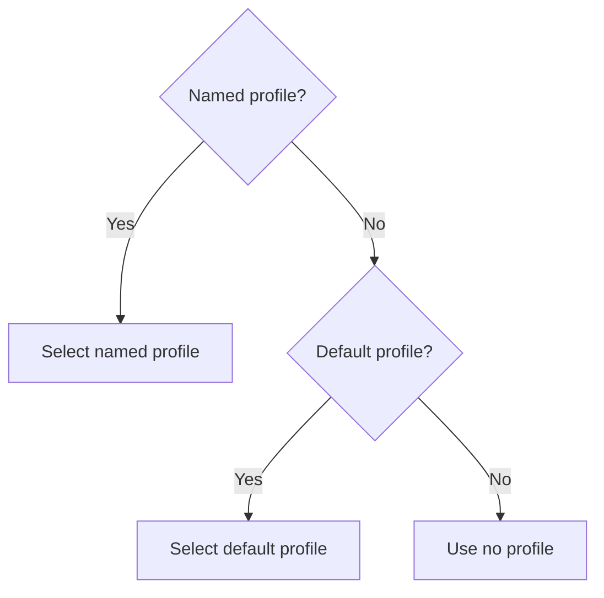

# Configuration Reference

ChannelTerm keeps three independent user-configuration responsibilities in one `config.toml`:
connection configuration, connection policy, and user preferences. It separately stores
automatically managed device identity state.

Diagnostic archives are ephemeral Host memory, not files under the configuration directory.
Their fixed retention limits and explicit raw-content opt-in are documented in the
[diagnostic export contract](mcp-tools.md#terminal_export_diagnostics). There are no new persistent
configuration fields or automatic raw-terminal logging settings.

## Paths

The default directory is the platform directory returned by Go's `os.UserConfigDir`, followed by
`channelterm`.

- User configuration: `config.toml`
- Managed device identity state: `state.json`
- Legacy read-only HTTP credential / Host domain key: `http-auth-token`
- Independent client registrations and local credential: see [HTTP clients](#independent-http-client-credentials)
- Opt-in client transfer snapshots and checkpoints: `transfers/<24-hex-job-id>/`

Transfer checkpoints are separate from connection configuration and Host Session state. They contain
local/device paths, a non-secret Host/serial endpoint binding, wire mode, byte counts and SHA-256
digests; never credentials. Upload snapshots and download partial files are stored as `payload`;
`checkpoint.json` is replaced from a synced temporary file and an OS-backed `lock` excludes another
worker. POSIX directories/files use owner-only permissions; Windows uses the user's profile ACL.
GUI and CLI on the same OS/user share these records. WSL and Windows have separate user directories.
`--config` does not relocate checkpoints. Storage survives process restarts; this is not a guarantee
against power loss or storage corruption. Hash failures stop recovery.

Successful jobs retain a small completion receipt but are hidden from `file jobs`; their payloads
are removed. Interrupted jobs do not expire automatically. To abandon one, stop its worker, inspect
its destination if publication was uncertain, and remove only that job's local directory and its
owned remote staging directory described in the [resume workflow](../getting-started/file-transfer.md#manual-resume-for-serial-files-and-directories).
No CLI/GUI action recursively removes arbitrary device paths or a published destination.

CLI and MCP serial opens use `LoadOrCreate`, which creates a minimal `config.toml` with owner-only
file permissions where the platform honors them. `channelterm list` treats a missing configuration
file as an empty profile list and does not create it. `channelterm install` also calls the same
`LoadOrCreate` implementation: it creates a missing minimal file, preserves an existing valid file,
and reports malformed configuration without resetting it.

`--config` and MCP `config_path` select an alternate TOML path for that operation. They do not move
the default `state.json` or `http-auth-token`.

`channelterm uninstall` preserves configuration and credential files. `channelterm uninstall --purge` explicitly
removes the default `config.toml`, `state.json`, `http-auth-token`, and their known adjacent lock
files after confirmation. It never recursively removes unknown files from the configuration
directory and does not edit third-party MCP client configurations. Independent client registration
stores and their `.local-token` files are preserved by this existing purge operation. When retiring
a Host domain, stop its Hosts and deliberately remove only that domain's registration/local-token
files; do not delete other Host domains or client exports. The separate `install.json`
ownership manifest is installer state rather than user configuration; see the
[CLI reference](cli.md#install-and-uninstall) for its platform paths.

`http-auth-token` is generated from 32 random bytes and stored with owner-only permissions where the
platform honors them. The first HTTP Host, built-in HTTP client, or HTTP selection in
`channelterm init --mcp` or `channelterm init --mcp-show` creates it when absent.
`CHANNELTERM_HTTP_AUTH_TOKEN` overrides this file for Host startup and explicit client credentials.
Without an override, built-in clients use the separate management registration described below.
Creation holds an adjacent
`http-auth-token.lock` file and installs a fully written, synchronized temporary file, so concurrent
first use cannot expose a partial credential. The stored value must decode to exactly 32 bytes of
unpadded Base64URL. The token is authentication material and must not be committed or copied into
logs. The HTTP selection in `init --mcp-show` intentionally includes it in generated configurations,
so that output must be handled as a secret.

## TOML schema

```toml
[serial]
default = "board"

[serial.profiles.board]
port = "COM8"
baud = 115200
data_bits = 8
parity = "none"
stop_bits = "1"
flow_control = "none"
wake = false

[connection]
default_policy = "ask"
```

`[serial]` and `[connection]` are the current persisted sections. The internal config model also
contains an empty `Preferences` value, but it has no fields or TOML section and does not change
files or serial behavior.

| Field | Meaning | Resolution default |
| --- | --- | --- |
| `serial.default` | Profile selected when no profile name is supplied. | none |
| `serial.profiles.<name>.port` | Operating-system serial endpoint. | none; required after resolution |
| `baud` | Positive baud rate. | 115200 |
| `data_bits` | `5`, `6`, `7`, or `8`. | 8 |
| `parity` | `none`, `odd`, `even`, `mark`, or `space`. | `none` |
| `stop_bits` | `1`, `1.5`, or `2`. | `1` |
| `flow_control` | `none`, `software` (XON/XOFF), or `hardware` (RTS/CTS). | `none` |
| `wake` | Send one carriage return after a new connection. | false |
| `connection.default_policy` | Discovery response policy: `ask`, `auto`, or `deny`. | `ask` |

An unknown named profile and an invalid connection policy are errors. Invalid serial values are
rejected before a physical open.

## Precedence and saving

Serial settings resolve in three steps:

1. Select the named profile, otherwise the default profile, otherwise no profile:



2. Fill omitted fields from built-in serial defaults.
3. Apply explicitly supplied CLI/MCP overrides.

Named and default profiles are alternatives, not inheritance layers. For example, if the default
profile uses 9600 baud but a different explicitly selected profile omits baud, the selected profile
uses the built-in 115200 baud. It does not inherit 9600 from the default profile. An unknown selected
profile is an error rather than a fallback to another profile.

Only explicitly present flags or JSON properties override profile values. The port in a target-first
`connect` or `attach` operation is always selected by that native serial target.

Terminal `--encoding`, `--view`, and `--description` are client-local invocation settings;
they are not profile fields and are not persisted by `--save`.

`--save NAME` or MCP `save` writes the final resolved profile before opening the transport. It
creates or replaces `serial.profiles.NAME`. If `serial.default` is empty, the saved name becomes the
default. Other connection opens leave existing configuration read-only.

Writes use a synchronized temporary file in the same directory followed by replacement. Unix targets
provide atomic rename and directory synchronization. Windows receives a fully synchronized
replacement file but Go does not guarantee that the final rename is atomic and does not expose a
portable directory-sync operation. Profile saving also holds an adjacent `config.toml.lock` file
across the latest read, profile merge, and write, so concurrent ChannelTerm processes preserve
unrelated profile updates. Lock files contain no configuration or credential data.

The [desktop profile API](gui-host-api.md#serial-profiles) also uses this configuration and lock.
It reads resolved profiles without creating a file, saves explicit settings without opening hardware,
and can select an existing default. Replacement requires explicit GUI confirmation. The GUI applies
a selected profile to editable fields and sends those fields as overrides; it resets wake to off
until explicitly selected. GUI display/encoding preferences are not saved in serial profiles.

Saving a serial profile does not create an empty `[preferences]` table. User preferences never
supply serial values and do not participate in profile resolution or Transport opening.

## Connection policy

The MCP command resolves policy in this order:

```text
--connection-policy
        |
connection.default_policy
        |
ask
```

`ask` requires the consuming client to request user approval after discovery. `auto` permits the
client to open when it already knows the required settings. `deny` tells the client to ignore a
discovery-driven connection. None of these values opens a Session automatically or blocks an
explicit user-requested open.

## `state.json`

`state.json` is a versioned, ChannelTerm-managed file. Version 1 contains durable device records
with `device_id`, transport, matching evidence, last endpoint, and timestamps. It does not store
Sessions, terminal output, profiles, labels, or authentication data.

The Device Registry persists an identity only when it has conservative evidence:

- `usb_serial`: transport + VID + PID + USB serial number.
- `usb_path`: transport + VID + PID + USB path, only when no USB serial is present.
- `runtime`: insufficient persistent evidence; the ID is process-local and not written.

State updates use a temporary file in the destination directory followed by rename. Corrupt JSON,
malformed records, and unsupported versions are returned as errors without silently replacing the
original file. Version 1 does not implement cross-process file locking; one Core process should own
a given state file.

## Electron client settings

The independent Electron frontend does not add TOML fields or alter Host configuration.
`CHANNELTERM_GUI_ENDPOINT` is a GUI Main-process override for the existing MCP endpoint, defaulting
to `http://127.0.0.1:37099/mcp`. The prototype accepts numeric loopback HTTP addresses only
(`127.0.0.1` or `::1`), without URL credentials, query, fragment, or redirects. Main reuses
`CHANNELTERM_HTTP_AUTH_TOKEN` or reads the separate local management credential created by the
matching Host. It reads the legacy token only to locate that Host-domain credential; it never
falls back to using the legacy token for management and never creates credentials itself.
The default endpoint connects automatically and may start the bundled local Host, which creates
its own credential using the existing mechanism. Other endpoints require explicit connection
and never trigger startup. Authentication failure never starts a replacement Host.
No token is passed to React or stored in GUI preferences. Development runner variables prefixed
`CHANNELTERM_GUI_DEV_` are internal and not Host configuration. See the
[GUI workflow](../development/electron-gui.md#connect-to-an-existing-host).

Desktop SSH connection fields are transient Host-side settings described in the
[desktop Host API](gui-host-api.md); no new TOML fields or saved profiles are added.

The GUI profile stores validated shortcut bindings and terminal display preferences in renderer
local storage, separately for production and development origins. The
[GUI menu reference](gui-menus.md#layout-shortcuts) owns shortcut defaults, migration and focus
rules; [terminal display](gui-menus.md#terminal-display) owns font bounds and persistence.
Neither setting changes Host configuration, serial framing, Session metadata or terminal output.

## SSH CLI settings

SSH connections use explicit CLI options and do not add TOML fields or saved profiles. The CLI
reads an optional private key and `known_hosts` from the user's `.ssh` directory unless paths are
supplied. Interactive confirmation of an unknown server appends its public key to that trust file,
creating the parent directory/file if needed (0700/0600 creation modes on Unix; Windows uses inherited
ACLs). Existing records, permissions, comments, and hashed entries are preserved. Writers coordinate
through a sibling `.lock` file and recheck trust after confirmation. This lock coordinates ChannelTerm
writers; unrelated SSH clients do not necessarily honor it. Trust files use the OpenSSH format and
are separate from ChannelTerm TOML. No client key pair is generated or copied automatically.

The sharing Host reuses the existing `http-auth-token` and environment override. Login passwords
are entered without echo and used only for authentication; they are never written to config,
trust records, or Session metadata. No password CLI argument or environment variable is supported.
Connection settings are not persisted. The `sftp` and `scp` commands use the same credential paths
and interactive callbacks without adding TOML fields. Their dedicated connections do not need the
HTTP Host's token or listener. See the [CLI reference](cli.md#ssh).

## Independent HTTP client credentials

The local Host account can register named clients with `channelterm clients add`.
Registrations are stored beside `http-auth-token` in
`http-clients-<SHA-256-of-host-token>.json`. This scopes independent credentials to
one shared-token authentication domain. The versioned file stores public IDs,
names, source kinds (`user` or `agent`) and SHA-256 credential digests, never the
issued credentials. Updates use the existing interprocess lock and atomic file
replacement. Files use owner-only modes where supported; the local OS account
and its filesystem permissions remain the trust boundary.

Each registration receives a random `CL-` identifier and a separate random
credential. Keep one credential per logical client; sharing it also shares its
identity. IDs survive reconnects and Host restarts, and are not online-presence
or Attachment counts. Rotate the shared Host token to select a different
registration domain. Registration is local administration, not a remote API.
The CLI exports a secret once to a new `--credential-file`; it never overwrites
that file or prints the secret. Public list output contains no digest or secret.

Set `CHANNELTERM_HTTP_AUTH_TOKEN` in the intended client's process to the issued
credential. CLI subprocesses must inherit that credential to preserve the AI
initiator rather than silently reverting to the default shared credential.
Electron can use the same explicit Main-process override. Do not give AI clients
another client's credential or access to the Host's private configuration when
OS-level isolation is required.

The Host rereads registrations for each HTTP request. Removal rejects subsequent
requests, including requests on an existing MCP connection; it does not cancel
already accepted operations or their recovery. Corrupt/unreadable registrations
reject independent-client authentication without exposing file contents.
The legacy shared token now grants observations only (including attachment event
bookkeeping), with no device writes or management. New `agent` registrations also
start read-only. `clients grant CLIENT_ID` explicitly permits agent device operations
across this Host; `clients revoke CLIENT_ID` removes that grant for subsequent requests.
The public list includes `write_allowed`. A `user` registration is a management
credential created only through trusted local administration. Never issue it to an AI
client to bypass grants. No caller-provided actor label can select these permissions.

The Host bootstraps one private local management registration for implicit CLI/Electron
access, stored in the registration file's adjacent `.local-token` file. Local clients
without an environment override use this separate credential; an explicit override is
always honored, even when it is read-only or invalid. A revoked local token is not
silently recreated. To deliberately register again, remove only its `.local-token`
file after verifying the Host domain. This registration identifies the local account's
client group, not each window/process. Independent named credentials remain available.

Revoking a write grant does not cancel an accepted command, file transfer, debug
operation or its cleanup. It can prevent later protocol calls needed by a multi-step
operation; finish or cancel that operation normally before revoking. Existing lease
expiry/recovery rules still apply. This is request authorization, not an emergency stop,
per-Session human takeover, or OS-level isolation. Stdio/local process access remains
trusted and unchanged. See the [upgrade workflow](../getting-started/mcp-server.md#http-credential-upgrade).
